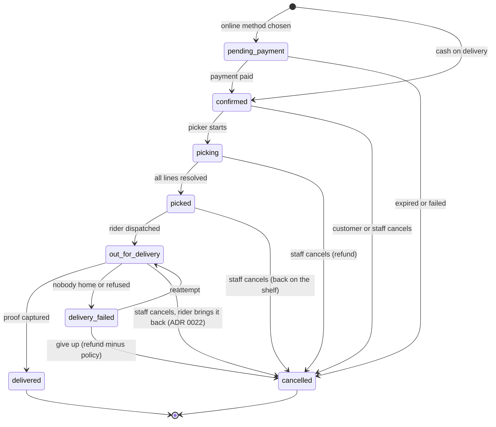

# Architecture

Status: draft v0.1. Decisions that are expensive to reverse are recorded in [docs/adr/](adr/). Versions are deliberately unpinned here; the setup guide installs the latest stable releases and the lockfile becomes the record.

## 1. Principles

1. **One deployable.** A single Next.js app serves the storefront, the admin and the API ([ADR 0001](adr/0001-modular-monolith-nextjs.md)). Split only when a measured problem demands it.
2. **Deep modules.** Each business domain is a folder with a small public interface and hidden internals. Callers learn the interface, not the implementation.
3. **The server is the authority.** Prices, stock, delivery eligibility and totals are computed on the server every time. The client displays and requests; it never decides.
4. **Money is integer centavos** ([ADR 0002](adr/0002-money-as-integer-centavos.md)).
5. **Provider-agnostic edges.** Payments, SMS, email, search and media sit behind interfaces so a vendor can change without touching business logic ([ADR 0003](adr/0003-payment-provider-interface.md)).
6. **Hub-aware from day one.** Stock, Slots, Zones and pricing hang off a Hub even while there is only one.
7. **Boring and observable.** Prefer well-known tools; log every state change of an Order and every payment event.

## 2. System context

```
                      +------------------+
   Customer phone --->|                  |---> Postgres (orders, catalogue, stock)
   (PWA / browser)    |   Next.js app    |---> Object storage + CDN (product images)
                      |                  |---> Postgres rate-limit table (ADR 0006)
   Staff (admin,  --->|  storefront      |
   picker, dispatch)  |  admin           |<--- Payment provider webhooks (Xendit/PayMongo)
                      |  API + webhooks  |---> Payment provider API (create/charge/refund)
                      |  cron endpoints  |---> Email (Resend) and SMS (Semaphore/Twilio)
                      +------------------+---> Maps / geocoding (address pin)
                              |
                              +--> Sentry, analytics, uptime monitor
```

## 3. Module map

Each module lives in `src/modules/<name>/` with `index.ts` (public), `internal/` (private), and its own tests. A module owns its tables: only that module reads or writes them. Others call its interface.

| Module          | Owns                                                            | Public interface (examples)                                                                                                       |
| --------------- | --------------------------------------------------------------- | --------------------------------------------------------------------------------------------------------------------------------- |
| `catalog`       | Product, Category, ProductImage, search index                   | `getProduct`, `listProducts`, `searchProducts`, `getCategoryTree`                                                                 |
| `pricing`       | Promotion, Voucher, price rules                                 | `priceCart(lines, context)` (pure), `priceFinal`, `checkVoucher`, `redeemVoucher`                                                 |
| `inventory`     | StockLevel, stock movements, Stock Alerts                       | `reserveStock`, `releaseStock`, `pickStock`, `receiveStock`, `recordShrink`, `countStock`, `getAvailability`                      |
| `cart`          | Cart, CartLine, Shopping List                                   | `getCart`, `addLines`, `setLineQuantity`, `mergeGuestCart`, `saveToList`                                                          |
| `delivery`      | Hub, Zone, Slot Schedule, Slot, Slot Hold                       | `resolveZone({ city, barangay })`, `listSlots`, `holdSlot`, `bookSlot`                                                            |
| `orders`        | Order, OrderLine, status history, Substitution, Order Note      | `placeOrder`, `transitionOrder(orderId, to, actor, reason, options)`, `cancelOrder`, `getPickList`, `recordPick`, `dispatchOrder` |
| `payments`      | Payment, PaymentEvent, Refund, Cash Handover, provider adapters | `createCodPayment`, `createOnlinePayment`, `startCheckout`, `handleWebhook`, `refundOrderPayment`, `sendRefund`                   |
| `customers`     | Customer profile, Address book, Referral                        | `getProfile`, `saveAddress`, `applyReferral`                                                                                      |
| `content`       | Recipe, Article                                                 | `getRecipe`, `addRecipeToCart`, `saveRecipe`, `saveArticle`                                                                       |
| `notifications` | Message templates, providers and delivery log                   | One sender per message: `sendOrderConfirmed`, `sendRefundIssued`, `sendOutForDelivery`, ...                                       |
| `jobs`          | Jobs outbox                                                     | `enqueueJob`, `runDueJobs`, `purgeDoneJobs`                                                                                       |
| `identity`      | Sessions, Staff roles, audit log (wraps Better Auth)            | `requireCustomer`, `requireStaff(area)`                                                                                           |
| `claims`        | Freshness Claims                                                | `fileClaim`, `decideClaim`, `claimableLines`                                                                                      |

There is no `fulfilment` module. Picking and dispatch live in `orders` (`orders/internal/picking.ts`, `orders/internal/delivery.ts`), which owns the Order Lines and Substitutions they change.

Dependency direction, from the imports in the code (arrow means "calls"):

```
app routes / server actions / src/server/job-handlers.ts
        |
  orders    --> cart, catalog, customers, delivery, inventory, jobs, payments, pricing
  claims    --> payments, pricing, jobs
  content   --> catalog, cart
  cart      --> catalog, inventory, pricing, jobs
  identity  --> customers, notifications (sign-in links and codes)
  customers --> delivery (resolveZone when saving an Address)
  catalog   --> pricing (Promotions set the shelf price)
  delivery  --> pricing (the ZoneFees type only)
  inventory --> jobs
  payments  --> jobs
  everything --> lib (db, money, dates and other helpers)
```

`pricing`, `jobs`, `notifications` and `lib` import no module. Apart from sign-in, modules queue a job for a message instead of calling `notifications`; `src/server/job-handlers.ts` wires each job kind to its sender. Cycles are a defect.

## 4. Routes and rendering

| Folder           | Area              | Examples                                                                                                                                          | Rendering                                                                                                             |
| ---------------- | ----------------- | ------------------------------------------------------------------------------------------------------------------------------------------------- | --------------------------------------------------------------------------------------------------------------------- |
| `src/app/[lang]` | Shop              | `/`, `/c/[...category]`, `/p/[slug]`, `/search`, `/recipes`, `/recipes/[slug]`, `/articles/[slug]`, `/delivery`, `/help`, `/offline`              | Server Components over cached reads (`"use cache"`, tags `catalog`, `content`, `stock`); staff edits call `updateTag` |
| `src/app/[lang]` | Account           | `/account`, `/account/orders`, `/account/addresses`, `/account/lists`, `/account/invite`, `/orders/[orderNo]`, `/orders/[orderNo]/claim`          | Dynamic, signed-in Customer                                                                                           |
| `src/app/[lang]` | Checkout          | `/cart`, `/checkout`, `/checkout/pay/[orderNo]`, `/checkout/confirmed/[orderNo]`                                                                  | Dynamic, no caching                                                                                                   |
| `src/app/[lang]` | Sign-in and links | `/sign-in`, `/s/[token]` (Substitution answer), `/stop/[token]` (reminder stop), `/r/[code]` (Referral)                                           | Dynamic; no sign-in needed                                                                                            |
| `src/app/admin`  | Staff             | `/admin/products`, `/admin/orders`, `/admin/pick/[orderNo]`, `/admin/dispatch`, `/admin/stock`, `/admin/claims`, `/admin/print/receipt/[orderNo]` | Dynamic; every page calls `requireStaff(area)` (`requireAnyStaff` on `/admin` itself)                                 |
| `src/app/api`    | API               | `/api/webhooks/[provider]`, `/api/cron/[job]`, `/api/auth/[...all]`, `/api/events`, `/api/search/suggest`, `/api/health`                          | Route handlers                                                                                                        |

Paths are shown as an English shopper sees them; Filipino pages add `/fil`. At the root of `src/app`: `manifest.ts`, `icon.tsx`, `robots.ts` and `sitemap.ts`. Development only: `/dev/pay/[ref]` (the fake checkout), `/dev/sign-in` and `/api/dev/mailbox`.

As built (Batch 5.5, [ADR 0017](adr/0017-filipino-pwa-and-funnel.md)): every shop page lives under `src/app/[lang]` (`en` or `fil`), whose layout is a root layout; `src/app/admin` is the other root layout and stays English. `src/proxy.ts` serves an address without a language from `/en` inside, sends `/en/...` to the address without it, and adds a `Link` header naming both languages (`hreflang`). Moving between shop and admin is a full page load.

Use the caching primitives of the Next.js version installed at setup time; read its docs then, because caching APIs change between major versions. Product URLs follow `/p/<slug>-<id>`; the id resolves the Product, the slug is cosmetic and redirects if stale.

Mutations use Server Actions with Zod validation. Each action calls a module interface and returns a typed result; it contains no business rules.

## 5. Cart and pricing

- A **guest Cart** is stored in the database keyed by a random 256-bit token in an HTTP-only cookie. The database keeps only the token's SHA-256 hash, so the cookie needs no signature and a database leak exposes no live Cart. Signing in merges it into the Customer's Cart (`mergeGuestCart`, quantities summed, capped by availability, never below what the Customer already had). The merge runs on the first request after sign-in and locks the guest Cart row, so it happens once.
- Cart Lines remember the price they were last set at (`seen_price_cents`), so the Cart flags a price change (CRT-5). Lines that are out of stock stay visible but are left out of the total.
- `priceCart(lines, context)` is a **pure function**: given lines, current prices, active Promotions, an optional Voucher and the Zone's fee rules, it returns line totals, discounts, delivery fee, VAT breakdown and total in centavos. Everything shown in the Cart, Checkout and on the Order comes from this one function.
- Because it is pure, it is the first thing built test-first and the most heavily tested unit in the system.
- VAT (as built in Batch 2.1): prices include 12% VAT, so the VAT inside a vatable amount is 12/112 of it, rounded half up per line and then summed (ADR 0002). The delivery fee is treated as vatable. **Confirm with the accountant** together with the tax class of each Category (docs/04 section 5).

## 6. Checkout and order placement

`placeOrder` is the critical transaction. It runs server-side in this order and is idempotent on a client-supplied `idempotencyKey`:

1. Load the Cart and re-run `priceCart`. If the total differs from what the Customer saw, return the new total and stop.
2. `resolveZone(address)`; reject if outside coverage or below the Zone minimum.
3. `bookSlot`: atomically increment `booked` only while `booked < capacity`; the earlier 10-minute hold is released into this booking.
4. `reserveStock` at the Hub: atomically increase `reserved` only while `onHand - reserved >= qty` for each line. Any shortfall rolls the whole transaction back and returns the unavailable lines.
5. Create the Order and Order Lines with snapshotted price, name, tax class and VAT amount.
6. Create the Payment: COD is `cod_pending`; online methods call the provider and return a redirect or invoice URL.
7. Commit, then enqueue notifications.

If an online payment is not completed in 15 minutes, a cron job cancels the Order, releases stock and frees the Slot.

As built (Batch 2.4, `src/modules/orders/internal/place-order.ts`):

- Checks before the transaction: idempotency replay, the Address belongs to the Customer and a Zone serves it, the Cart has priced lines, the Zone minimum, and the total the Customer saw.
- One transaction: close the Cart (`checked_out_at`, so two tabs place one Order), `bookSlot`, create the Order, `reserveStock` (Products in a fixed order, so concurrent Orders cannot deadlock), Order Lines with snapshots (name, price, tax class, VAT, the chosen substitute and picker note), the first status event and a `cod_pending` Payment. Any refusal throws and rolls everything back.
- Out-of-stock Cart Lines are left out of the Order, as the Cart already showed them outside the total.
- The order number is `SW-YYMMDD-XXXX` (Manila date, four characters without 0, O, 1 or I); a clash retries.
- Dependencies: `orders` also calls `cart` (load and close the Cart) and `customers` (the Address).

## 7. Order lifecycle

Order status and payment status are separate fields. Only `transitionOrder()` (orders module) changes Order status; each call writes a status-history row with actor and reason. Cancelling a COD Order sets its Payment to `unpaid`.

Picking, as built (Batch 4.2, [ADR 0010](adr/0010-picking-and-substitutions.md)). The pick functions live in `orders`, which owns Order Lines and Substitutions; dispatch (Batch 4.3) lives there too. There is no `fulfilment` module.

- `getPickList` returns an Order's lines in Category order (top-level, then sub-Category, then name) with the Substitution Preference, the chosen alternative and the Picker Note.
- `recordPick` saves what was found: pieces, or a weighed pack's grams (0 is short; more than 10% over is refused).
- `proposeSubstitution` stands a Product in for the pieces not found, one per line, never on a weighed line or a "no substitute" line. "I'll choose" takes only the Customer's Product and is accepted at once. "Pick a similar item" stores a random token and a 10-minute Substitution Window and queues `order.substitution_asked`, an SMS and email with a link to `/s/[token]`, where the Customer says yes or no without signing in.
- Dispatch, as built (Batch 4.3, ADR 0011): `dispatchOrder` sends a picked (or missed) Order out with an active Rider, a new 4-digit Delivery PIN and `order.out_for_delivery` (SMS and email with the Rider's name and number and the PIN; the tracking page shows them too). The Rider's `completeDelivery` needs the PIN (5 wrong tries lock it) and, for cash on delivery, the cash; the Dispatcher's `deliverWithoutPin` needs a reason. `failDelivery` keeps the Rider's reason and queues "we missed you". The order queue no longer moves an Order out or delivers it: only dispatch does.
- `finishPicking` refuses while a window is open, treats silence as a yes, then moves the Order to `picked`: the Final Total charges an accepted substitute at the lower of its price and the ordered price, a refused one not at all (ADR 0008 refunds any difference). The order queue's "Picked" goes through it too.



Payment status: `unpaid`, `authorised`, `paid`, `partially_refunded`, `refunded`, `failed`, `cod_pending`, `cod_collected`.

Reports and printouts, as built (Batch 4.4, ADR 0012). `dailyReport` gives a Manila day's Orders placed, delivered and cancelled, revenue (delivered Orders' Final Totals), average basket, fill rate and Substitution rate over delivered lines, and deliveries after their Slot ended (`/admin/report`). The pick sheet (`/admin/print/pick/[orderNo]`) and the delivery receipt (`/admin/print/receipt/[orderNo]`) are pages with a print stylesheet; the receipt splits the charged amounts into VATable (VAT included), VAT-exempt and zero-rated sales and the VAT inside (`pricing.receiptBreakdown`), and says it is not an official receipt.

## 7a. Recipes and Articles

As built (Batch 5.1, [ADR 0013](adr/0013-recipes-articles-and-content-editors.md)). The `content` module owns Recipes, their ingredients, Articles and their linked Products.

- A Content Editor (role `content_editor`, area `content`; Admins too) writes them at `/admin/recipes` and `/admin/articles`. The editor holds the whole draft in the browser and sends it as one JSON field, validated with zod and then by `saveRecipe` or `saveArticle` (form results, ADR 0009). Each save is audited and calls `updateTag("content")`, so the shop shows it at once.
- An ingredient is a Product to buy (a count for the base servings, and whether it grows with servings) or plain text. The page shows live catalogue prices; `scaledCount` (`lib/servings.ts`) rounds scaled counts up, in the browser for the preview and on the server for the Cart.
- `addRecipeToCart` takes only the servings and the ticked rows. It recomputes every count, accepts a Product in a row only if it is the ingredient's or one of its similar Products (`listRelatedProducts`), and adds on top of the Cart through `cart.setLineQuantity`, which caps at stock. It reports what sold out and what was capped.
- Pages: `/recipes`, `/recipes/[slug]` (Recipe structured data), `/articles`, `/articles/[slug]`, the featured Recipe on Home, a Recipes link in the Category menu, and both in the sitemap. Reads are cached with the `content` and `catalog` tags.

## 7b. Reorder, Shopping Lists, reminders and alerts

As built (Batch 5.2, [ADR 0014](adr/0014-reorder-lists-reminders-stock-alerts.md)).

- `cart.addLines` adds Products on top of the Cart, each capped by stock through `setLineQuantity`, and says what sold out or was capped. Reorder (`orders.getReorderLines`), Shopping Lists (`cart.shoppingListLines`) and Recipes all go through it; `app/cart/fill.ts` turns the result into the message the shopper sees.
- "Buy again" on Home reads `orders.listBoughtBefore`: Products in delivered Orders, most often bought first, still sold.
- Shopping Lists belong to the `cart` module and are read and written only with the owning Customer's id.
- The cron tick queues Cart Reminders (`cart.queueCartReminders`: opted-in Customer with an email, Cart idle 3 hours to 2 days, not checked out, not reminded) and Stock Alerts (`inventory.queueStockAlerts`: ends alerts older than 30 days, queues the rest whose Product has free stock) before it runs jobs. Each marks its Cart or ends its alert in the transaction that queues the job.
- `notifications.sendOnce` dedupes messages not tied to an Order by `ref` ("cart:<id>", "stock-alert:<id>"). The reminder's stop link carries the Customer id signed with HMAC (`lib/signed.ts`); `/stop/[token]` turns consent off on a button press, never on the link alone.

## 7c. Promotions, Vouchers and Referrals

As built (Batch 5.3, [ADR 0015](adr/0015-promotions-vouchers-referrals.md)).

- **Promotions are the shelf price.** `catalog` builds Product summaries with `pricing.promotedPrice` over `activePromotions()`: the lowest promoted price wins, the regular price becomes `compareAtCents` (struck through) and `promotion` names the offer. Everything that prices from summaries (Cart, Checkout, Order Line snapshots, Recipes, lists) gets the same price. Sorting and price filters still use the regular price. Staff edits call `updateTag("catalog")`.
- **A Voucher** is kept on the Cart (`carts.voucher_code`). `getCart` re-checks it each time (`checkVoucher`: dates, switched off, one Customer only, first order only, total and per-Customer uses by Orders not cancelled) and passes its terms to `priceCart`, which spreads a percent or peso discount over the lines before VAT (`spreadDiscount`) or zeroes the Delivery Fee. `placeOrder` refuses a Voucher the Cart could not use, and records the use with `redeemVoucher` under a row lock inside the Order transaction.
- After picking, `priceFinal` and `receiptBreakdown` keep the checkout discount but never more than what was picked, spread the same way.
- **Referrals**: `/r/<code>` keeps the code in a cookie for 30 days; the first Checkout links the Customer (`customers.applyReferral`). `transitionOrder` queues `order.delivered`; its job calls `customers.rewardReferral` with `pricing.createRewardVoucher`, so the two Vouchers and the ledger row commit together, once per friend, then emails both.
- `MAX_LINE_QUANTITY` lives in `lib/cart-limits.ts` so the browser stepper never imports a module index that reaches the database.

## 7d. Freshness Claims

As built (Batch 5.4, [ADR 0016](adr/0016-freshness-claims.md)).

- `claims.fileClaim` takes a delivered Order Line of the Customer's own, within 24 hours of `delivered_at`, once per line (a unique `order_line_id`). The server works out what it is worth: `claimValue` takes the items' share of `pricing.chargedLine` (what was charged after picking, substitutes included) less that share of the Order's discount, spread as ADR 0007 says. A weighed line is claimed whole. Photos (1 to 3, required for spoiled or damaged) are resized to WebP through the media store.
- `claims.decideClaim` locks the claim row, so it is decided once. Approving pays back up to what was claimed: `payments.refundOrderPayment(tx, orderId, "claim", amount, claimId)` for an online Payment, and `pricing.createCreditVoucher` for what cannot be refunded (cash, or nothing left). `refunds.claim_id` is unique; other reasons keep one Refund per Payment through a partial unique index. Both outcomes queue `claim.decided`, which messages the Customer; the refund's own notice is skipped for claims.
- Staff with the `claims` area (Admins, Dispatchers) review at `/admin/claims`. The daily report shows claims and claims per 100 delivered Orders.

## 7e. Languages, the installable app and the Funnel

As built (Batch 5.5, [ADR 0017](adr/0017-filipino-pwa-and-funnel.md)).

- **Words**: `src/i18n/en.ts` and `fil.ts` hold the shop's words under the same keys (TypeScript checks it). Server Components read the language with `getLang()` (`next/root-params`) or take a `lang` prop from the root shell; Client Components use `useMessages()` from `I18nProvider`. Root params cannot be read in Server Actions, so actions return reason codes and data (`CartResult.notice`, `FillResult`, `HoldState.reason`, `setCartVoucher` and `placeOrder` refusals) and the page words them; Checkout and the pay page send `lang` with the form or as a bound argument, only to pick the next address and the answer's words.
- **Addresses**: shop code links with `@/components/link`, which adds `/fil` on Filipino pages (an ESLint rule keeps `next/link` out of shop code). Forms, redirects and canonical URLs use `localPath(lang, path)`. `usePathname()` reads `/en/...` while prerendering and `/...` in the browser, so shop code reads `useShopPath()`, which strips the language.
- **Installable app**: `src/app/manifest.ts`, `src/app/icon.tsx` (192 and 512 px) and `public/sw.js`, registered only in production builds. The worker keeps shop pages (network first) and built files, photos and icons (stored first) up to 150 each, and an offline page per language; Cart, Checkout, payments, Orders, account, sign-in, signed links, the API and staff screens are never stored. A note shows while offline.
- **Funnel**: `src/lib/funnel.ts` counts steps in `funnel_counts`. The browser sends `product_viewed`, `added_to_cart` (the first unit of a Product) and `checkout_started` as a beacon to `/api/events` (allowlisted, 120 per minute per IP); `order_placed` is counted where the Order is placed. The daily report shows the 7 days to the chosen day.

## 8. Payments

- **Interface:** `PaymentProvider` with `createCheckout`, `expireCheckout`, `capture`, `refund`, `verifyWebhook`, `parseEvent`. The PayMongo adapter implements it ([ADR 0003](adr/0003-payment-provider-interface.md)); `PAYMENT_PROVIDER` names the one new Orders pay through. `fake` is a stand-in for development and the local e2e build only (refused on a real domain): its hosted checkout is `/dev/pay/[ref]`, whose Pay button sends a signed webhook. `capture` (taking a card hold) is implemented but never called: there are no card holds (ADR 0008).
- **Leftovers from the card-hold plan:** the `authorised` payment status and `orders.authorised_cents` are in the schema, but nothing sets them.
- **Webhooks** hit `/api/webhooks/[provider]`. The handler verifies the signature, records the raw event in `payment_events` with a unique constraint on the provider event id, then applies it. A duplicate event is acknowledged and ignored. The handler never trusts amounts from the browser return URL; the webhook (or a provider fetch) is the source of truth.
- **Online checkout, as built (Batch 3.2):**
  - `placeOrder` holds stock and the Slot as `pending_payment` with an `unpaid` Payment; no notice yet. The COD limits do not apply.
  - The Checkout action then calls `startCheckout`: one hosted checkout per Order, stored on the Payment (`checkout_url`) and reused on a second click. When two requests race, the first stored wins and the other session is expired at once.
  - Both return URLs land on `/checkout/pay/[orderNo]`. It reads the Order, never the redirect, and refreshes for two minutes while waiting. It offers Pay now and Back to cart.
  - Only a verified `paid` webhook confirms: `handleWebhook` takes an `onPaid` callback (`orders.confirmPaidOrder`) that runs in its transaction, so the Payment and the Order change together, and the confirmation notice is queued with them.
  - **Payment Window:** the cron tick's `expireUnpaidOrders` takes Orders unpaid after 15 minutes. It closes the checkout first (`closeOnlinePayment`: expire the session, or mark the Payment failed before one opens). PayMongo refuses to expire a paid or processing session; that Order is left for its webhook. Then, in one transaction (Order row, Cart, Slot, stock: the order placeOrder locks them in), it cancels, releases stock and the Slot place, and returns the lines to the Customer's open Cart without overwriting lines added since.
  - Back to cart on the pay page, and Cancel on the tracking page for an unpaid Order, run the same path now (`abandonPayment`). `cancelOrder` takes only confirmed Orders, so no path cancels an unpaid Order with its checkout still open.
  - Money for an Order no longer waiting is recorded `late` and logged as a refund owed (refunds: Batch 3.3).
  - Dependencies: `orders` also calls `payments` (close a checkout) and `cart` (`returnLinesToCart`).
- **Cash on delivery:** the Rider records collected cash at delivery; Dispatch reconciles per Rider per day. As built (Batch 4.3, [ADR 0011](adr/0011-dispatch-pin-and-cash.md)): `completeDelivery` records the cash in the delivery's transaction (`payments.recordCodCollected`: `cod_collected`, `captured_cents`, and `collected_note` when it differs from the Final Total). `/admin/cash` lists each Rider's recorded cash for a Manila date; the Dispatcher's count is a `cash_handovers` row, one per Rider per day, and a shortfall needs a note.
- **Weighed items** ([ADR 0008](adr/0008-weighed-items-online-and-refunds.md)): every online method, cards included, charges the estimate; there are no card holds. On the move to `picked`, `transitionOrder` sets the Order's `final_total_cents` from `pricing.priceFinal`: each line by what was packed (weight, or pieces picked), never above its checkout amount, so a heavier pick is on Hoshimono. The Delivery Fee and discount stay. Paid online, the difference is refunded in one go; cash on delivery, the Final Total is what the Rider collects. A Picker may pack up to 10% over the ordered weight (`recordPick` refuses more); a lighter pack of any weight is accepted and charged by its weight.
- **Refunds** (ADR 0008): `payments.refundOrderPayment` records a `refunds` row in the caller's transaction (one per Payment and reason: `cancelled`, `picked`, `late_payment`), raises `refunded_cents` (a database check keeps it within `captured_cents`) and queues `payment.refund`. The job (`sendRefund`) claims the row (`pending` to `sending`), calls the provider with the payment id from the paid webhook (`payments.payment_ref`), and marks it `sent`, then emails and texts the Customer once. A clear refusal (a 4xx) goes back to `pending` and the job retries; no clear answer, or a row found still `sending`, becomes `needs_review` and is never resent. Triggers: cancelling a paid Order (`transitionOrder`), money arriving after cancellation (`handleWebhook`'s late path), and `picked`. Cancelling from the tracking page runs the job at once (`after`); the cron tick is the safety net.
- Card data never touches our servers; use hosted checkout or provider-hosted fields.

## 9. Inventory and Slots

- `stock_levels(product_id, hub_id, on_hand, reserved)`. Available = `on_hand - reserved`. All changes go through `inventory`, which writes an append-only `stock_movements` row (reason: receipt, reserve, release, pick, shrink, adjustment, return).
- Reservation, release and Slot booking are single atomic SQL updates with a `WHERE` guard, not read-then-write in application code. This avoids overselling under concurrent checkouts.
- Slot hold for 10 minutes uses a `slot_holds` row with `expires_at`; a cron job purges expired holds each minute.
- As built (Batch 2.3): places left in a Slot are `capacity - booked - live holds of other carts`. `holdSlot` and `bookSlot` lock the Slot row (`SELECT ... FOR UPDATE`) before counting, so the last place goes to exactly one cart. A Slot stops taking new holds 90 minutes before it starts (`SLOT_CUTOFF_MINUTES`, an assumption until operations set it); a cart holding a place may still book until the Slot starts. `bookSlot` runs inside the caller's Order transaction.
- Low stock shows as "Only a few left" below a per-Product threshold; the storefront never reveals exact counts.
- As built (Batch 4.4, [ADR 0012](adr/0012-stock-slots-reports-receipts.md)): stock leaves the shelf when an Order moves to `picked`. `pickStock` releases each line's reservation and takes what was packed (pieces found, or the whole pack for a weighed line, plus an accepted substitute) off `on_hand`. Cancelling after the pick puts it back (`return`); cancelling before it only releases.
- Staff with the `stock` area receive deliveries, record shrink (a note is required), set the count after a physical count (below what is reserved, the Product stops selling and those Orders come up short at the pick: ADR 0022) and set the low-stock threshold at `/admin/stock`. Each change is a movement and an audit row.
- Slots are made from a weekly schedule (`slot_templates`: weekday, start, end, capacity per Hub). The cron makes the next 7 Manila days' Slots and never touches one that exists, so a change to the schedule applies to days not made yet. Admins edit Zone fees, the schedule and single Slots' capacity at `/admin/setup`; a Slot cannot go below what is booked.

## 10. Search

MVP: PostgreSQL full-text search with `pg_trgm` and `unaccent` for typo tolerance and Filipino/Spanish-derived spellings, behind a `SearchIndex` interface in `catalog`. If relevance, speed or faceting outgrows it (roughly beyond 10,000 Products or when merchandising needs synonyms and boosting), swap in Meilisearch or Typesense without changing callers.

As built in Batch 1.1 (`src/modules/catalog/internal/search/`):

1. **Words.** The query is folded to lowercase ASCII words (accents removed); pack sizes such as `5kg` or `12 pcs` are dropped.
2. **Full text.** Every word must match. The typed word matches as a prefix; synonyms (a fixed Filipino and English list in `synonyms.ts`, such as gatas and milk) match as whole words. A Product matches on its own name, brand and description plus its Category's name and search words (`categories.search_words`, set by a Merchandiser in the admin: "meat" on Pork, nothing on Fish and seafood, so "fish" and "fresh fish" stay in the fish aisle). Two-word synonyms ("bitter gourd") match as phrases.
3. **Ranking.** Whole-word matches on the Product's own words first, then prefix matches, then matches through its own Category, then text rank, then name.
4. **No results.** Correct up to three words to the closest catalogue word (a swap for short words, one edit up to 8 letters, two beyond; edit distance in code, as `pg_trgm` similarity misses a swapped pair in a short word: "mlik" scores 0.11 against milk, under the 0.3 threshold), and return the corrected query for "Showing results for ...". Then try the words joined ("pan de sal"). Then trigram similarity on brand and name, every word required.

The index narrows candidates first (any one word hits the Product or its Category), then every word must match. Measured on 5,000 Products in local Postgres: 14 to 22 ms per search, 66 ms in the worst case (eight unknown words through every fallback), 14 to 21 ms per suggestion.

## 11. Background work

No queue service in the MVP. A `jobs` table plus a cron endpoint called every minute by the host handles: expiring Slot holds and unpaid Orders, retrying notifications and sending Cart Reminders. Stock reservations are never swept: one ends only when its Order is cancelled (released) or picked (taken off the shelf). Jobs are idempotent and lock rows with `FOR UPDATE SKIP LOCKED`. Move to a managed queue only when jobs need fan-out or long runtimes.

As built (Batch 2.5):

- `jobs` is an outbox. Work that must follow a commit is written in the same transaction (`placeOrder` enqueues `order.confirmed`), so a placed Order always gets its notice.
- `runDueJobs` leases due rows with `UPDATE ... WHERE id IN (SELECT ... FOR UPDATE SKIP LOCKED)`, so overlapping runs never take the same job. Failures retry after 1, 4, 9 and 16 minutes, then stop with the last error kept.
- `GET /api/cron/tick` needs `Authorization: Bearer <CRON_SECRET>` (Vercel Cron sends it; any other job name answers 404). It runs these steps in order, each on its own, so one failing does not stop the rest (a failed step makes the answer a 500 naming it):
  1. Purge lapsed Slot Holds (`purgeExpiredHolds`).
  2. Make the next 7 Manila days' Slots from the Slot Schedule (`ensureSlots`, Batch 4.4).
  3. Cancel online Orders unpaid after 15 minutes (`expireUnpaidOrders`), which releases their stock and Slot place.
  4. Queue Cart Reminders (`queueCartReminders`) and Stock Alerts (`queueStockAlerts`, Batch 5.2).
  5. Run due jobs (`runDueJobs`): notices, refunds, Referral rewards.
  6. Delete ended rate-limit windows (`purgeRateLimits`).
  7. Delete guest Carts idle 30 days and Carts checked out over 30 days ago (`purgeIdleCarts`).
  8. Delete jobs finished over 30 days ago (`purgeDoneJobs`).
- Checkout also starts a job run with `after()` so notices go out at once.
- `notifications` logs each sent message (unique per template, channel and Order), so a retried job sends only what is missing. Console providers only, until Resend and the SMS sender exist. Per-minute crons need a paid Vercel plan.

## 12. Identity and access

- **Customers:** mobile OTP, email magic link, Google. Sessions are HTTP-only cookies.
- **Staff:** the same sign-in as Customers (email link, text code or Google, at `/sign-in`); there are no passkeys. An Admin adds a Staff row by email, and the first sign-in with that verified email links it. Roles `admin`, `merchandiser`, `content_editor`, `picker`, `dispatcher`, `rider`.
- Authorisation is checked in two places: the page or Server Action (`requireCustomer`, `requireStaff` per operation) and data access (row ownership, every query filtered by the Customer). There is no route middleware layer: Next 16 pages render inside Suspense and each one checks on its own. A missing check in one layer must not expose data.
- Rate-limit OTP sends, login and checkout creation per IP and per phone number.
- Audit log for every admin write: who, what, before, after.

As built (Batch 2.6):

- Sign-in methods: email magic link, 6-digit code by SMS (Better Auth `phoneNumber` plugin; the first code sign-in creates the account with a stand-in email that is never used), and Google when `GOOGLE_CLIENT_ID` and `GOOGLE_CLIENT_SECRET` are set.
- A Customer row links to an existing one only by a verified email or a verified mobile number. A number already on another account is left there.
- **Staff areas (Batch 4.1).** A Staff member opens only the areas their role allows (`identity`, `staffAreas`): admin opens all of them; merchandiser the catalogue (Products, Categories, import and export); dispatcher the order queue; picker none yet (the Picker view is Batch 4.2). Admin alone opens Staff, the audit log and refunds to check. Batch 4.2 adds `picking` (Picker, Admin); Batch 4.3 adds `dispatch` (Dispatcher, Admin: the dispatch board and cash) and `delivery` (Rider, Admin: the Rider's own deliveries). Every staff page and Server Action calls `requireStaff(area)`; the admin menu lists only the areas the role may open. An admin cannot change their own role or switch themselves off, so an active admin always remains.
- **Order queue (Batch 4.1).** `/admin/orders` lists Orders by Slot time, filtered by status and delivery day, searched by Order Number, name, email or mobile. An Order's page shows the Customer, lines, totals, the full history with who moved it and why, refunds, and Order Notes. Staff move it only along `staffMoves` (the lifecycle, minus an unpaid online Order, which its webhook or the Payment Window settles); cancelling or a failed delivery needs a reason. Every move and note is in the audit log.
- Every sending endpoint is closed over HTTP (`disabledPaths`) and runs only from Server Actions with Postgres rate limits ([ADR 0006](adr/0006-postgres-rate-limit-store.md)): 3 links or codes per address or number per 15 minutes, 30 per IP, 10 code checks per number; 10 Order attempts per Customer per hour and 20 per IP; 120 suggestion requests per IP per minute.

## 13. Media

Product images are stored in object storage behind a CDN and served through `next/image`. Upload rule: square, at least 1000 by 1000 px, converted to WebP/AVIF, white or neutral background, one primary plus up to five secondary. Alt text defaults to the Product name.

## 14. Quality gates and delivery

| Gate                 | Tool                                                            | When                                                          |
| -------------------- | --------------------------------------------------------------- | ------------------------------------------------------------- |
| Format and lint      | Prettier, ESLint                                                | Pre-commit (Husky + lint-staged), CI                          |
| Types                | `tsc --noEmit`                                                  | Pre-commit, CI                                                |
| Unit and integration | Vitest against a real Postgres test branch                      | CI; test-first for pricing, cart, inventory, orders, payments |
| End to end           | Playwright: browse, add to cart, checkout (COD), order tracking | CI on main and release branches                               |
| Accessibility        | `axe` checks inside Playwright on key pages                     | CI                                                            |
| Performance          | Lighthouse CI budget for Home, Category, Product                | Weekly and before launch                                      |
| Security             | `npm audit`, dependency review, secret scanning                 | CI                                                            |

Environments: **local** (dev DB branch), **preview** (per pull request, own DB branch), **staging** (production-like, provider sandbox), **production**. Migrations run with `prisma migrate deploy` as a release step, never at app start.

## 15. What we are deliberately not doing

- Microservices, Kubernetes, event buses, GraphQL, a headless commerce platform. Each solves a problem we do not have.
- A custom payment form. Hosted checkout keeps card data out of scope.
- Real-time everywhere. The tracking page (`/orders/[orderNo]`) does not poll: it shows the Order as of the last load. Only the pay page (`/checkout/pay/[orderNo]`) refreshes itself, every 3 seconds for 2 minutes, while it waits for the payment webhook.
- A native mobile app. The PWA covers MVP and V1. If one is built later it will be Flutter on a versioned JSON API; the frozen plan is in [concepts/flutter-mobile](concepts/flutter-mobile/README.md).
