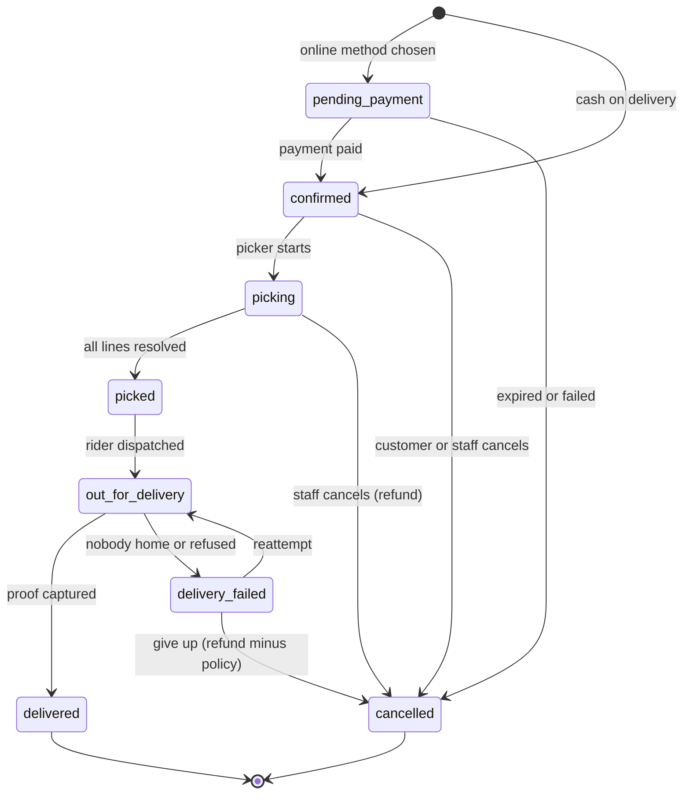

# Architecture

Status: draft v0.1. Decisions that are expensive to reverse are recorded in [docs/adr/](adr/). Versions are deliberately unpinned here; the setup guide installs the latest stable releases and the lockfile becomes the record.

## 1. Principles

1. **One deployable.** A single Next.js app serves the storefront, the admin and the API ([ADR 0001](adr/0001-modular-monolith-nextjs.md)). Split only when a measured problem demands it.
2. **Deep modules.** Each business domain is a folder with a small public interface and hidden internals. Callers learn the interface, not the implementation.
3. **The server is the authority.** Prices, stock, delivery eligibility and totals are computed on the server every time. The client displays and requests; it never decides.
4. **Money is integer centavos** ([ADR 0002](adr/0002-money-as-integer-centavos.md)).
5. **Provider-agnostic edges.** Payments, SMS, email, search and media sit behind interfaces so a vendor can change without touching business logic ([ADR 0003](adr/0003-payment-provider-interface.md)).
6. **Hub-aware from day one.** Stock, Slots, Zones and pricing hang off a Hub even while there is only one.
7. **Boring and observable.** Prefer well-known tools; log every state change of an Order and every payment event.

## 2. System context

```
                      +------------------+
   Customer phone --->|                  |---> Postgres (orders, catalogue, stock)
   (PWA / browser)    |   Next.js app    |---> Object storage + CDN (product images)
                      |                  |---> Redis / KV (rate limits, optional cache)
   Staff (admin,  --->|  storefront      |
   picker, dispatch)  |  admin           |<--- Payment provider webhooks (Xendit/PayMongo)
                      |  API + webhooks  |---> Payment provider API (create/charge/refund)
                      |  cron endpoints  |---> Email (Resend) and SMS (Semaphore/Twilio)
                      +------------------+---> Maps / geocoding (address pin)
                              |
                              +--> Sentry, analytics, uptime monitor
```

## 3. Module map

Each module lives in `src/modules/<name>/` with `index.ts` (public), `internal/` (private), and its own tests. A module owns its tables: only that module reads or writes them. Others call its interface.

| Module          | Owns                                            | Public interface (examples)                                       |
| --------------- | ----------------------------------------------- | ----------------------------------------------------------------- |
| `catalog`       | Product, Category, ProductImage, search index   | `getProduct`, `listProducts`, `searchProducts`, `getCategoryTree` |
| `pricing`       | Promotion, Voucher, price rules                 | `priceCart(lines, context)` (pure), `validateVoucher`             |
| `inventory`     | StockLevel, reservations                        | `reserve(orderId, lines)`, `release`, `adjust`, `availability`    |
| `cart`          | Cart, CartLine                                  | `getCart`, `addLine`, `setQuantity`, `mergeGuestCart`             |
| `delivery`      | Hub, Zone, Slot, Address resolution             | `resolveZone(address)`, `listSlots`, `holdSlot`, `confirmSlot`    |
| `orders`        | Order, OrderLine, status history, Substitution  | `placeOrder`, `transition(orderId, event)`, `cancelOrder`         |
| `payments`      | Payment, PaymentEvent, provider adapters        | `createPayment`, `handleWebhook`, `refund`                        |
| `fulfilment`    | Pick tasks, Rider assignment, proof of delivery | `getPickList`, `markPicked`, `proposeSubstitution`, `dispatch`    |
| `customers`     | Customer profile, Address book, Referral        | `getProfile`, `saveAddress`, `applyReferral`                      |
| `content`       | Recipe, Article                                 | `getRecipe`, `recipeToCart`                                       |
| `notifications` | Message templates and delivery log              | `notify(event, recipient)`                                        |
| `identity`      | Sessions, roles (wraps Better Auth)             | `requireCustomer`, `requireStaff(role)`                           |
| `claims`        | Freshness Claims                                | `openClaim`, `resolveClaim`                                       |

Allowed dependency direction (arrow means "may call"):

```
app routes / server actions
        |
  orders --> payments, delivery, inventory, pricing, notifications, cart, customers
  cart   --> pricing, catalog, inventory (read-only availability)
  customers --> delivery (resolveZone when saving an Address)
  fulfilment --> orders, inventory
  content --> catalog, cart
  everything --> lib (db, money, dates, logger)
```

`catalog`, `pricing` and `lib` never import upward. Cycles are a defect.

## 4. Routes and rendering

| Route group | Examples                                                           | Rendering                                                                                                    |
| ----------- | ------------------------------------------------------------------ | ------------------------------------------------------------------------------------------------------------ |
| `(shop)`    | `/`, `/c/[...category]`, `/p/[slug]`, `/search`, `/recipes/[slug]` | Server-rendered with incremental revalidation; tag-based invalidation when admin edits a Product or Category |
| `(account)` | `/account`, `/account/orders/[id]`, `/account/addresses`           | Dynamic, authenticated                                                                                       |
| `checkout`  | `/cart`, `/checkout`, `/checkout/confirmed/[orderNo]`              | Dynamic, no caching                                                                                          |
| `admin`     | `/admin/products`, `/admin/orders`, `/admin/pick/[orderId]`        | Dynamic, role-gated                                                                                          |
| `api`       | `/api/webhooks/[provider]`, `/api/cron/[job]`, `/api/health`       | Route handlers                                                                                               |

Use the caching primitives of the Next.js version installed at setup time; read its docs then, because caching APIs change between major versions. Product URLs follow `/p/<slug>-<id>`; the id resolves the Product, the slug is cosmetic and redirects if stale.

Mutations use Server Actions with Zod validation. Each action calls a module interface and returns a typed result; it contains no business rules.

## 5. Cart and pricing

- A **guest Cart** is stored in the database keyed by a random 256-bit token in an HTTP-only cookie. The database keeps only the token's SHA-256 hash, so the cookie needs no signature and a database leak exposes no live Cart. Signing in merges it into the Customer's Cart (`mergeGuestCart`, quantities summed, capped by availability, never below what the Customer already had). The merge runs on the first request after sign-in and locks the guest Cart row, so it happens once.
- Cart Lines remember the price they were last set at (`seen_price_cents`), so the Cart flags a price change (CRT-5). Lines that are out of stock stay visible but are left out of the total.
- `priceCart(lines, context)` is a **pure function**: given lines, current prices, active Promotions, an optional Voucher and the Zone's fee rules, it returns line totals, discounts, delivery fee, VAT breakdown and total in centavos. Everything shown in the Cart, Checkout and on the Order comes from this one function.
- Because it is pure, it is the first thing built test-first and the most heavily tested unit in the system.
- VAT (as built in Batch 2.1): prices include 12% VAT, so the VAT inside a vatable amount is 12/112 of it, rounded half up per line and then summed (ADR 0002). The delivery fee is treated as vatable. **Confirm with the accountant** together with the tax class of each Category (docs/04 section 5).

## 6. Checkout and order placement

`placeOrder` is the critical transaction. It runs server-side in this order and is idempotent on a client-supplied `idempotencyKey`:

1. Load the Cart and re-run `priceCart`. If the total differs from what the Customer saw, return the new total and stop.
2. `resolveZone(address)`; reject if outside coverage or below the Zone minimum.
3. `confirmSlot(slotId)`: atomically increment `booked` only while `booked < capacity`; the earlier 10-minute hold is released into this booking.
4. `reserve(lines)` at the Hub: atomically increase `reserved` only while `onHand - reserved >= qty` for each line. Any shortfall rolls the whole transaction back and returns the unavailable lines.
5. Create the Order and Order Lines with snapshotted price, name, tax class and VAT amount.
6. Create the Payment: COD is `pending_cod`; online methods call the provider and return a redirect or invoice URL.
7. Commit, then enqueue notifications.

If an online payment is not completed in 15 minutes, a cron job cancels the Order, releases stock and frees the Slot.

As built (Batch 2.4, `src/modules/orders/internal/place-order.ts`):

- Checks before the transaction: idempotency replay, the Address belongs to the Customer and a Zone serves it, the Cart has priced lines, the Zone minimum, and the total the Customer saw.
- One transaction: close the Cart (`checked_out_at`, so two tabs place one Order), `bookSlot`, create the Order, `reserveStock` (Products in a fixed order, so concurrent Orders cannot deadlock), Order Lines with snapshots (name, price, tax class, VAT, the chosen substitute and picker note), the first status event and a `cod_pending` Payment. Any refusal throws and rolls everything back.
- Out-of-stock Cart Lines are left out of the Order, as the Cart already showed them outside the total.
- The order number is `SW-YYMMDD-XXXX` (Manila date, four characters without 0, O, 1 or I); a clash retries.
- Dependencies: `orders` also calls `cart` (load and close the Cart) and `customers` (the Address).

## 7. Order lifecycle

Order status and payment status are separate fields. Only `orders.transition()` changes Order status; each call writes a status-history row with actor and reason.



Payment status: `unpaid`, `authorised`, `paid`, `partially_refunded`, `refunded`, `failed`, `cod_pending`, `cod_collected`.

## 8. Payments

- **Interface:** `PaymentProvider` with `createCheckout`, `capture`, `refund`, `verifyWebhook`, `parseEvent`. Adapters for Xendit and PayMongo implement it; the active one is chosen by `PAYMENT_PROVIDER`.
- **Webhooks** hit `/api/webhooks/[provider]`. The handler verifies the signature, records the raw event in `payment_events` with a unique constraint on the provider event id, then applies it. A duplicate event is acknowledged and ignored. The handler never trusts amounts from the browser return URL; the webhook (or a provider fetch) is the source of truth.
- **Cash on delivery:** the Rider records collected cash at delivery; Dispatch reconciles per Rider per day.
- **Weighed items:** where the method supports it (cards), authorise estimate plus 10% and capture the final amount after picking. Wallets such as GCash generally cannot hold funds, so charge the estimate and refund any difference once the final weight is entered. Picker tolerance is plus or minus 10% of ordered weight; a heavier pick within tolerance is absorbed by Hoshimono. **Open decision:** confirm provider capabilities in Phase 3 and revise this paragraph.
- **Refunds** always go through `payments.refund`, produce a ledger row, and notify the Customer.
- Card data never touches our servers; use hosted checkout or provider-hosted fields.

## 9. Inventory and Slots

- `stock_levels(product_id, hub_id, on_hand, reserved)`. Available = `on_hand - reserved`. All changes go through `inventory`, which writes an append-only `stock_movements` row (reason: receipt, reserve, release, pick, shrink, adjustment).
- Reservation, release and Slot booking are single atomic SQL updates with a `WHERE` guard, not read-then-write in application code. This avoids overselling under concurrent checkouts.
- Slot hold for 10 minutes uses a `slot_holds` row with `expires_at`; a cron job purges expired holds each minute.
- As built (Batch 2.3): places left in a Slot are `capacity - booked - live holds of other carts`. `holdSlot` and `bookSlot` lock the Slot row (`SELECT ... FOR UPDATE`) before counting, so the last place goes to exactly one cart. A Slot stops taking new holds 90 minutes before it starts (`SLOT_CUTOFF_MINUTES`, an assumption until operations set it); a cart holding a place may still book until the Slot starts. `bookSlot` runs inside the caller's Order transaction.
- Low stock shows as "Only a few left" below a per-Product threshold; the storefront never reveals exact counts.

## 10. Search

MVP: PostgreSQL full-text search with `pg_trgm` and `unaccent` for typo tolerance and Filipino/Spanish-derived spellings, behind a `SearchIndex` interface in `catalog`. If relevance, speed or faceting outgrows it (roughly beyond 10,000 Products or when merchandising needs synonyms and boosting), swap in Meilisearch or Typesense without changing callers.

As built in Batch 1.1 (`src/modules/catalog/internal/search/`):

1. **Words.** The query is folded to lowercase ASCII words (accents removed); pack sizes such as `5kg` or `12 pcs` are dropped.
2. **Full text.** Every word must match. The typed word matches as a prefix; synonyms (a fixed Filipino and English list in `synonyms.ts`, such as gatas and milk) match as whole words. A Product matches on its own name, brand and description plus its Category's name and its parent Category's name. A parent that joins two topics ("Meat and fish") lends only the topic none of its children owns, so Pork gets "meat" but "fish" and "fresh fish" stay in the fish aisle. Two-word synonyms ("bitter gourd") match as phrases.
3. **Ranking.** Whole-word matches on the Product's own words first, then prefix matches, then matches through its own Category, then text rank, then name.
4. **No results.** Correct up to three words to the closest catalogue word (a swap for short words, one edit up to 8 letters, two beyond), and return the corrected query for "Showing results for ...". Then try the words joined ("pan de sal"). Then trigram similarity on brand and name, every word required.

The index narrows candidates first (any one word hits the Product or its Category), then every word must match. Measured on 5,000 Products in local Postgres: 14 to 22 ms per search, 66 ms in the worst case (eight unknown words through every fallback), 14 to 21 ms per suggestion.

## 11. Background work

No queue service in the MVP. A `jobs` table plus a cron endpoint called every minute by the host handles: expiring Slot holds and unpaid Orders, retrying notifications, releasing stale reservations, sending abandoned-cart nudges (V1). Jobs are idempotent and lock rows with `FOR UPDATE SKIP LOCKED`. Move to a managed queue only when jobs need fan-out or long runtimes.

## 12. Identity and access

- **Customers:** mobile OTP, email magic link, Google. Sessions are HTTP-only cookies.
- **Staff:** email plus Google Workspace or passkey; roles `admin`, `merchandiser`, `picker`, `dispatcher`.
- Authorisation is checked in three places: route middleware (coarse), server action (per operation) and data access (row ownership). A missing check in one layer must not expose data.
- Rate-limit OTP sends, login and checkout creation per IP and per phone number.
- Audit log for every admin write: who, what, before, after.

## 13. Media

Product images are stored in object storage behind a CDN and served through `next/image`. Upload rule: square, at least 1000 by 1000 px, converted to WebP/AVIF, white or neutral background, one primary plus up to five secondary. Alt text defaults to the Product name.

## 14. Quality gates and delivery

| Gate                 | Tool                                                            | When                                                          |
| -------------------- | --------------------------------------------------------------- | ------------------------------------------------------------- |
| Format and lint      | Prettier, ESLint                                                | Pre-commit (Husky + lint-staged), CI                          |
| Types                | `tsc --noEmit`                                                  | Pre-commit, CI                                                |
| Unit and integration | Vitest against a real Postgres test branch                      | CI; test-first for pricing, cart, inventory, orders, payments |
| End to end           | Playwright: browse, add to cart, checkout (COD), order tracking | CI on main and release branches                               |
| Accessibility        | `axe` checks inside Playwright on key pages                     | CI                                                            |
| Performance          | Lighthouse CI budget for Home, Category, Product                | Weekly and before launch                                      |
| Security             | `npm audit`, dependency review, secret scanning                 | CI                                                            |

Environments: **local** (dev DB branch), **preview** (per pull request, own DB branch), **staging** (production-like, provider sandbox), **production**. Migrations run with `prisma migrate deploy` as a release step, never at app start.

## 15. What we are deliberately not doing

- Microservices, Kubernetes, event buses, GraphQL, a headless commerce platform. Each solves a problem we do not have.
- A custom payment form. Hosted checkout keeps card data out of scope.
- Real-time everywhere. Order status updates by polling or server-sent events on the tracking page only.
- A native mobile app. The PWA covers MVP and V1. If one is built later it will be Flutter on a versioned JSON API; the frozen plan is in [concepts/flutter-mobile](concepts/flutter-mobile/README.md).
