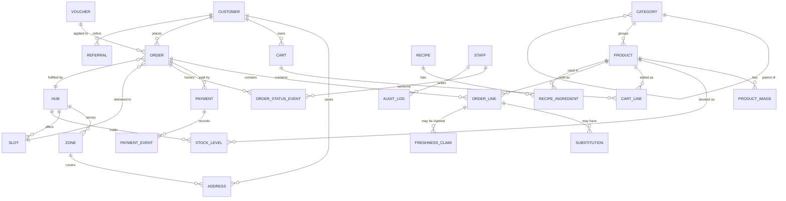

# Data Model

Status: v0.2, 2026-10-17. `prisma/schema.prisma` is now the source of truth for tables and fields; this document keeps the reasoning and invariants. Terms follow [GLOSSARY.md](../GLOSSARY.md).

**Schema v0 (Batch 0.3)** covers the MVP tables (Phases 0 to 4). Recipes, Vouchers, Promotions, Freshness Claims and the Referral fields on `customers` arrive with Phase 5 in a new migration; `orders.voucher_id` comes with them. Differences from the field lists below:

- `carts.checked_out_at` marks a Cart that became an Order. "Active Cart" (invariant 9) means `checked_out_at IS NULL`.
- Append-only tables (`stock_movements`, `order_status_events`, `payment_events`, `audit_log`) have `created_at` (or `at`, `received_at`) but no `updated_at`.
- `payments.provider` is null for cash on delivery.
- `products.search_vector` is a generated column: `simple` text search over `immutable_unaccent()` of name (weight A), brand (B) and description (C). Catalogue search (Batch 1.1) may change the expression in a new migration.
- Invariants 1, 2, 3, 4, 5, 8 and 9 are database constraints in the first migration and are covered by `tests/db/invariants.test.ts`. Invariants 6 and 7 are enforced in code (`orders` module, Phase 2).

## 1. Conventions

- Primary keys: UUID (v7 where available) as `String @id`. Human-facing Order numbers are separate (`SW-YYMMDD-XXXX`).
- Every table: `created_at`, `updated_at` (UTC). Database names are `snake_case` via `@map`.
- **Money:** integer centavos in `*_cents` columns. Never `Float` or `Decimal` ([ADR 0002](adr/0002-money-as-integer-centavos.md)).
- **Quantities:** pieces are integers; weights are integer grams (`*_grams`).
- **Soft delete only for Product** (`archived_at`). Everything else is deleted for real or kept as history.
- **Snapshots over joins** for anything a receipt must reproduce: Order Lines copy name, price, tax class and VAT.
- Enumerations as Postgres enums for closed sets (order status), lookup tables for open sets (tags).

## 2. Entity relationship overview

## 3. Core tables

Only fields that carry meaning are listed. Standard columns are omitted.

### catalog

**`products`**: `id`, `slug`, `name`, `brand`, `description`, `category_id`, `pack_size_value`, `pack_size_unit` (`g`, `ml`, `pc`), `unit_price_basis` (per 100 g, per litre, per piece), `price_cents`, `compare_at_cents` (nullable, for strikethrough), `tax_class` (`vatable`, `vat_exempt`, `zero_rated`), `is_weighed`, `avg_unit_weight_grams` (for weighed items sold per piece), `barcode`, `allergens[]`, `dietary_tags[]`, `storage` (`ambient`, `chilled`, `frozen`), `status` (`draft`, `active`, `archived`), `search_vector`.
Unique: `slug`, `barcode` (where present). Index: `category_id`, `status`, GIN on `search_vector`, trigram on `name`.

**`categories`**: `id`, `parent_id`, `slug`, `name`, `sort_order`, `image_url`, `search_words?` (words its Products also answer to in search, such as "meat" on Pork). Tree depth is capped at 3.

**`product_images`**: `product_id`, `url`, `alt`, `sort_order`, `is_primary` (one primary per Product, enforced by partial unique index).

### delivery

**`hubs`**: `id`, `name`, `address`, `lat`, `lng`, `is_active`.

**`zones`**: `id`, `hub_id`, `name`, `cities[]`, `barangays[]` (or a polygon later), `delivery_fee_cents`, `free_delivery_over_cents`, `min_order_cents`.

**`slots`**: `id`, `hub_id`, `date` (Manila local), `starts_at`, `ends_at`, `capacity`, `booked`. Check: `booked <= capacity`. Unique: `(hub_id, starts_at)`.

**`slot_holds`**: `slot_id`, `cart_id`, `expires_at`.

### inventory

**`stock_levels`**: `(product_id, hub_id)` primary key, `on_hand`, `reserved`, `low_stock_threshold`. Check: `reserved >= 0 AND on_hand >= 0 AND reserved <= on_hand`.

**`stock_movements`**: append-only. `product_id`, `hub_id`, `delta`, `reason`, `order_id?`, `staff_id?`, `note`.

### buying

**`carts`**: `id`, `customer_id?`, `guest_token_hash?`, `voucher_code?`, `updated_at`. A Customer has at most one active Cart.

**`cart_lines`**: `cart_id`, `product_id`, `quantity`, `seen_price_cents` (the price when the line was last set, so the Cart can flag a change), `substitution_preference` (`allow`, `preferred`, `none`), `preferred_product_id?`, `note`. Unique: `(cart_id, product_id)`.

**`orders`**: `id`, `order_no`, `customer_id`, `hub_id`, `slot_id`, `channel` (`web`, later `grab`, `lazada`), `status`, `payment_status`, `address_snapshot` (JSON), `contact_phone`, `rider_notes`, `subtotal_cents`, `discount_cents`, `delivery_fee_cents`, `vat_cents`, `total_cents`, `authorised_cents`, `final_total_cents?`, `voucher_id?`, `idempotency_key` (unique), `placed_at`, `cancelled_at?`, `delivered_at?`.

**`order_lines`**: `order_id`, `product_id`, `name_snapshot`, `unit_price_cents`, `tax_class`, `vat_cents`, `ordered_qty`, `fulfilled_qty`, `ordered_weight_grams?`, `final_weight_grams?`, `line_total_cents`, `substitution_preference`, `preferred_product_id?` and `note?` (copied from the Cart Line for the Picker), `status` (`pending`, `picked`, `short`, `substituted`, `refunded`).

**`substitutions`**: `order_line_id`, `substitute_product_id`, `price_cents`, `proposed_by`, `customer_response` (`auto_accepted`, `accepted`, `rejected`), `responded_at`.

**`order_status_events`**: append-only history: `order_id`, `from`, `to`, `actor_type` (`customer`, `staff`, `system`), `actor_id`, `reason`, `at`.

### payments

**`payments`**: `id`, `order_id`, `provider`, `method` (`cod`, `gcash`, `card`, other wallets), `provider_ref` (the hosted checkout), `checkout_url`, `payment_ref` (the provider's id of the completed payment, which refunds name), `amount_cents`, `captured_cents`, `refunded_cents` (check: within `captured_cents`), `status`.

**`refunds`**: money going back on a Payment ([ADR 0008](adr/0008-weighed-items-online-and-refunds.md)). `payment_id`, `amount_cents` (check: above 0), `reason` (`cancelled`, `picked`, `late_payment`; **unique with payment_id**, so a trigger never refunds twice), `status` (`pending`, `sending`, `sent`, `needs_review`), `provider_ref?`, `last_error?`, `created_at`, `sent_at?`.

**`payment_events`**: raw provider events. `provider`, `provider_event_id` (**unique with provider**), `type`, `payload`, `received_at`, `processed_at?`.

### customers and content

**`customers`**: profile linked to the auth user: `phone` (verified), `email`, `name`, `marketing_opt_in`, `referral_code`, `referred_by?`.

**`addresses`**: `customer_id`, `label`, `line1`, `barangay`, `city`, `landmark`, `lat`, `lng`, `zone_id?`, `notes`, `is_default`.

**`recipes`** and **`recipe_ingredients`**: ingredient rows hold `product_id`, `quantity_per_serving`, `unit`, `is_optional`.

**`vouchers`**, **`promotions`**: eligibility JSON (categories, products, minimum spend, first order only), `starts_at`, `ends_at`, `usage_limit`, `per_customer_limit`.

**`freshness_claims`**: `order_line_id`, `reason`, `photo_urls[]`, `status`, `resolution` (`refund`, `credit`, `rejected`), `resolved_by`.

**`staff`**, **`audit_log`**: staff identity with role; append-only record of admin writes.

## 4. Invariants the schema must enforce

Prefer database constraints over application checks wherever possible.

1. `stock_levels.reserved <= stock_levels.on_hand` and both non-negative.
2. `slots.booked <= slots.capacity`.
3. `payment_events (provider, provider_event_id)` is unique, so duplicate webhooks cannot apply twice.
4. `orders.idempotency_key` is unique, so a double-click cannot place two Orders.
5. `orders.total_cents = subtotal_cents - discount_cents + delivery_fee_cents`; VAT is included in prices and reported separately, never added again.
6. `order_lines.line_total_cents` is derived from the snapshot price, never from the live Product row.
7. Order status changes only through `transitionOrder()` in the orders module; every change has a status-event row.
8. A primary image is unique per Product.
9. A Customer has at most one active Cart.

## 5. Tax

Philippine VAT is 12% on vatable goods; many fresh and unprocessed foods are VAT-exempt. Prices are stored tax-inclusive; `tax_class` decides how much of the line is VAT for receipts. **Confirm the class of each Product category with the business accountant before launch.**

## 6. Seed data (Phase 0 deliverable)

- 1 Hub, 3 Zones, Slot templates for the next 7 days.
- A category tree of about 40 nodes.
- 150 realistic Products across all categories with at least one Weighed Product, one frozen item and one out-of-stock item.
- Staff accounts for each role; 3 test Customers with addresses.
- 5 Recipes (V1) can wait; Vouchers wait for Phase 5.

The seed must be re-runnable on an empty database and produce deterministic data so end-to-end tests are stable.

## 7. Migration policy

Forward-only migrations, reviewed like code. Destructive changes use expand, migrate, contract across two releases. Never edit an applied migration. Backups: daily snapshots plus point-in-time recovery on the production database, with a tested restore before launch.
