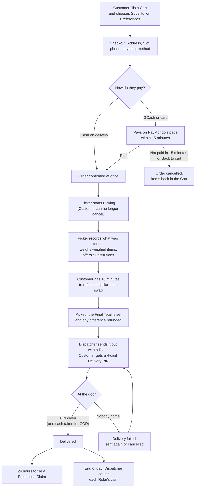
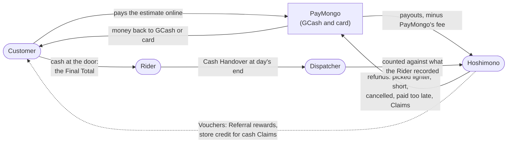

# 1. The business

This chapter describes Hoshimono as a business, the way the software models it. There is almost no code here. Every word in capitals (Hub, Slot, Picker) is defined in the [glossary](../../GLOSSARY.md); this chapter shows how those things work together.

## 1.1 What Hoshimono is

Hoshimono is an online supermarket for Metro Manila. A Customer browses a full grocery range on their phone, fills a Cart, chooses a delivery Slot, and pays by cash on delivery, GCash or card. Staff pick the Order at a Hoshimono-run Hub and a Rider delivers it the same day.

The [PRD](../01-PRD.md) sets three goals that shape every screen:

1. A Customer places a grocery Order in under four minutes on a mid-range phone over a mediocre connection.
2. The Hub can pick, hand off and deliver 200 Orders a day with one Picker shift lead and no spreadsheets.
3. The owner can add and price Products, set delivery rules and see the day's Orders without a developer.

Six things are meant to set Hoshimono apart (PRD section 6): Substitution control per line, honest weighed-item charging, Recipe to Cart in one tap, Unit Prices everywhere, live Slot capacity, and being light on data.

## 1.2 The places: Hub, Zones and Addresses

A **Hub** is a non-public building where the stock sits, Pickers pick and Riders leave from. Hoshimono starts with one Hub. The code is ready for many: stock, Slots, Zones and Orders all point to a Hub, so a second Hub is a new row of data, not a rewrite. The seed data calls the first one "Pasig Hub".

A **Zone** is an area one Hub serves, written as a list of cities and, optionally, barangays. Each Zone has its own money rules:

| Zone (seed placeholder) | Delivery Fee | Free-Delivery Threshold | Order Minimum |
| ----------------------- | ------------ | ----------------------- | ------------- |
| Pasig and Mandaluyong   | ₱49          | ₱1,500                  | ₱500          |
| Makati and Taguig       | ₱69          | ₱2,000                  | ₱700          |
| Quezon City South       | ₱79          | ₱2,500                  | ₱800          |

These amounts are placeholders. The real ones are an owner decision still owed ([ADR 0007](../adr/0007-pricing-rules-ahead-and-tax-to-confirm.md), item 3). An Admin can change them at any time on the "Zones and Slots" screen (`/admin/setup`), and Checkout uses the new amounts at once.

An **Address** is a Customer's saved delivery place: a line, a barangay, a city, a landmark (required, because Manila addresses are often informal) and notes for the Rider. When a Customer saves an Address, the app looks for the Zone that serves it. A Zone that lists barangays serves only those; a Zone without barangays serves the whole city. A barangay match wins over a whole-city match. Matching is by name today ("City of Pasig", "pasig city" and "Pásig" all match), because no map provider has been chosen yet. The public page `/delivery` lists every Zone and its fees.

## 1.3 Time: Slots, the schedule, holds and cutoffs

A **Slot** is a delivery window on one date at one Hub, with a capacity: the number of Orders it can take. The Customer sees real Slots with real places left, not a vague "same day".

Slots come from a weekly pattern, the **Slot Schedule**. The seed schedule is every day from 8 AM to 8 PM in 2-hour windows of 20 Orders each. Every minute, an automatic task (the cron tick, chapter 10) makes sure the next 7 Manila days have their Slots. It never changes a Slot that already exists, so editing the schedule affects only days not made yet. To change a single day, an Admin edits that one Slot's capacity; setting it to the number already booked closes it.

Three rules protect the Hub's day:

- **Slot Hold.** When a Customer picks a Slot at Checkout, their Cart keeps a place in it for 10 minutes, so it is not taken while they type their phone number. A Cart holds one Slot at a time; choosing another moves the hold.
- **Slot Cutoff.** A Slot stops taking new holds and Orders 90 minutes before it starts, leaving time to pick and travel. A Customer who already holds a place may still finish their Order until the Slot starts. The 90 minutes is an assumption until operations set it.
- **Booking window.** Customers can book up to 7 days ahead.

The Customer sees each Slot as open, "only a few left" (under 20% of capacity), or full. They never see exact counts.

## 1.4 The people

**Customers** are people with an account who place Orders. A visitor can fill a Guest Cart without signing in; signing in is needed only to check out. Customers sign in with a link sent by email, a 6-digit code sent by text message, or Google (once its keys exist). There are no passwords.

**Staff** are the people who run the shop. Each has one role, and each role opens only its own "areas" of the staff screens (least privilege, PRD ADM-11):

| Role           | What they do                                                                                                                   | Areas they can open                      |
| -------------- | ------------------------------------------------------------------------------------------------------------------------------ | ---------------------------------------- |
| Admin          | Everything, including managing Staff, the audit log and refunds to check                                                       | All 14 areas                             |
| Merchandiser   | Products, Categories, CSV import and export, Promotions and Vouchers                                                           | catalog, promotions                      |
| Content Editor | Recipes and Articles, nothing else                                                                                             | content                                  |
| Picker         | Picks Orders and proposes Substitutions                                                                                        | picking                                  |
| Dispatcher     | Runs the order queue, sends Orders out with Riders, counts cash, keeps stock, reads the daily report, reviews Freshness Claims | dispatch, orders, stock, reports, claims |
| Rider          | Carries Orders, enters the Delivery PIN, records cash, marks failed deliveries                                                 | delivery                                 |

The table comes from one place in the code, `src/modules/identity/internal/link.ts`. Chapter 11 explains how it is enforced. An Admin can add Staff, change roles and switch accounts off, but never their own, so there is always at least one active Admin.

## 1.5 The life of an Order, in business terms

Here is one ordinary Order from start to finish. Chapters 6 to 8 follow the same story through the code.

Some details worth knowing as an owner:

- **The Customer can cancel free of charge until Picking starts** (PRD ACC-5). After that, only Staff can cancel, with a reason.
- **Out-of-stock Products stay visible** but are left out of the Cart's total and out of the Order.
- **Substitutions follow the Customer's wish per line**: "pick a similar item", "I'll choose" (a Product they named), or "no substitute". Weighed items are never substituted. The Customer always pays the lower of the two prices ([ADR 0010](../adr/0010-picking-and-substitutions.md)).
- **Weighed Products** (meat, fish, loose produce) are sold at an estimated weight. The Picker enters the real weight. A lighter pack costs less; a heavier one costs no more ([ADR 0008](../adr/0008-weighed-items-online-and-refunds.md)). A pack more than 10% over the ordered weight is refused by the Picker screen and must be repacked.
- **Every status change is kept in the Order's history**, with who made it and why.

## 1.6 Where the money goes

**Cash on delivery (COD).** The Order is confirmed at once and nothing is charged before delivery. After Picking, the Final Total is what the Rider collects. At the door the Rider records the cash taken for each Order; a different amount needs a note. At the end of the day the Dispatcher counts each Rider's cash against the total the Rider recorded, and a shortfall needs a note. Because COD Orders hold stock and Slot places without any money, one Customer may have at most 3 open Orders when placing a COD Order, and a COD Order may be at most ₱20,000. Both limits are assumptions until operations set them (`src/modules/orders/internal/place-order.ts`).

**GCash and card through PayMongo.** The Customer pays the estimated total on PayMongo's own page. The Order waits up to 15 minutes for PayMongo's signed message that it is paid (the Payment Window). If no payment arrives, the Order is cancelled and its lines go back into the Customer's Cart. Once picked, if the Final Total is lower than what was paid, the difference is refunded in one go. PayMongo keeps its fee on refunded payments, so every refund costs Hoshimono that fee ([ADR 0008](../adr/0008-weighed-items-online-and-refunds.md)).

**Refunds** go back automatically in four cases: a paid Order is cancelled (all of it), money arrives after the Order was already cancelled (all of it), Picking packed less than was paid for (the difference), and a Freshness Claim is approved (the approved amount). A refund is sent at most once. If PayMongo gives no clear answer, the refund is marked for a person to check on the "Refunds to check" screen, never sent twice.

**Vouchers** are codes that take money off an Order or make delivery free. Merchandisers create public Vouchers; the app also makes personal ones: ₱100 for each side of a Referral, and store credit when a Freshness Claim on a cash Order is approved.

**VAT.** Prices include 12% VAT for vatable Products. Fresh and unprocessed food is usually VAT-exempt. The app works out the VAT inside every line for receipts, but the printed Delivery Receipt says "This is not an official receipt" until BIR registration ([ADR 0012](../adr/0012-stock-slots-reports-receipts.md)). Whether the business is VAT-registered at launch, and the Tax Class of each Category, are questions for the accountant ([ADR 0007](../adr/0007-pricing-rules-ahead-and-tax-to-confirm.md)).

## 1.7 A day at the Hub

| When             | Who        | Screen                         | What happens                                                                                                                                                                                                         |
| ---------------- | ---------- | ------------------------------ | -------------------------------------------------------------------------------------------------------------------------------------------------------------------------------------------------------------------- |
| Morning          | Dispatcher | Stock (`/admin/stock`)         | Receives supplier deliveries, records Shrink, checks what is low                                                                                                                                                     |
| Before each Slot | Picker     | Picking (`/admin/pick`)        | Opens confirmed Orders in Slot order, walks the Pick List, prints a Pick Sheet if wanted                                                                                                                             |
| During Picking   | Customer   | Text or email link (`/s/...`)  | Says yes or no to a similar-item swap within 10 minutes                                                                                                                                                              |
| When picked      | Dispatcher | Dispatch (`/admin/dispatch`)   | Chooses a Rider for each picked Order and sends it out                                                                                                                                                               |
| At each door     | Rider      | My deliveries                  | Enters the Customer's Delivery PIN, records cash for COD, or marks the delivery failed                                                                                                                               |
| Any time         | Dispatcher | Orders (`/admin/orders`)       | Finds an Order, reads its history, adds an Order Note, cancels with a reason                                                                                                                                         |
| Any time         | Dispatcher | Freshness Claims               | Approves (full or less) or rejects claims: the Customer's own, filed within 24 hours of delivery, or one staff filed for a Customer who called in ([ADR 0022](../adr/0022-staff-tools-for-the-last-runbook-gaps.md)) |
| End of day       | Dispatcher | Cash (`/admin/cash`)           | Counts each Rider's cash against what they recorded                                                                                                                                                                  |
| End of day       | Admin      | Daily report (`/admin/report`) | Orders placed, delivered and cancelled, revenue, basket, fill rate, late deliveries, claims, Funnel                                                                                                                  |

## 1.8 What is still pretend

Several parts of the business do not exist yet, so the software stands in for them. Chapter 14 lists them all. The main ones:

- **No real messages go out.** Email and text messages are written to the server's log until the Resend and SMS sender accounts exist.
- **No real payments.** PayMongo is coded but has no keys yet. A stand-in payment page (`PAYMENT_PROVIDER=fake`) is used in development and tests, and is refused on a real domain.
- **Seed data.** Prices pair real brands with invented amounts, and Zone fees are placeholders. They must not appear on a public preview.
- **No Hub, Riders or BIR registration yet.** These are business tracks the owner chose to start after most of the app is built (roadmap section 11).

## Check yourself

A Customer in Pasig chooses the 2 PM Slot at 12:45 PM. Can they book it?

No. The Slot Cutoff is 90 minutes, so the 2 PM Slot stopped taking new holds at 12:30 PM. If they had taken a hold before 12:30 PM, they could still finish their Order until 2 PM.

Who can see the "Refunds to check" screen?

Only Admins. The `refunds` area belongs to the Admin role alone.

A Customer ordered 1 kg of pork at ₱320 and paid by GCash. The Picker packed 1.08 kg. What is the pork charged?

₱320. A heavier pack never costs more than the estimate; Hoshimono absorbs it. Had the pack been 0.92 kg, the pork would be ₱294.40 and the ₱25.60 difference refunded after Picking.

