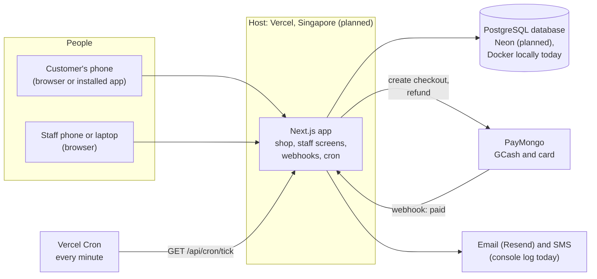
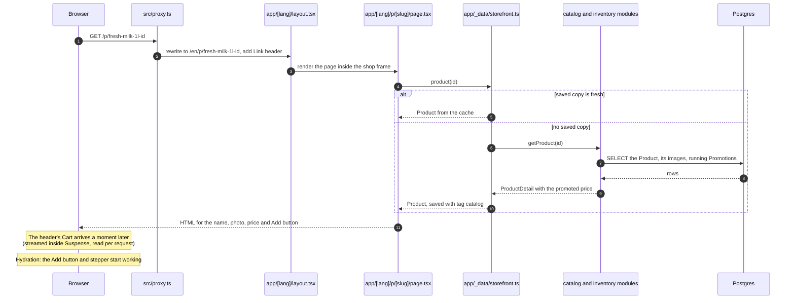

# 2. The building blocks

This chapter explains the tools Hoshimono is made of, in plain words, and where each one lives in the `src/` folder. Once you know these ten or so ideas, every other chapter reads more easily.

## 2.1 Server and browser

Two computers take part in every visit to the shop:

- The **browser** is the program on the Customer's phone or laptop (Chrome, Safari). It shows pages and reacts to taps.
- The **server** is a computer on the internet that runs the Hoshimono app for everyone at once. It can read and write the database, hold secrets (such as the PayMongo key), and decide prices. Today the server is a developer's laptop; at launch it will be Vercel, a hosting company, in its Singapore region (`vercel.json`: `"regions": ["sin1"]`).

They talk in **requests** and **responses**. The browser asks for a web address (a request); the server answers with a page or some data (a response). Anything the browser sends can be tampered with by whoever holds the phone, so the server never trusts it for prices, stock or totals. That is the most important rule in the whole app ([CLAUDE.md](../../CLAUDE.md), "Prices, stock and totals are always recomputed on the server").



## 2.2 The languages: TypeScript, SQL, HTML and CSS

- **TypeScript** is the language almost all of the app is written in, on the server and in the browser. It is JavaScript with **types**: every value says what kind of thing it is (a number, a text, an Order), and a checker (`tsc`) refuses code that mixes them up before it ever runs. For example, an amount of money is always a whole number of centavos, and the checker helps keep it that way.
- **SQL** is the database's own language. Most queries are generated for us by Prisma (below), but the ones that must be safe when many people act at once are written by hand.
- **HTML** is what a page is made of, and **CSS** is how it looks. The app uses **Tailwind**, a way of writing CSS as short class names next to the HTML (`className="rounded-card border p-5"`). The colours and type sizes come from the design system ([05-DESIGN-SYSTEM.md](../05-DESIGN-SYSTEM.md)).

## 2.3 React and Next.js

**React** is a library for building screens out of **components**: small reusable pieces such as a Product card, a price tag or a quantity stepper. A component is a TypeScript function that returns what to show.

**Next.js** (version 16.4) is the framework the whole app is built on. It turns folders into web addresses, runs components on the server or in the browser, and handles forms, caching and images. One Next.js app holds the shop, the staff screens and the machine-facing addresses together ([ADR 0001](../adr/0001-modular-monolith-nextjs.md)).

### Folders become addresses

Next.js uses the **App Router**: the folder path under `src/app/` is the web address. A few special file names say what each folder does:

| File                         | Meaning                                                                                        | Example                                         |
| ---------------------------- | ---------------------------------------------------------------------------------------------- | ----------------------------------------------- |
| `page.tsx`                   | The screen shown at this address                                                               | `src/app/[lang]/cart/page.tsx` is the Cart page |
| `layout.tsx`                 | The frame around every page below it (header, footer, menu)                                    | `src/app/admin/layout.tsx` is the staff sidebar |
| `route.ts`                   | A **route handler**: an address that answers machines with data instead of a page              | `src/app/api/health/route.ts`                   |
| `actions.ts`                 | Server Actions for the pages in that folder (a naming habit of this codebase, not a Next rule) | `src/app/[lang]/checkout/actions.ts`            |
| `error.tsx`, `not-found.tsx` | What to show when something breaks or does not exist                                           | `src/app/[lang]/not-found.tsx`                  |

A folder name in **square brackets** is a variable part of the address. `src/app/[lang]/p/[slug]/page.tsx` serves `/p/fresh-milk-1l-<id>` with `slug` set to `fresh-milk-1l-<id>`. Three dots mean "any number of parts": `src/app/[lang]/c/[...category]/page.tsx` serves `/c/fruit-and-vegetables/fruit`.

### Two root layouts: the shop and the staff screens

The app has two separate frames that never share a page:

- **The shop** lives under `src/app/[lang]/`. `[lang]` is `en` or `fil`, so every shop page exists in English and Filipino ([ADR 0017](../adr/0017-filipino-pwa-and-funnel.md)). English addresses have no prefix (`/cart`); Filipino ones start with `/fil` (`/fil/cart`).
- **The staff screens** live under `src/app/admin/`, always in English, with their own sidebar and no shopper header ([ADR 0018](../adr/0018-design-pass.md)).

Both use the `Document` frame in `src/app/root-shell.tsx` (fonts, theme, language, the skip link, the screen-reader announcer). Moving between the shop and the staff screens is a full page load.

### The proxy

`src/proxy.ts` is a small piece of code that sees every shop request before any page does. It does three things: an English address like `/cart` is served from `/en/cart` inside, without the visitor seeing it; an address that starts with `/en/` is redirected to the address without it, so each page has one address; and every answer gets a `Link` header naming both language versions for search engines (`hreflang`). It skips the staff screens, the API, uploaded photos and Next's own files.

## 2.4 Server Components and Client Components

This is the idea that most shapes how the code looks.

A **Server Component** is a component that runs only on the server. It can read the database directly, it never sends its own code to the phone, and the browser receives only the finished HTML. Pages, layouts and most of the shop are Server Components. They are the default: a file is a Server Component unless it says otherwise.

A **Client Component** runs in the browser too. It is needed only for things that must react on the phone without asking the server first: a quantity stepper that changes at once, a drawer that slides open, an animation, reading the phone's language or connection. A Client Component file starts with the line `"use client"`. Hoshimono has 64 of them among its 170 `.tsx` files, and keeps them small: "leaf" components at the edges of a page, never whole pages ([CLAUDE.md](../../CLAUDE.md)).

Why this matters: every Client Component adds JavaScript the phone must download and run before the page responds. The shop has a budget of about 170 KB of JavaScript per page ([05-DESIGN-SYSTEM.md](../05-DESIGN-SYSTEM.md) section 11), and the Lighthouse check in CI fails a pull request whose mobile performance score falls below 90 (chapter 12). Some tricks you will see in the code exist only to save bytes: the Add button arrives as plain HTML and loads the stepper and its animation library (Motion) only on the first tap (`src/components/product/add-to-cart.tsx`).

A Server Component can contain Client Components, but not the other way round. A typical shop page is a Server Component that reads data and passes plain values down to a few Client Components.

**Hydration** is the moment the browser attaches the Client Components' code to the HTML it already shows, so the buttons start working. Until hydration, a page is visible but its interactive parts are asleep.

## 2.5 Server Actions and route handlers

There are two ways for the browser to ask the server to do something.

A **Server Action** is a server function that a button or form calls directly, as if it were a local function. The file starts with `"use server"`. When the Customer taps, the browser sends a request carrying the action's hidden id and its arguments; Next.js runs the function on the server and sends back its result. Hoshimono has 24 action files, all under `src/app/`. Every action does the same three things and nothing more: check who is asking (`requireCustomer` or `requireStaff`), check the input (with **zod**, a library that describes what valid input looks like), and call a module's public function. Actions contain no business rules; the modules do ([03-ARCHITECTURE.md](../03-ARCHITECTURE.md) section 4).

A **route handler** (`route.ts`) is a plain address that answers with data, for callers that are not our own pages:

| Address                        | File                                       | Who calls it                                                 |
| ------------------------------ | ------------------------------------------ | ------------------------------------------------------------ |
| `/api/webhooks/[provider]`     | `src/app/api/webhooks/[provider]/route.ts` | PayMongo (or the stand-in) when a payment happens            |
| `/api/cron/[job]`              | `src/app/api/cron/[job]/route.ts`          | Vercel Cron every minute (only `tick` exists)                |
| `/api/auth/[...all]`           | `src/app/api/auth/[...all]/route.ts`       | Better Auth's sign-in pages and callbacks                    |
| `/api/health`                  | `src/app/api/health/route.ts`              | An uptime monitor: is the app up and the database reachable? |
| `/api/search/suggest`          | `src/app/api/search/suggest/route.ts`      | The search box, as you type                                  |
| `/api/events`                  | `src/app/api/events/route.ts`              | The browser's Funnel counts (chapter 9)                      |
| `/api/dev/mailbox`             | `src/app/api/dev/mailbox/route.ts`         | End-to-end tests only; answers 404 on a real domain          |
| `/admin/export`                | `src/app/admin/export/route.ts`            | A Merchandiser downloading the catalogue as CSV              |
| `/r/[code]`, `/dev/sign-in/go` | under `src/app/[lang]/`                    | A Referral link; one-click sign-in for local testing         |

## 2.6 Rendering, caching and streaming

The shop must feel fast on a mid-range phone, so most pages are prepared ahead.

- **Prerendering** means building a page's HTML before anyone asks for it, so the server can answer at once. Each language of the shop is prerendered on its own. The first 96 Products are prerendered at build time; the rest are built on their first visit.
- **Caching** means keeping a saved copy of something slow to make. The shop's reads go through one file, `src/app/_data/storefront.ts`, where each function starts with `"use cache"` and gets a lifetime (`cacheLife("minutes")`) and **tags** (`catalog`, `stock`, `content`). When a Merchandiser saves a Product, the admin action calls `updateTag("catalog")`, which throws away every saved copy with that tag, so the change shows on the shop at once. When an Order reserves stock, the Checkout action calls `updateTag("stock")`.
- **Streaming** means sending the page in pieces. The parts that need the signed-in Customer (the header's Cart, the Checkout form) sit inside a React **Suspense** boundary: the rest of the page is sent at once with a grey placeholder (a "skeleton"), and the personal part follows when ready. This setting is on for the whole app (`cacheComponents: true` in `next.config.ts`).

Three other Next.js helpers appear often:

- `after(() => ...)` runs work after the answer has been sent, such as sending the confirmation message right after an Order is placed.
- `refresh()` asks the browser to re-read the current page, so a server-rendered total updates after an action.
- `redirect(...)` sends the browser to another address, such as the confirmation page.

## 2.7 The database: PostgreSQL

All of Hoshimono's data lives in one **PostgreSQL** database ("Postgres"), a free, widely used database ([ADR 0004](../adr/0004-postgres-prisma.md)). There is no other store: no separate search engine, no cache server, no queue service.

A database holds **tables**, like spreadsheets. Each **row** is one thing (one Order, one Product) and each **column** is one fact about it (`total_cents`, `status`). There are 45 tables. Their source of truth is `prisma/schema.prisma`; [04-DATA-MODEL.md](../04-DATA-MODEL.md) explains the reasoning.

Postgres protects the data with rules it enforces itself, whatever the app does. These are called **constraints**:

- A **unique** constraint forbids two rows with the same value. Two Orders can never share an `idempotency_key`; a provider's event can be recorded only once.
- A **check** constraint forbids impossible values. `reserved` stock can never exceed `on_hand` stock, and a Slot's `booked` can never exceed its `capacity`.
- A **foreign key** ties a row to another. An Order Line cannot point to a Product that does not exist.

When a constraint is broken, the database refuses the change and the app sees an error. Hoshimono relies on this on purpose: a bug that would oversell or double-refund fails loudly instead of quietly corrupting the books.

Two Postgres add-ons (**extensions**) power search: `pg_trgm`, which measures how alike two words are, and `unaccent`, which ignores accents. Section 10 of [03-ARCHITECTURE.md](../03-ARCHITECTURE.md) and section 3.4 here describe search.

A **transaction** groups several changes so that either all of them happen or none do. Placing an Order closes the Cart, books the Slot, reserves stock and writes the Order and its lines in one transaction; if any step fails, the database is left exactly as it was. Chapter 6 goes deeper, including **locks**, which make transactions wait their turn.

Today the database runs in a **Docker** container (a packaged, isolated program) called `hoshimono-db` on the developer's laptop, port 5433, with three databases: `hoshimono` for development, `hoshimono_test` for automated tests and `hoshimono_e2e` for browser tests. At launch it moves to **Neon**, a hosted Postgres service in Singapore ([ADR 0005](../adr/0005-neon-postgres-host.md)).

## 2.8 Prisma: talking to the database

**Prisma** (version 7.10) is the library the app uses to read and write the database ([ADR 0004](../adr/0004-postgres-prisma.md)). It does three jobs:

1. **The schema.** `prisma/schema.prisma` describes every table, column and relation in one readable file. In code, names are `camelCase` (`totalCents`); in the database they are `snake_case` (`total_cents`), mapped with `@map`.
2. **The client.** From the schema, Prisma generates typed TypeScript functions into `src/generated/prisma/` (made by `npm install`, not stored in git). Code then writes `db.order.findUnique({ where: { orderNo } })` and the type checker knows exactly what comes back. The one shared connection, `db`, is made in `src/lib/db.ts`, which also offers `inTransaction`: run some work in the caller's transaction if there is one, or in a new one.
3. **Migrations.** A **migration** is a file of database changes (add a table, add a column) applied once, in order. There are 20, in `prisma/migrations/`, from `20261017073830_init` to `20261022120000_funnel_counts`. Constraints Prisma's schema language cannot express (check constraints, partial unique indexes, the search column) are written by hand into the migration SQL. Migrations only move forward; an applied one is never edited ([04-DATA-MODEL.md](../04-DATA-MODEL.md) section 7).

Where safety under many simultaneous requests matters, the code writes SQL by hand with `db.$queryRaw` or `tx.$executeRaw`. For example, stock is reserved with one statement that only succeeds while enough is free (chapter 6). These are written as **tagged templates** (`` tx.$executeRaw`UPDATE ... WHERE id = ${id}` ``): Prisma sends the values separately from the SQL text, so a value can never be mistaken for a command (this blocks a classic attack called SQL injection).

## 2.9 Other libraries worth recognising

| Library            | What it does here                                                                 |
| ------------------ | --------------------------------------------------------------------------------- |
| Better Auth        | Sign-in, sessions and the `auth_*` tables (chapter 11)                            |
| zod                | Checks that input has the right shape before a module sees it                     |
| Motion             | Small animations (the Add button turning into a stepper), loaded only when needed |
| vaul               | The Cart drawer that slides up on phones                                          |
| sharp              | Resizes uploaded photos and converts them to WebP                                 |
| Phosphor           | The one icon set                                                                  |
| next-themes        | Light and dark mode                                                               |
| Vitest, Playwright | Automated tests (chapter 12)                                                      |

The full list with versions is in `package.json`. The [roadmap's section 2](../07-ROADMAP.md#2-tech-stack-and-where-it-is-used) lists the planned stack; a few planned tools were not needed and are not installed (React Hook Form, TanStack Table, `next-intl`, Sentry so far).

## 2.10 The map of `src/`

```text
src/
  app/                    Addresses: pages, layouts, Server Actions, route handlers
    [lang]/               The shop, once per language (en, fil)
      page.tsx            Home
      c/ p/ search/       Category, Product and Search pages
      cart/ checkout/     Cart and Checkout, with their actions
      orders/[orderNo]/   The Customer's Order page (tracking, cancel, claim, reorder)
      account/            Profile, Addresses, Order history, Shopping Lists, invite friends
      recipes/ articles/  Recipes and Articles
      s/[token]/          The Customer's answer to a Substitution
      stop/[token]/       Stop Cart Reminders without signing in
      dev/                Local-only test tools (stand-in pay page, one-click sign-in)
    admin/                The staff screens, one folder per screen
    api/                  Route handlers: webhooks, cron, auth, health, search, events
    _data/storefront.ts   Cached shop reads (the only place shop caching is set)
    root-shell.tsx        The HTML frame both root layouts share
    manifest.ts, icon.tsx The installable app's manifest and icon
  components/             React components, grouped by area (cart, product, checkout, shell, ui)
  modules/                The business logic: 13 modules (chapter 3)
  server/job-handlers.ts  Wires background job names to module functions (chapter 10)
  lib/                    Small shared tools: db, money, dates, phone, rate limits, signing
  i18n/                   The English and Filipino dictionaries
  config/                 Brand name, Home settings, the z-index scale
  proxy.ts                Language handling for every shop request
```

The rule of thumb: **`app/` decides who may do what and shows it; `modules/` decides what is allowed and does it; `lib/` holds tools with no business meaning.**

## 2.11 How one page is built, end to end

Here is what happens when a Customer opens a Product page, `/p/fresh-milk-1l-<id>`:



The name, photo and price render in the first piece of HTML, so the page paints quickly on a slow phone. The Cart in the header depends on who is visiting, so it streams in afterwards and is never cached.

## Where to look in the code

| Topic                         | File                                                  |
| ----------------------------- | ----------------------------------------------------- |
| The shop's frame and language | `src/app/[lang]/layout.tsx`, `src/app/root-shell.tsx` |
| The staff frame               | `src/app/admin/layout.tsx`                            |
| Language in the address       | `src/proxy.ts`, `src/i18n/lang.ts`                    |
| Shop caching                  | `src/app/_data/storefront.ts`                         |
| The database connection       | `src/lib/db.ts`                                       |
| Every table                   | `prisma/schema.prisma`, `prisma/migrations/`          |
| Next.js settings              | `next.config.ts`                                      |

## Check yourself

<details>
<summary>Why is the Cart page's quantity stepper a Client Component, but the Product page itself is not?</summary>

The stepper must change the number the moment it is tapped, before the server answers, which needs code running in the browser. The Product page only shows data the server already has, so it is cheaper as HTML built on the server.
</details>

<details>
<summary>A Merchandiser changes a price. Why does the shop show it at once, even though Product pages are cached?</summary>

The admin action calls `updateTag("catalog")`, which throws away every cached read tagged `catalog`. The next visitor's request rebuilds the page with the new price.
</details>

<details>
<summary>What does a check constraint like <code>reserved &lt;= on_hand</code> protect against, if the code already checks stock?</summary>

Bugs and races. If any code path, now or in future, tried to reserve more than is on the shelf, the database itself refuses the change and the whole transaction rolls back, so the error is loud and nothing is oversold.
</details>
