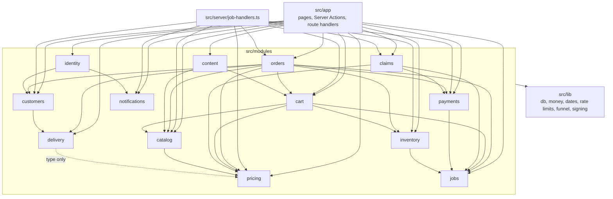

# 3. The modules

All of Hoshimono's business rules live in 13 folders under `src/modules/`. This chapter explains what a module is, the one rule that keeps them apart, what each one owns, and the shared habit for saying "no".

## 3.1 What a module is

A **module** is a folder that owns one business area: the catalogue, the Cart, Orders, payments. It has two parts:

- **`index.ts`, the public interface.** A short list of the functions and types other code may use. It contains no logic, only re-exports such as `export { placeOrder } from "./internal/place-order"`.
- **`internal/`, the private workings.** Everything else: queries, rules, helpers. Nothing outside the module may import from here.

A module also **owns its tables**: only that module reads or writes them. Other code asks the module through its interface. For example, only `inventory` changes `stock_levels`; when `orders` needs stock reserved, it calls `inventory.reserveStock`.

This style is called a **modular monolith** ([ADR 0001](../adr/0001-modular-monolith-nextjs.md)): one app, one deployment, one database, but divided inside into parts with firm walls. The design aims for **deep modules**: a small interface hiding a lot of careful work. `placeOrder` is one function to its callers, and about 370 lines of checks, locks and retries inside.

Why bother? Three reasons:

1. **You can change the inside without breaking the outside.** Search could move from Postgres to a dedicated search engine without any caller noticing, because callers only know `searchProducts`.
2. **Each rule lives in one place.** There is one `priceCart`, one `transitionOrder`, one `reserveStock`. A fix is made once.
3. **A module could later become its own service**, because it already owns its tables and has a narrow interface. Nobody plans to do this; it is simply possible.

## 3.2 The boundary rule and how it is enforced

> Import another module only through its `index.ts`. Reaching into `modules/x/internal/` from outside `x` is a boundary violation. ([CLAUDE.md](../../CLAUDE.md))

A convention like this decays unless a machine checks it. Two things check it:

- **A lint rule.** `eslint.config.mjs` defines `moduleBoundary`, a `no-restricted-imports` rule that refuses any import path containing `modules/*/internal` (or a relative path into a sibling's `internal/`). The linter (ESLint, a tool that reads code for mistakes) runs before every commit and in CI, so a violation cannot be committed.
- **A test of the rule.** `tests/module-boundary.test.ts` feeds the linter three small pieces of code and checks that it blocks the two bad imports and allows the good ones, so the rule itself cannot silently stop working.

**Honest shortcuts.** Some modules read another module's rows through Prisma relations instead of calling its interface: for example, `orders` reads Product and Category names for the Pick List, and `pricing` counts a Customer's Orders to check a "first order only" Voucher. Each of these is marked in the code with a `shortcut:` comment that says what it reads and why (search the code for `shortcut:`). They only read, never write, and they are listed so they can be replaced if a module ever moves out.

## 3.3 The module map

Arrows mean "imports from the public interface of". This map is drawn from the actual imports in the code.

Read it from the bottom up:

- **`jobs`, `notifications` and `pricing` depend on no other module.** `pricing` is pure arithmetic plus its own tables, which is why it is the most heavily tested part of the app.
- **`orders` sits at the top.** Placing, cancelling and picking an Order touches nearly everything, so it calls nearly everything.
- **There are no cycles.** No module depends, directly or through others, on itself. A cycle would be a defect ([03-ARCHITECTURE.md](../03-ARCHITECTURE.md) section 3).
- **Glue lives outside the modules.** `src/server/job-handlers.ts` connects background job names to the modules that do the work, so modules stay unaware of each other's messages (chapter 10). The pages and actions in `src/app` connect the modules for each screen.

## 3.4 The 13 modules, one by one

Each entry lists what the module owns, its most important public functions, and the files to read.

### catalog: Products, Categories and search

- **Owns:** `products`, `categories`, `product_images`, and the search index (the generated `search_vector` column and trigram index on `products`).
- **Shop functions:** `getProduct`, `getProductSummaries` (Products as the shop shows them, with the promoted price), `listProducts` (filters and sort), `getCategoryTree`, `getCategory`, `searchProducts`, `suggestSearch`, `listRelatedProducts`, `listPromotedProducts`, `listSitemapEntries`.
- **Staff functions:** `createProduct`, `updateProduct`, `importProductsCsv`, `exportProductsCsv`, Category and image editing. Callers check `requireStaff("catalog")` first.
- **Depends on:** `pricing`, to apply running Promotions to every Product summary (`src/modules/catalog/internal/products.ts`, function `promoted`).
- **Search** (`src/modules/catalog/internal/search/`) hides behind the `SearchIndex` interface (`search-index.ts`), implemented on Postgres in `postgres-search-index.ts`. A query is folded to plain lowercase words, pack sizes like `5kg` are dropped, and every word must match. Filipino and English words count as the same through a fixed list of Search Synonyms (`synonyms.ts`: gatas and milk, itlog and eggs, toyo and soy sauce). A Category's "also found by" words (`categories.search_words`, set by a Merchandiser) let "meat" find pork. With no results, the search corrects up to three misspelled words ("mlik" becomes "milk") and says "Showing results for ...". Measured at 14 to 22 ms per search on 5,000 Products.

### pricing: every total, Promotions and Vouchers

- **Owns:** `promotions`, `vouchers`, `voucher_redemptions`.
- **Functions:** `priceCart` (the one place a Cart total is computed; pure), `priceFinal` and `chargedLine` (the Final Total after Picking), `receiptBreakdown` (VAT split for the Delivery Receipt), `spreadDiscount`, `promotedPrice`, `activePromotions`, `checkVoucher`, `redeemVoucher`, `createRewardVoucher`, `createCreditVoucher`, and the staff screens' save functions.
- **Depends on:** nothing but `lib`.
- **Read:** `src/modules/pricing/internal/price-cart.ts`, `price-final.ts`, `discounts.ts`, `vouchers.ts`. Chapter 5 is about this module.

### inventory: stock

- **Owns:** `stock_levels` (per Product per Hub: `on_hand`, `reserved`, `low_stock_threshold`), `stock_movements` (an append-only log of every change), `stock_alerts`.
- **Functions:** `getAvailability` (free units, for server checks), `getStockStates` (only "in stock", "low" or "out", for pages: the shop never reveals counts), `reserveStock`, `releaseStock`, `pickStock`, `returnStock`, and for staff `receiveStock`, `recordShrink`, `countStock`, `setLowStockThreshold`, `listStockForAdmin`, `stockHistory`. Stock Alerts: `requestStockAlert`, `queueStockAlerts`.
- **Depends on:** `jobs` (to queue back-in-stock messages).
- **Read:** `src/modules/inventory/internal/reserve.ts`, `stock-states.ts`, `admin.ts`, `alerts.ts`.

### cart: Carts, Cart Lines and Shopping Lists

- **Owns:** `carts`, `cart_lines`, `shopping_lists`, `shopping_list_items`.
- **Functions:** `getCart` (the Cart priced, as a `CartView`), `setLineQuantity`, `addLines` (add on top, capped by stock: used by Recipes, Reorder and Shopping Lists), `setSubstitution`, `setLineNote`, `setCartVoucher`, `mergeGuestCart`, `newGuestToken`, `checkOutCart` and `readCartVersion` (used inside `placeOrder`'s transaction), `returnLinesToCart`, `purgeIdleCarts`, the Shopping List functions, and `queueCartReminders`.
- **Depends on:** `catalog` (Products and prices), `inventory` (what is free), `pricing` (`priceCart`, `checkVoucher`), `jobs`.
- **Read:** `src/modules/cart/internal/cart.ts` (the heart), `add.ts`, `lists.ts`, `reminders.ts`. Chapters 4 and 6.

### delivery: Hubs, Zones and Slots

- **Owns:** `hubs`, `zones`, `slots`, `slot_templates`, `slot_holds`.
- **Functions:** `resolveZone` (which Zone serves an Address), `getDefaultHubId`, `listSlots`, `holdSlot`, `getSlotHold`, `bookSlot` and `releaseSlot` (used inside Order transactions), `purgeExpiredHolds`, `ensureSlots` (make the next 7 days' Slots from the schedule), and the setup screen's functions (`updateZoneFees`, `addSlotTemplate`, `setSlotCapacity`, and others). Constants: `SLOT_HOLD_MINUTES = 10`, `SLOT_CUTOFF_MINUTES = 90`.
- **Depends on:** `pricing`, for the `ZoneFees` type only.
- **Read:** `src/modules/delivery/internal/slots.ts`, `zones.ts`, `schedule.ts`.

### orders: Orders, their history, Picking and dispatch

- **Owns:** `orders`, `order_lines`, `order_status_events`, `substitutions`, `order_notes`.
- **Functions:**
  - Placing: `placeOrder`.
  - The lifecycle: `transitionOrder` (the only way an Order changes status), `cancelOrder`, `confirmPaidOrder`, `expireUnpaidOrders`, `abandonPayment`.
  - Picking: `getPickList`, `recordPick`, `proposeSubstitution`, `answerSubstitution`, `finishPicking`.
  - Dispatch: `dispatchOrder`, `completeDelivery`, `deliverWithoutPin`, `failDelivery`, `listDispatchBoard`, `listDeliveriesForRider`.
  - Reading: `getOrder`, `listOrders`, `getOrderForStaff`, `listOrdersForStaff`, `staffMoves`, `addOrderNote`.
  - Reports: `dailyReport`, `getReceipt`; Reorder: `getReorderLines`, `listBoughtBefore`.
- **Depends on:** `cart`, `catalog`, `customers`, `delivery`, `inventory`, `payments`, `pricing`, `jobs`.
- **Read:** `src/modules/orders/internal/place-order.ts`, `status.ts`, `picking.ts`, `delivery.ts`. Chapters 6 and 8.

### payments: Payments, webhooks, refunds and cash

- **Owns:** `payments`, `payment_events`, `refunds`, `cash_handovers`.
- **Functions:** `createCodPayment`, `createOnlinePayment`, `voidCodPayment`, `recordCodCollected`, `startCheckout`, `closeOnlinePayment`, `handleWebhook`, `refundOrderPayment`, `sendRefund`, `listRefundsToCheck`, `settleRefund`, `paymentProvider` (which provider is active), the `PaymentProvider` interface and its two implementations (`createPaymongo`, the stand-in `fake`), and the cash functions `riderCashDay`, `listCashDay`, `recordCashHandover`.
- **Depends on:** `jobs` (to queue refunds).
- **Read:** `src/modules/payments/internal/webhooks.ts`, `refunds.ts`, `checkout.ts`, `provider.ts`, `paymongo.ts`. Chapter 7.

### customers: the Customer, Addresses and Referrals

- **Owns:** `customers`, `addresses`, `referral_rewards`.
- **Functions:** `customerForUser` (find or create the Customer row for a signed-in person), `getProfile`, `updateName`, `setMarketingOptIn`, `listAddresses`, `getAddress`, `getDefaultAddress`, `saveAddress` (up to 10, each resolved to a Zone), `setDefaultAddress`, `deleteAddress`, `getReferralCode`, `applyReferral`, `rewardReferral`, `listReferrals`.
- **Depends on:** `delivery` (`resolveZone` when saving an Address).
- **Read:** `src/modules/customers/internal/addresses.ts`, `link.ts`, `referrals.ts`.

### identity: sign-in, sessions, Staff and the audit log

- **Owns:** `auth_users`, `auth_sessions`, `auth_accounts`, `auth_verifications` (Better Auth's tables), `staff`, `audit_log`.
- **Functions:** `requireCustomer`, `currentCustomer`, `requireStaff(area)`, `requireAnyStaff`, `currentStaff`, `getStaff`, `staffAreas`, `signOut`, the sign-in starters (`emailSignInLink`, `textSignInCode`, `verifySignInCode`, `googleSignInUrl`, `safeNext`), Staff management (`addStaff`, `updateStaff`, `listStaff`, `listRiders`), `recordAudits`, `listAudits`, and `authHandler` for `/api/auth`.
- **Depends on:** `customers` (to link a sign-in to a Customer), `notifications` (to send sign-in links and codes).
- **Read:** `src/modules/identity/internal/session.ts`, `link.ts`, `auth.ts`. Chapter 11.

### content: Recipes and Articles

- **Owns:** `recipes`, `recipe_ingredients`, `articles`, `article_products`.
- **Functions:** `getRecipe`, `listRecipes`, `getFeaturedRecipe`, `saveRecipe`, `deleteRecipe`, `ingredientCount`, the Article equivalents, `setContentPhoto`, and `addRecipeToCart`.
- **Depends on:** `catalog` (Products and similar Products), `cart` (`addLines`).
- **Read:** `src/modules/content/internal/recipes.ts`, `to-cart.ts`. Chapter 9.

### claims: Freshness Claims

- **Owns:** `freshness_claims`.
- **Functions:** `claimableLines`, `fileClaim`, `fileClaimForCustomer` (staff, ADR 0022), `listOrderClaims`, `decideClaim`, `reopenClaim` (a rejected claim, ADR 0022), `listClaimsForStaff`, `getClaimForStaff`, `countClaims`, `claimValue`. Constant: `CLAIM_WINDOW_HOURS = 24`.
- **Depends on:** `payments` (refund), `pricing` (charged amounts, credit Vouchers), `jobs`.
- **Read:** `src/modules/claims/internal/claims.ts`, `decide.ts`, `value.ts`. Chapter 9.

### notifications: messages and their log

- **Owns:** `notifications`, the log of every message sent (one row per template, channel and Order, or per template, channel and `ref` for messages not about an Order).
- **Functions:** one sender per message: `sendOrderConfirmed`, `sendSubstitutionAsked`, `sendOutForDelivery`, `sendDeliveryFailed`, `sendRefundIssued`, `sendClaimDecided`, `sendCartReminder`, `sendBackInStock`, `sendReferralReward`, `sendSignInLink`, `sendSignInCode`.
- **Providers:** email and SMS sit behind small interfaces (`EmailProvider`, `SmsProvider` in `providers.ts`). Only console providers exist today: they print the message to the server log, and refuse to run in a production build on a real domain.
- **Depends on:** nothing.
- **Read:** `src/modules/notifications/internal/send-once.ts`, `providers.ts`, `order-confirmed.ts`. Chapter 10.

### jobs: the outbox

- **Owns:** `jobs`.
- **Functions:** `enqueueJob`, `runDueJobs`, `purgeDoneJobs`. Constant: `MAX_ATTEMPTS = 5`.
- **Depends on:** nothing.
- **Read:** `src/modules/jobs/internal/jobs.ts`. Chapter 10.

### Two tables outside the modules

Two small tables belong to tools in `src/lib/`, because they serve the whole app and carry no business meaning:

- `rate_limits`, used by `src/lib/rate-limit.ts` (chapter 11).
- `funnel_counts`, used by `src/lib/funnel.ts` (chapter 9).

## 3.5 Joining a caller's transaction

A pattern you will see everywhere: many module functions take a first argument called `tx`. That is an open **transaction** started by the caller. By accepting it, the function's changes become part of the caller's all-or-nothing group.

`placeOrder` (in `orders`) opens one transaction and passes it to:

- `cart.checkOutCart(tx, ...)` and `cart.readCartVersion(tx, ...)`
- `delivery.bookSlot(tx, ...)`
- `pricing.redeemVoucher(tx, ...)`
- `inventory.reserveStock(tx, ...)`
- `payments.createCodPayment(tx, ...)` or `payments.createOnlinePayment(tx, ...)`
- `jobs.enqueueJob(tx, ...)`

So the Order, its Slot place, its stock, its Voucher use, its Payment and its confirmation job are saved together or not at all, even though five modules own those tables. This is how the app keeps module walls and still gets one safe transaction.

## 3.6 How a module says no (ADR 0009)

Things do not always work: a Product sells out, a Voucher has ended, a form is missing a field, the database is down. Early on the modules said "no" in six different ways. [ADR 0009](../adr/0009-module-results-and-errors.md) fixed one rule, chosen by what the caller must do with the answer:

| Kind of answer                               | Shape                                                                  | Real examples                                                                                                                                                                   |
| -------------------------------------------- | ---------------------------------------------------------------------- | ------------------------------------------------------------------------------------------------------------------------------------------------------------------------------- |
| **A read** that finds nothing, or not yours  | `null`                                                                 | `getOrder(customerId, orderNo)`, `getAddress`, `getPickList`, `getProduct`                                                                                                      |
| **A business refusal** the shop must explain | `{ ok: false, reason: "snake_case", ...details }`                      | `placeOrder` (`"total_changed"` with the new total), `holdSlot` (`"full"`), `setLineQuantity` (`"out_of_stock"`), `checkVoucher` (`"ended"`), `dispatchOrder` (`"not_a_rider"`) |
| **A form** with fields to mark               | `{ ok: false, errors: { field: message } }`, `form` for the whole form | `saveAddress`, `recordPick`, `fileClaim`, `completeDelivery`, `recordCashHandover`, `savePromotion`, the catalogue admin                                                        |
| **"Not allowed now" or "already done"**      | `true` or `false`                                                      | `transitionOrder`, `cancelOrder`, `setSubstitution`, `settleRefund`                                                                                                             |
| **Several outcomes that are not failures**   | a word from a fixed list                                               | `handleWebhook` (`"applied"`, `"duplicate"`, `"late"`...), `expireCheckout` (`"expired"` or `"refused"`), `answerSubstitution`                                                  |
| **An amount or a count**                     | a number                                                               | `refundOrderPayment` (centavos now owed), `expireUnpaidOrders` (how many cancelled)                                                                                             |
| **A bug or an outage**                       | thrown error, caught only at the edge                                  | a database outage, a constraint broken by a bug                                                                                                                                 |

The last row matters most. A database outage must never be turned into a business "no": the sign-in page once showed "wrong code" when the database was down. Now `verifySignInCode` returns `false` only when Better Auth refuses the code, and lets every other error through (`src/modules/identity/internal/sign-in.ts`). Only the **edge** catches errors: a Server Action, a route handler, or the job runner, which log them and show a general message.

Inside a module, a thrown error may carry a refusal to the top of a transaction, because throwing is how a transaction is rolled back. `placeOrder` defines a small `Refused` class: deep inside the transaction it throws `new Refused({ ok: false, reason: "slot_unavailable" })`, the transaction rolls back, and the outer code catches it and returns the result normally. Callers never see the throw. `inventory.reserveStock` does the same with `OutOfStockError`.

**Who turns a reason into words?** The page, not the module. Server Actions cannot know the page's language ([ADR 0017](../adr/0017-filipino-pwa-and-funnel.md)), so they return reason codes and the page picks the words from the English or Filipino dictionary. For example, `placeOrderAction` in `src/app/[lang]/checkout/actions.ts` has an `explain` function that turns `{ reason: "below_minimum", shortByCents: 12000 }` into "Add ₱120.00 more to reach the minimum order for this area." on an English page, or "Magdagdag pa ng ₱120.00 para maabot ang minimum order sa lugar na ito." on a Filipino one. The words live in `src/i18n/en.ts` and `src/i18n/fil.ts`.

## 3.7 A note on the architecture document's table

The module table in [03-ARCHITECTURE.md](../03-ARCHITECTURE.md) section 3 was written before the code and still lists a `fulfilment` module for pick lists, Rider assignment and proof of delivery. It was never made. Picking and dispatch live in `orders` (`src/modules/orders/internal/picking.ts` and `delivery.ts`), because `orders` owns Order Lines and Substitutions and every pick or dispatch step is an Order status change. Some function names in that table were also renamed when built (`reserve` became `reserveStock`, `confirmSlot` became `bookSlot`, `transition` became `transitionOrder`). Trust the `index.ts` files; this chapter follows them.

## Check yourself

The Picker screen needs to know a Product's Category order to sort the Pick List. Which module owns that data, and how does <code>orders</code> get it?

`catalog` owns Categories. `orders` reads them through a Prisma relation in `getPickList`, a read-only shortcut marked with a `shortcut:` comment at the top of `src/modules/orders/internal/picking.ts`.

Why does <code>reserveStock</code> take a <code>tx</code> argument instead of opening its own transaction?

So the reservation is part of `placeOrder`'s single transaction. If anything later fails (the Slot is full, a Voucher's last use is gone), the reservation is rolled back with everything else.

A new function checks whether a Rider may take another Order. It can refuse because the Rider is off duty. Which shape should it return?

A business refusal: `{ ok: false, reason: "off_duty" }`, so the Dispatcher's screen can say why. If the only answer were yes or no with nothing to explain, a boolean would do.

