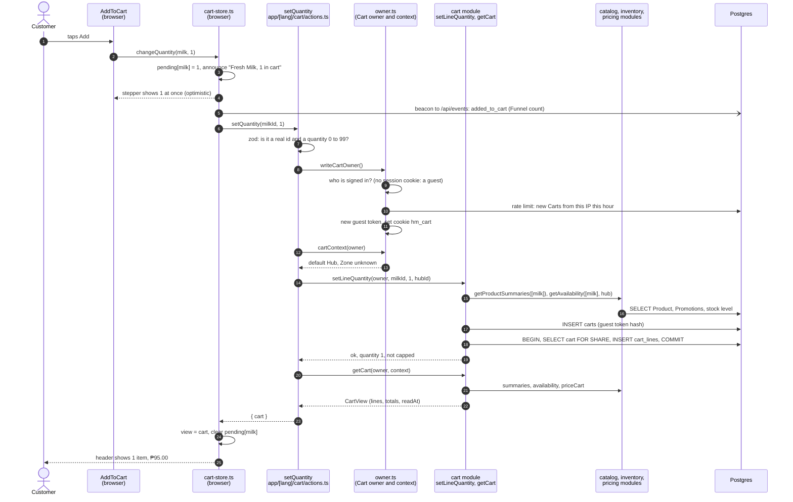

# 4. A request's journey: one tap on "Add"

This chapter follows one real tap from the Customer's thumb to the database and back, naming every file on the way. If you understand this chapter, you understand the shape of every other action in the app: a Client Component reacts at once, a Server Action checks who is asking and what they sent, a module applies the rules, Prisma talks to Postgres, and the server's answer replaces the browser's guess.

**The scene.** A visitor who has never been to Hoshimono opens the Home page on their phone. They are not signed in and have no Cart yet. They tap **Add** on a carton of Fresh Milk, 1 L, priced ₱95.00.

## 4.1 Before the tap: how the button got there

The Home page (`src/app/[lang]/page.tsx`) is a Server Component. It reads Products through the cached functions in `src/app/_data/storefront.ts` and draws each one with `ProductCard` (`src/components/product/product-card.tsx`), also a Server Component. Inside each card sits one Client Component: `AddToCart` (`src/components/product/add-to-cart.tsx`).

`AddToCart` is deliberately tiny. It arrives as plain HTML (a pill that says "Add") and carries almost no code. The real stepper, with its animation, is in a separate file, `live-add-to-cart.tsx`, that the phone downloads only on the first tap. A grid of 24 Products therefore ships 24 light buttons, not 24 animated steppers. This keeps the shop under its JavaScript budget (chapter 2).

Meanwhile the header's Cart button was filled in by `CartSlot` (`src/components/shell/cart-slot.tsx`), a Server Component that reads the visitor's Cart per request and hands it to the browser through `CartSync`. For our visitor it is empty.

All the Cart's Client Components share one small in-browser store, `src/components/cart/cart-store.ts`. A **store** is a single place in the browser's memory that several components read from, so the header, the drawer, the Cart page and every Add button always agree. It holds:

- `view`: the Cart as the server last described it (a `CartView`).
- `pending`: quantities the Customer has tapped but the server has not yet confirmed.
- `notice`: a short message to show under one Product, such as "Sorry, that just sold out."

## 4.2 The whole journey at a glance



The rest of the chapter walks through each step.

## 4.3 In the browser: show it at once

The tap runs `onClick` in `AddToCart`, which does two things:

1. `setWoke(true)`: tells React to load `LiveAddToCart` (the stepper) now.
2. `changeQuantity(productId, name, 1, lang)` from `cart-store.ts`.

`changeQuantity` is the most important function on the browser side. In order:

- **Count the Funnel step.** If this Product was at 0, it sends a tiny beacon (`navigator.sendBeacon("/api/events", "added_to_cart")`) through `sendStep` in `src/components/count-step.tsx`. The server adds 1 to today's `added_to_cart` count. Nothing about who tapped is sent ([ADR 0017](../adr/0017-filipino-pwa-and-funnel.md), chapter 9).
- **Number this tap.** A counter (`sequence`) gives every tap a number, and `latest[productId]` remembers the newest tap per Product. This matters if the Customer taps fast: only the newest tap's answer may settle the number.
- **Show the new quantity at once.** It sets `pending[productId] = 1`. Every component that reads this Product's quantity (`quantityIn`) now sees 1, so the Add pill turns into a stepper showing 1 before the server has done anything. This is an **optimistic update**: show what we expect, then correct it if the server disagrees (PRD CRT-2).
- **Tell screen readers.** `announce("Fresh Milk, 1 in cart")` writes into an invisible "live region" (`src/components/live-region.tsx`) that screen readers read aloud, so a blind Customer hears the result.
- **Ask the server.** `await setQuantity(productId, 1)`.

`setQuantity` looks like an ordinary function, but it is imported from `src/app/[lang]/cart/actions.ts`, a file that starts with `"use server"`. When the app is built, Next.js replaces the import in the browser with a small stand-in that sends a POST request to the current address, carrying a hidden id for `setQuantity` and its two arguments. On the server, Next.js finds the real function by that id and runs it. That is a **Server Action** (chapter 2).

## 4.4 On the server: the Server Action

`setQuantity` in `src/app/[lang]/cart/actions.ts` is short, and every line has a job:

```ts
export async function setQuantity(
  id: string,
  quantity: number
): Promise<CartResult> {
  const input = z
    .object({ id: productId, quantity: z.int().min(0).max(MAX_LINE_QUANTITY) })
    .safeParse({ id, quantity });
  if (!input.success) return { cart: await currentCart(), notice: "invalid" };
  const owner = await writeCartOwner();
  if (!owner) return { cart: await currentCart(), notice: "busy" };
  const context = await cartContext(owner);
  const result = await setLineQuantity(
    owner,
    input.data.id,
    input.data.quantity,
    context.hubId
  );
  const cart = await getCart(owner, context);
  if (!result.ok) {
    return {
      cart,
      notice: result.reason === "out_of_stock" ? "sold_out" : "not_sold",
    };
  }
  return result.capped ? { cart, notice: "capped" } : { cart };
}
```

**1. Check the input.** Anyone can send anything to a Server Action, not just our button. The zod check makes sure the id looks like a real id (a GUID, the 36-character format of every id in the database) and the quantity is a whole number from 0 to 99 (`MAX_LINE_QUANTITY` in `src/lib/cart-limits.ts`). Bad input gets the Cart back unchanged with the notice `"invalid"`.

**2. Find out whose Cart this is.** `writeCartOwner()` in `src/app/[lang]/cart/owner.ts`:

- It first calls `readCartOwner()`, which asks the `identity` module who is signed in (`currentCustomer()`). Better Auth reads the session **cookie** (a small value the browser keeps for our site and sends with every request) and finds nobody.
- It then looks for the guest Cart cookie, `hm_cart`. Our visitor has none.
- Before starting a new Guest Cart, it checks a **rate limit**: at most 60 new Carts per IP address per hour (`takeToken("cart:new:ip:<ip>", 60, 3600)` in `src/lib/rate-limit.ts`). This stops a script from filling the database with empty Carts. The limit is generous because many Filipino phones on mobile data share one carrier IP address. Over the limit, the action answers with the notice `"busy"`.
- It makes a new guest token with `newGuestToken()` (`src/modules/cart/internal/cart.ts`): 32 random bytes, written as 43 letters and digits. That is 256 bits: nobody can guess it.
- It sets the cookie: `httpOnly` (the page's own scripts cannot read it, so a malicious script cannot steal it), `sameSite: "lax"` (other sites cannot make the browser send it in a hidden form), `secure` in production (sent only over HTTPS), and kept for 30 days (`CART_RETENTION_DAYS`).

For a signed-in Customer, the owner is `{ customerId }` instead, and if a guest cookie is still around from before sign-in, `readCartOwner` merges that Guest Cart into the Customer's Cart first (chapter 6).

**3. Find the Hub and Zone.** `cartContext(owner)` decides which Hub's stock and which Zone's fees apply. For a signed-in Customer it uses the Zone of their default Address. A guest has no Address, so it uses the default Hub (`delivery.getDefaultHubId()`) and an unknown Zone: the Cart will say delivery is worked out at Checkout.

**4. Ask the cart module to set the line.** `setLineQuantity(owner, milkId, 1, hubId)`.

**5. Read the whole Cart back,** priced, with `getCart`, and return it. Every Cart action returns the whole Cart as the server now sees it, so the browser can replace its guess with the truth.

## 4.5 In the cart module: the rules

`setLineQuantity` in `src/modules/cart/internal/cart.ts` applies the business rules:

**Is the Product still sold?** It calls `getProductSummaries([productId])` from the `catalog` module. That reads the Product (only if its status is `active`), and applies any running Promotion through `pricing.promotedPrice`. If the Product is gone, the answer is `{ ok: false, reason: "not_found" }`.

**How many are free?** It calls `getAvailability([productId], hubId)` from the `inventory` module, which reads the `stock_levels` row and returns `on_hand - reserved`. The quantity is capped at the smaller of 99 and what is free. If nothing is free, the answer is `{ ok: false, reason: "out_of_stock" }`. If the Customer asked for more than is free, the line is set to what is free and the answer says `capped: true`.

**Make sure there is a Cart.** `ensureCartId(owner)` looks for this owner's open Cart. There is none, so it inserts one:

```sql
INSERT INTO carts (id, guest_token_hash, updated_at)
VALUES ($1::uuid, $2, now())
ON CONFLICT DO NOTHING
```

The database never stores the token itself, only its **SHA-256 hash**: a one-way fingerprint. Given the token, anyone can compute the hash; given the hash, nobody can work back to the token. So even if the database leaked, nobody could use it to open a Guest Cart ([03-ARCHITECTURE.md](../03-ARCHITECTURE.md) section 5). `ON CONFLICT DO NOTHING` handles two first taps arriving at the same moment: the unique index on `guest_token_hash` lets only one insert win, the other quietly does nothing, and both then read the same Cart.

**Write the line, safely.** This is the subtle part:

```sql
BEGIN;
SELECT id FROM carts
WHERE id = $cartId AND checked_out_at IS NULL
FOR SHARE;

INSERT INTO cart_lines (id, cart_id, product_id, quantity, seen_price_cents, updated_at)
VALUES ($1, $cartId, $milkId, 1, 9500, now())
ON CONFLICT (cart_id, product_id) DO UPDATE
  SET quantity = EXCLUDED.quantity,
      seen_price_cents = EXCLUDED.seen_price_cents,
      updated_at = now();
COMMIT;
```

- `FOR SHARE` takes a **shared lock** on the Cart row for the length of this short transaction. Checkout closes a Cart with an exclusive lock. The two cannot overlap: a line either lands before Checkout reads the Cart, or Checkout has already closed it and the loop tries again with a new Cart. A line can never slip into a Cart that has already become an Order (chapter 6).
- `ON CONFLICT (cart_id, product_id) DO UPDATE` means "insert the line, or if this Product is already in this Cart, update its quantity". Setting a quantity is therefore the same whether it is the first tap or the fifth.
- `seen_price_cents` remembers the price the Customer saw when they last set the line. If the price changes later, the Cart can say "was ₱95.00" (PRD CRT-5).
- After the transaction it bumps `carts.updated_at`, which the Cart Reminder uses to know when the Cart was last touched (chapter 9).

## 4.6 Pricing the Cart and answering

`getCart(owner, context)` reads the Cart with its lines, then in parallel asks `catalog` for each Product's current summary and `inventory` for its stock state. It builds one `CartLineView` per line: the Product, the quantity, the Substitution Preference (default "pick a similar item", `allow`), the stock state, whether the price changed since it was set, and whether the Hub has fewer free than the line asks for.

Then it calls `pricing.priceCart` with the lines that are in stock. `priceCart` is pure arithmetic (chapter 5): for our one carton it returns a subtotal of 9500 centavos, no discount, no delivery fee yet (the Zone is unknown, so `deliveryFeeCents` is `null`), the VAT inside the price, and a total of 9500.

The `CartView` also carries two fields that protect the browser from confusion:

- `readAt`: the server's clock when the Cart was read, in milliseconds. Answers can reach the browser out of order (an action's answer, then a page refresh that was rendered earlier), so the browser keeps only the newest.
- `version`: every line as `"product:quantity"`, sorted. Checkout compares it inside the Order transaction to catch a change made in another tab (chapter 6).

## 4.7 Back in the browser: settle the truth

When `setQuantity` answers, `changeQuantity` decides what to keep:

- If a newer tap on the same Product happened meanwhile, that tap keeps its own optimistic number; this older answer must not overwrite it.
- If this answer's `readAt` is older than the view the store already has, the store keeps its newer view.
- Otherwise the store takes the server's Cart as the truth and clears `pending` for this Product.
- If the answer carries a notice (`sold_out`, `not_sold`, `capped`, `busy`, `invalid`), it is shown under the Product for 5 seconds in the page's language, from `MESSAGES[lang].cart.notices` (for example "That is all we have for now."), and announced to screen readers.
- If the request failed entirely (no connection, a server error), the `catch` clears the pending number, so the stepper falls back to what the server last said, and shows "We couldn't update your cart. Please try again."

The header's Cart button reads the same store and now shows 1 item and ₱95.00. It shows goods only (subtotal minus any Voucher), never the delivery fee, because the fee depends on the Address chosen at Checkout, and the header and Checkout must never disagree.

## 4.8 What changed in the database

After one tap, four tables have new or changed rows:

| Table           | Row                                                                                      |
| --------------- | ---------------------------------------------------------------------------------------- |
| `rate_limits`   | `cart:new:ip:<ip>` with `count = 1` and a `reset_at` one hour ahead                      |
| `carts`         | A new Cart with `guest_token_hash` set, no `customer_id`, `checked_out_at` empty         |
| `cart_lines`    | Fresh Milk, `quantity = 1`, `seen_price_cents = 9500`, `substitution_preference = allow` |
| `funnel_counts` | Today's `added_to_cart` count up by one                                                  |

Nothing about stock changed. A Cart is not a commitment: stock is only reserved when the Cart becomes an Order (chapter 6). That is why two Customers can both have the last carton in their Carts; only one will be able to check it out.

## 4.9 What can go wrong, and what happens

| Situation                                                  | What the Customer sees                                                                     | Where it is handled                         |
| ---------------------------------------------------------- | ------------------------------------------------------------------------------------------ | ------------------------------------------- |
| Someone else bought the last carton after the page loaded  | The stepper goes back to Add; "Sorry, that just sold out."                                 | `setLineQuantity` returns `out_of_stock`    |
| They tap + to 12 but the Hub has 8 free                    | The stepper settles on 8; "That is all we have for now."                                   | `setLineQuantity` caps, returns `capped`    |
| The Merchandiser archived the Product a minute ago         | "Sorry, that item is no longer sold."                                                      | `getProductSummaries` finds nothing         |
| They tap + five times quickly                              | The number climbs at once; only the last answer settles it                                 | `sequence` and `latest` in `cart-store.ts`  |
| A script tries to create thousands of Carts                | After 60 in an hour from one IP: "Too many new carts from your network."                   | `writeCartOwner` rate limit                 |
| The phone loses its connection mid-request                 | The stepper falls back; "We couldn't update your cart. Please try again."                  | the `catch` in `changeQuantity`             |
| Someone sends `quantity: -5` or `quantity: 10000` directly | Nothing changes                                                                            | the zod check in `setQuantity`              |
| The database is down                                       | The action throws; the browser shows the failure notice; the error is logged on the server | thrown error, caught at the edge (ADR 0009) |

## 4.10 The same shape everywhere

Every Customer or Staff action in the app follows this pattern. Compare `placeOrderAction` (chapter 6), `recordPickAction` (chapter 8) or `deliveredAction` (chapter 8):

1. A Client Component reacts at once, or a plain HTML form submits.
2. A Server Action checks **who** (`requireCustomer`, `requireStaff(area)`, or the Cart owner) and **what** (zod or simple checks).
3. It calls one or two module functions through their `index.ts`.
4. The module applies the rules, using locks or guarded SQL where two people could collide.
5. The action returns a result shape from ADR 0009, or redirects.
6. The page words the result in the right language.

## Where to look in the code

| Step                            | File                                                               |
| ------------------------------- | ------------------------------------------------------------------ |
| The Add button                  | `src/components/product/add-to-cart.tsx`                           |
| The stepper loaded on first tap | `src/components/product/live-add-to-cart.tsx`                      |
| The browser's Cart store        | `src/components/cart/cart-store.ts`                                |
| The Server Action               | `src/app/[lang]/cart/actions.ts` (`setQuantity`)                   |
| Cart owner and context          | `src/app/[lang]/cart/owner.ts`                                     |
| The rules and SQL               | `src/modules/cart/internal/cart.ts` (`setLineQuantity`, `getCart`) |
| Stock available                 | `src/modules/inventory/internal/stock-states.ts`                   |
| Product with Promotion          | `src/modules/catalog/internal/products.ts`                         |
| The total                       | `src/modules/pricing/internal/price-cart.ts`                       |
| The rate limit                  | `src/lib/rate-limit.ts`                                            |
| The Funnel beacon               | `src/components/count-step.tsx`, `src/app/api/events/route.ts`     |

## Check yourself

<details>
<summary>Why does the stepper show 1 before the server answers, and what happens if the server then says "sold out"?</summary>

It is an optimistic update: `changeQuantity` puts 1 in `pending` at once. When the server answers with `notice: "sold_out"` and a Cart without the line, the store takes the server's Cart, clears `pending`, and shows the notice. The stepper goes back to Add.
</details>

<details>
<summary>The database stores only a hash of the guest token. How does the server find the Cart when the cookie comes back?</summary>

It hashes the token from the cookie with SHA-256 and looks for a Cart whose `guest_token_hash` equals that hash (`ownerWhere` in `cart.ts`).
</details>

<details>
<summary>Does adding milk to the Cart reserve a carton at the Hub?</summary>

No. Stock is reserved only inside `placeOrder` at Checkout. A Cart is not a commitment.
</details>
