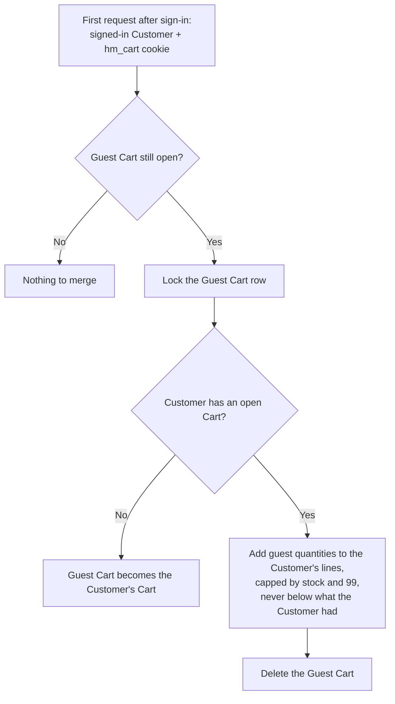
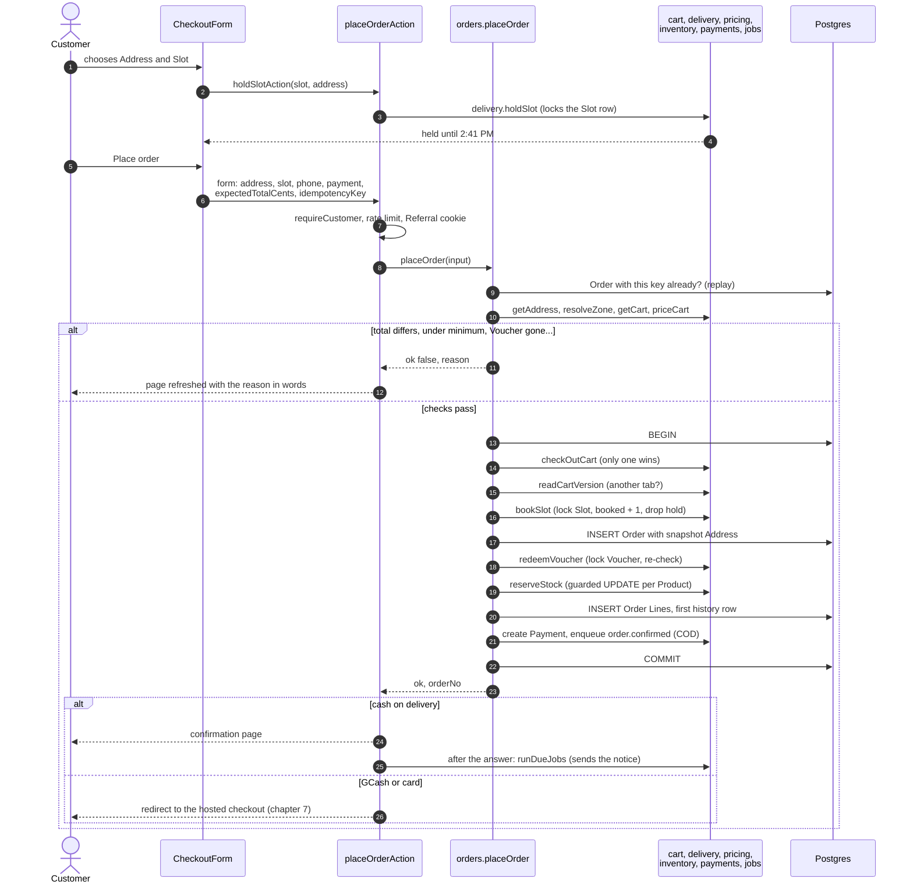

# 6. Cart and Checkout

This chapter covers the journey from a filled Cart to a placed Order: how Carts are kept for guests and Customers, how they merge at sign-in, how a Slot is held, and what `placeOrder` does in its one critical transaction. It ends with the concurrency guarantees: why two shoppers can never both get the last carton or the last Slot place, and why a double-click never places two Orders.

Words used here: [Cart, Cart Line, Guest Cart, Checkout, Order, Slot Hold, Substitution Preference, Picker Note](../../GLOSSARY.md#buying).

## 6.1 The Cart as data

A Cart is one row in `carts` with its lines in `cart_lines` (`prisma/schema.prisma`). The important columns:

| Column                               | Meaning                                                                                  |
| ------------------------------------ | ---------------------------------------------------------------------------------------- |
| `carts.customer_id`                  | Set for a signed-in Customer's Cart                                                      |
| `carts.guest_token_hash`             | Set for a Guest Cart: the SHA-256 hash of the cookie's token, never the token itself     |
| `carts.checked_out_at`               | Empty while the Cart is open; set the moment it becomes an Order                         |
| `carts.voucher_code`                 | The Voucher the Customer added, re-checked every time the Cart is priced                 |
| `carts.reminded_at`                  | Set when its one Cart Reminder was queued (chapter 9)                                    |
| `cart_lines.quantity`                | 1 to 99                                                                                  |
| `cart_lines.seen_price_cents`        | The price when the line was last set, so a price change can be flagged                   |
| `cart_lines.substitution_preference` | `allow` ("pick a similar item", the default), `preferred` ("I'll choose"), or `none`     |
| `cart_lines.preferred_product_id`    | The Product the Customer chose, for `preferred`                                          |
| `cart_lines.note`                    | The Picker Note, up to 200 characters (the Cart offers it on weighed lines: "lean cuts") |

**One open Cart per owner.** A Customer has at most one Cart with `checked_out_at` empty (invariant 9 in [04-DATA-MODEL.md](../04-DATA-MODEL.md)), enforced by a unique index in the database, not just by code. A Product appears at most once per Cart (unique `cart_id, product_id`).

**What the Cart shows** comes from `getCart` in `src/modules/cart/internal/cart.ts` (chapter 4): each line with its stock state, a "was ₱X" flag when the price changed since it was set, a flag when the Hub has fewer free than the line asks for, and the totals from `priceCart`. A line whose Product sold out stays visible, marked, but is left out of the total and will be left out of the Order. A line whose Product is no longer sold is hidden and counted in `unavailableCount`.

**Housekeeping.** The cron tick deletes Guest Carts idle for 30 days and Carts checked out more than 30 days ago (`purgeIdleCarts`). A Customer's open Cart is never deleted.

## 6.2 Guest Carts and the merge at sign-in

A visitor can fill a Cart without an account (PRD CRT-1). Chapter 4 showed how the first tap creates a Guest Cart and sets the `hm_cart` cookie. Signing in is needed only at Checkout.

When a guest signs in, their Guest Cart must join their account. This happens on the **first request after sign-in**: `readCartOwner` in `src/app/[lang]/cart/owner.ts` sees both a signed-in Customer and a guest cookie, checks cheaply that the Guest Cart still exists (`hasGuestCart`), and calls `cart.mergeGuestCart(token, customerId, hubId)`.

`mergeGuestCart` runs in one transaction:

1. **Lock the Guest Cart row** (`SELECT ... FOR UPDATE`). If two requests arrive at once right after sign-in (the header and the page both ask), the second waits, then finds the Guest Cart already gone, and does nothing. The merge happens exactly once.
2. **If the Customer has no open Cart**, the Guest Cart simply becomes theirs: `customer_id` is set and the token hash cleared.
3. **Otherwise each guest line is folded in**: quantities are added, capped by what the Hub has free and by 99, and never lowered below what the Customer already had. The Customer's own line settings (Substitution Preference, note) win. A guest line for a Product with nothing free is kept, so it shows as out of stock instead of vanishing.
4. **The Guest Cart is deleted.**

The cookie lingers until a Server Action clears it (pages cannot change cookies); `writeCartOwner` deletes it on the next Cart action.



## 6.3 Checkout, step by step

Checkout (`/checkout`, `src/app/[lang]/checkout/page.tsx`) collects on one page (PRD CHK-1): the Address, the Slot, a contact number, notes for the Rider, and the payment method. The page:

1. Requires a signed-in Customer (`requireCustomer("/checkout")`, which redirects to sign-in and back).
2. Lists their Addresses. With none, it shows the Address form beside a summary of the Cart. A new Address is resolved to a Zone when saved (`customers.saveAddress`, up to 10 per Customer).
3. Resolves the chosen Address to a Zone (`delivery.resolveZone`). The Zone decides the Hub (whose stock and Slots apply) and the fees.
4. Prices the Cart for that Zone (`getCart` with the Zone's fees), so the Delivery Fee and Order Minimum are now known.
5. Lists the Hub's Slots for the next 7 days, after the 90-minute cutoff, each marked open, few or full, and whether this Cart holds it (`delivery.listSlots`).
6. Draws the `CheckoutForm` Client Component with two hidden values that matter later:
   - `idempotencyKey`: a fresh random id (`randomUUID()`) each time the page loads.
   - `expectedTotalCents`: the total the Customer is looking at.
7. Counts the `checkout_started` Funnel step.

### Holding a Slot

When the Customer taps a Slot, the form calls `holdSlotAction` (`src/app/[lang]/checkout/actions.ts`), which calls `delivery.holdSlot(cartId, slotId, { hubId })` (`src/modules/delivery/internal/slots.ts`):

1. In a transaction, **lock the Slot row** with `SELECT ... FOR UPDATE`, but only if it belongs to the Address's Hub and starts within 7 days. A Slot of another Hub is "not found".
2. Count the **live holds of other Carts** on this Slot.
3. Places free = `capacity - booked - other carts' live holds`. This Cart's own hold counts as its place.
4. Refuse if the Slot starts within 90 minutes (`closed`) or nothing is free (`full`).
5. Otherwise insert or move this Cart's hold: one row per Cart in `slot_holds`, so choosing another Slot moves the hold. It expires in 10 minutes.

The form shows "Held for you until 2:41 PM". Because the Slot row is locked while counting, two Carts reaching for the last place at the same instant are served one after the other, and only one gets it. Expired holds stop counting at once (every count filters on `expires_at > now`) and are deleted by the cron tick each minute.

## 6.4 Placing the Order: `placeOrderAction`

Tapping "Place order" submits the form to `placeOrderAction` in `src/app/[lang]/checkout/actions.ts`:

1. `requireCustomer("/checkout")`.
2. Read the page's language from the form (Server Actions cannot read it themselves, chapter 9).
3. Choose the payment method. For GCash or card, check that a payment provider is configured (`paymentProvider()`); if not, say online payment is off.
4. **Rate limit**: at most 10 Order attempts per Customer and 20 per IP address per hour (`takeOrderAttempt` in `order-limits.ts`), because cash Orders reserve stock without payment.
5. **Referral**: if a friend's Referral link was opened before this first Order, link the Customer to them now (`customers.applyReferral`) and clear the cookie (chapter 9).
6. Call `orders.placeOrder(...)` with the Customer, the Address, the Slot, the phone, the Rider notes, the payment method, the expected total and the idempotency key.
7. **On success**: tell the shop's cache that stock changed (`updateTag("stock")`), count `order_placed` in the Funnel after answering, and then either
   - for GCash or card, send the Customer to the hosted checkout (chapter 7), or
   - for cash on delivery, start the job runner after answering so the confirmation goes out at once (`after(() => runDueJobs(...))`), and redirect to `/checkout/confirmed/[orderNo]`.
8. **On a refusal**: re-read the page (`refresh()`), so the Cart, Slots and total show as they are now, and show the reason in words, keeping what the Customer typed.

## 6.5 `placeOrder`: the critical transaction

`placeOrder` in `src/modules/orders/internal/place-order.ts` turns the Cart into an Order. It trusts nothing from the browser except the choices (which Address, which Slot, which payment method). It runs in two parts.

### Part 1: checks before the transaction

These read only, so they are cheap and safe to repeat:

1. **Shape**: zod checks every field (ids, a key of 16 to 100 characters, a non-negative whole total).
2. **Phone**: normalised to `+639XXXXXXXXX`, or refused as `invalid_phone`.
3. **Replay**: is there already an Order with this idempotency key? If it is this Customer's, return that Order (`replayed: true`). If someone else's, refuse as `invalid`. This is how a double-click or a resubmitted form gets the same Order back.
4. **Address**: it must be this Customer's (`getAddress(customerId, addressId)`), and a Zone must serve it.
5. **Cart**: load and price it for this Zone (`getCart`). Refuse an empty Cart, a Cart where nothing is in stock, a Cart under the Order Minimum (with how much more is needed), a cash Order over ₱20,000, and a Voucher that stopped applying.
6. **Total**: if the server's total differs from `expectedTotalCents`, refuse as `total_changed` with the new total (chapter 5).

### Part 2: one transaction

Everything below happens in one database transaction. Any refusal **throws**, which rolls back every change made so far, and is then turned back into a normal result (the `Refused` class, chapter 3).

1. **Close the Cart.** `cart.checkOutCart(tx, cartId, now)` runs `UPDATE carts SET checked_out_at = now WHERE id = ... AND checked_out_at IS NULL`. Only one transaction can make that change; a second one finds nothing to update and is refused as `already_placed`. This also locks the Cart row until the transaction ends.
2. **Re-check the Cart's version.** Now that the Cart is locked, read its lines again (`readCartVersion`). If they differ from what was priced in Part 1 (the Customer changed something in another tab), refuse as `cart_changed`.
3. **Cash limit on open Orders.** For a cash Order, count the Customer's Orders that are still open; 3 or more is refused as `too_many_open_orders`.
4. **Book the Slot.** `delivery.bookSlot(tx, ...)` locks the Slot row, recounts, and if a place is free, adds 1 to `booked` and deletes this Cart's hold. A Cart that holds a place may book until the Slot starts; one without a hold faces the 90-minute cutoff and must find a place not held by others. Refused as `slot_unavailable`.
5. **Create the Order** with a new Order Number (`SW-YYMMDD-XXXX`: the Manila date and four characters without 0, O, 1 or I, so it reads well over the phone). A cash Order starts as `confirmed` with payment status `cod_pending`; an online one as `pending_payment` with `unpaid`. The Address is copied into `address_snapshot`, so editing the Address later never changes where this Order goes.
6. **Record the Voucher's use**, if one applied: `pricing.redeemVoucher` locks the Voucher row, checks every rule again (leaving out this Order), and writes a `voucher_redemptions` row. If the last use was taken a moment ago, refused as `voucher_unavailable`.
7. **Reserve stock.** `inventory.reserveStock(tx, ...)` (section 6.6). If any line is short, it throws `OutOfStockError` with the Products that ran out; the Customer is told which.
8. **Write the Order Lines** with snapshots: the name, unit price, Tax Class, VAT, quantity, estimated weight for weighed Products, the Substitution Preference, the chosen alternative and the Picker Note. Out-of-stock Cart Lines are left out, as the Cart already showed.
9. **Write the first history row** (`order_status_events`): from nothing to `confirmed` or `pending_payment`, by the Customer.
10. **Create the Payment** (`payments.createCodPayment` or `createOnlinePayment`).
11. **For cash on delivery, queue the confirmation job** (`jobs.enqueueJob(tx, "order.confirmed", ...)`) in the same transaction, so a placed Order always gets its notice. An online Order's confirmation is queued later, when PayMongo says it is paid.

Then the transaction commits, and all of it becomes real at once.

### Retries

The transaction is wrapped in a loop that tries up to 3 times:

- If it failed, first look again for an Order with this idempotency key. A twin request (a double-click) may have won; answer with its Order.
- Two Orders drawing the same Order Number (a unique violation), or Postgres breaking a **deadlock** (two transactions each waiting for the other) or a write conflict, are safe to retry: nothing was saved.
- Anything else is a real error and is thrown.

The transaction may wait up to 5 seconds to start and run up to 15 seconds.



## 6.6 Reserving stock without overselling

Stock is kept per Product per Hub in `stock_levels`: `on_hand` (on the shelf) and `reserved` (promised to placed Orders not yet picked). What is free is `on_hand - reserved`.

`reserveStock` in `src/modules/inventory/internal/reserve.ts` reserves each line with **one guarded update**:

```sql
UPDATE stock_levels
SET reserved = reserved + $quantity, updated_at = now()
WHERE product_id = $product AND hub_id = $hub
  AND on_hand - reserved >= $quantity
```

The `WHERE` clause is the guard. The database checks "is enough still free?" and makes the change **in the same step**, with the row locked while it does so. If two Orders try to take the last carton at the same instant, one update goes first and succeeds; the second then sees `on_hand - reserved` is 0, matches no row, and changes nothing (`updated === 0`). The code collects every short line, and if any, throws `OutOfStockError` listing them, which rolls back the whole Order.

Why not read the stock, check it in code, then write? Because between the read and the write, another Checkout could do the same read. Both would see "1 free" and both would write. A guarded update leaves no gap ([ADR 0004](../adr/0004-postgres-prisma.md)).

Two more details:

- **Same order every time.** Lines are reserved sorted by Product id. If Order A wanted milk then eggs and Order B eggs then milk, each could lock one row and wait forever for the other (a deadlock). Sorting means both lock milk first, so one simply waits for the other.
- **A database check behind the code.** `stock_levels` has a check constraint: neither `on_hand` nor `reserved` below zero. Releasing more than was reserved breaks it and fails loudly, instead of being quietly clamped to zero. Until 29 October it also refused `reserved` above `on_hand`; [ADR 0022](../adr/0022-staff-tools-for-the-last-runbook-gaps.md) dropped that part so a physical count can record what is really on the shelf, even below what Orders reserved (those Orders come up short at the pick). Checkout still cannot oversell: the guarded update above reserves only what is free, and free is never below zero.

Every reservation is logged in `stock_movements` (reason `reserve`, the Order's id, the quantity).

## 6.7 The concurrency guarantees

**Concurrency** means several things happening at the same time: two Customers checking out, one Customer double-clicking, a Picker and the cron tick touching the same Order. Each risk has exactly one guard:

| Risk                                                  | Guard                                                                                                       | Where                                     |
| ----------------------------------------------------- | ----------------------------------------------------------------------------------------------------------- | ----------------------------------------- |
| A double-click or resubmitted form places two Orders  | One idempotency key per page load; unique `orders.idempotency_key`; the replay answers with the first Order | `place-order.ts` (`replay`), the database |
| Two tabs check out the same Cart                      | `checkOutCart` only succeeds while `checked_out_at` is empty                                                | `cart.ts` (`checkOutCart`)                |
| A line added in another tab after the Cart was priced | The Cart version is re-read under the lock; a difference is `cart_changed`                                  | `cart.ts` (`readCartVersion`)             |
| A line saved into a Cart that just became an Order    | Line writes take a share lock on the open Cart; Checkout's close waits for them, and vice versa             | `cart.ts` (`setLineQuantity`)             |
| Two Orders take the last unit                         | Guarded `UPDATE ... WHERE on_hand - reserved >= qty`, with the row locked                                   | `reserve.ts`                              |
| Two Orders deadlock on shared Products                | Products locked in sorted order; a deadlock that still happens is retried                                   | `reserve.ts`, `place-order.ts`            |
| Two Carts take the last Slot place                    | The Slot row is locked while counting; `booked <= capacity` is a database check                             | `slots.ts`, the database                  |
| Two Orders take a Voucher's last use                  | The Voucher row is locked and every rule re-checked inside the Order transaction                            | `vouchers.ts` (`redeemVoucher`)           |
| A cancel and a Checkout deadlock                      | Both lock in the same order: Cart, Slot, stock                                                              | `status.ts` comments                      |
| Two first taps create two Carts                       | Unique indexes plus `INSERT ... ON CONFLICT DO NOTHING`                                                     | `cart.ts` (`ensureCartId`)                |
| A guest Cart merged twice                             | The Guest Cart row is locked first                                                                          | `cart.ts` (`mergeGuestCart`)              |

These are not just claims. The database tests run real races against a real Postgres: "two buyers at once sell the last unit once", "take the last Slot place once", "places one Order for a double-click", "places one Order when two tabs check out the same Cart", "gives the last place to exactly one of many carts at once" (`tests/db/orders.test.ts`, `tests/db/delivery.test.ts`; chapter 12).

## 6.8 After the Order is placed

- **The confirmation page** (`/checkout/confirmed/[orderNo]`) shows the Order Number, the Slot and the total, and says "about" when weighed Products make it an estimate.
- **The confirmation message** goes out by email and SMS through the `order.confirmed` job (chapter 10).
- **The Order page** (`/orders/[orderNo]`, signed in) shows the status timeline, the lines, the totals, and later the Rider and Delivery PIN, refunds and Freshness Claims. It does not refresh by itself; the Customer reloads it.
- **Cancel before Picking.** While the Order is `confirmed`, the Customer may cancel free of charge (PRD ACC-5). `cancelOrderAction` calls `orders.cancelOrder`, which only moves `confirmed` to `cancelled`; once a Picker starts, it is too late. Cancelling gives back the Slot place and the reserved stock, voids a cash Payment, or refunds an online one in full (chapter 7). An Order still waiting for online payment is cancelled through `abandonPayment` instead, which first closes the hosted checkout.

## Where to look in the code

| Topic                             | File                                                                          |
| --------------------------------- | ----------------------------------------------------------------------------- |
| Cart rules, merge, checkout close | `src/modules/cart/internal/cart.ts`                                           |
| Cart owner and the guest cookie   | `src/app/[lang]/cart/owner.ts`                                                |
| Checkout page                     | `src/app/[lang]/checkout/page.tsx`                                            |
| Checkout form                     | `src/components/checkout/checkout-form.tsx`                                   |
| Checkout actions                  | `src/app/[lang]/checkout/actions.ts`, `order-limits.ts`                       |
| `placeOrder`                      | `src/modules/orders/internal/place-order.ts`                                  |
| Slots, holds and booking          | `src/modules/delivery/internal/slots.ts`                                      |
| Stock reservation                 | `src/modules/inventory/internal/reserve.ts`                                   |
| The race tests                    | `tests/db/orders.test.ts` ("two buyers at once"), `tests/db/delivery.test.ts` |

## Check yourself

<details>
<summary>A Customer double-clicks "Place order". Walk through why only one Order is created.</summary>

Both requests carry the same idempotency key from the same page load. If the first has already committed, the second's replay check finds it and returns it. If both run at once, both pass the pre-checks, but only one transaction can close the Cart; the other is refused or hits the unique key, and its catch block looks up the key again and answers with the winner's Order.
</details>

<details>
<summary>A Slot has capacity 20, 18 booked, and two other Carts hold places. A third Cart tries to hold it. What happens?</summary>

Free places are 20 − 18 − 2 = 0, so `holdSlot` answers `full`. If one of the holds expires (10 minutes), it stops counting at once and a place frees up.
</details>

<details>
<summary>Why does <code>placeOrder</code> check the total before the transaction, when it could check inside?</summary>

The checks before the transaction only read, so they are cheap and hold no locks. Refusing early (wrong total, under the minimum) never makes other Checkouts wait. Inside the transaction it re-checks only what could change in the meantime and must be decided under lock: the Cart's version, the Slot, the Voucher's last use and the stock.
</details>
