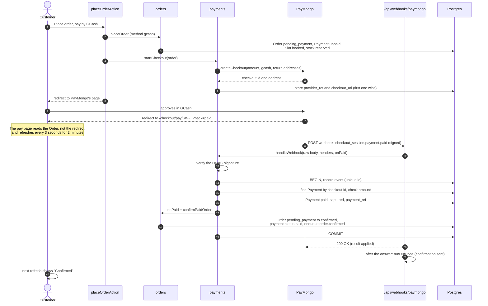
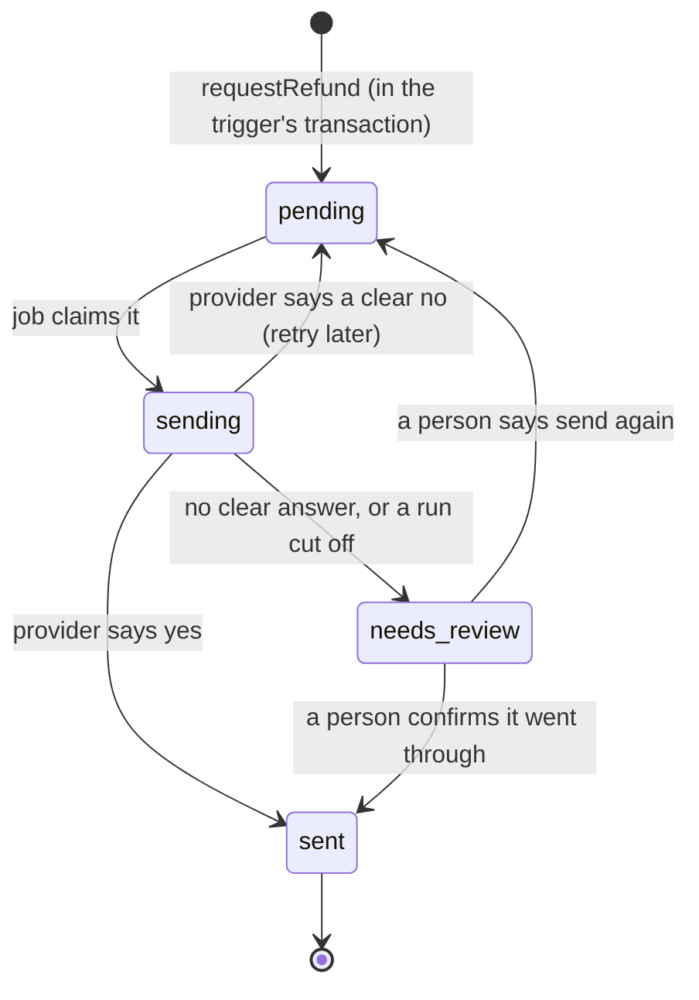
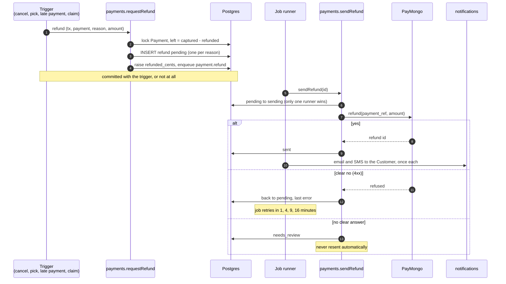

# 7. Payments and refunds

"Checkout and payment webhooks must never double-charge or lose an Order" (PRD section 7). This chapter shows how Hoshimono takes cash on delivery and online payments through PayMongo, how it learns that a payment went through, what happens when it does not, and how money goes back, exactly once.

Words used here: [Payment, Payment Event, Refund, Final Total, Payment Window, Cash Handover](../../GLOSSARY.md#buying). Decisions: [ADR 0003](../adr/0003-payment-provider-interface.md) (the provider interface and PayMongo) and [ADR 0008](../adr/0008-weighed-items-online-and-refunds.md) (weighed items and refunds).

## 7.1 The Payment record

Every Order has one row in `payments` (owned by the `payments` module):

| Column           | Meaning                                                                                      |
| ---------------- | -------------------------------------------------------------------------------------------- |
| `method`         | `cod`, `gcash` or `card`                                                                     |
| `provider`       | Empty for cash; otherwise the provider's name (`paymongo`, or `fake` in development)         |
| `amount_cents`   | What the Order asked for at Checkout                                                         |
| `provider_ref`   | The hosted checkout's id at the provider                                                     |
| `checkout_url`   | The address of that hosted checkout, reused if the Customer comes back                       |
| `payment_ref`    | The provider's id for the completed payment; refunds name it                                 |
| `captured_cents` | Money actually received (online), or cash the Rider recorded (COD)                           |
| `refunded_cents` | Money sent back so far; a database check keeps it within `captured_cents`                    |
| `collected_note` | Why the cash taken differs from the Final Total                                              |
| `status`         | `cod_pending`, `cod_collected`, `unpaid`, `paid`, `partially_refunded`, `refunded`, `failed` |

The Order has its own `payment_status` too, kept in step with the Payment, so lists of Orders can show it without a join. Order status and payment status are separate: an Order can be `picked` and `partially_refunded` at once.

(The schema also has a payment status `authorised` and an Order column `authorised_cents`, and the provider interface has a `capture` function. They were meant for card holds on weighed items. [ADR 0008](../adr/0008-weighed-items-online-and-refunds.md) decided against card holds, so nothing uses them.)

## 7.2 Cash on delivery

Cash on delivery (COD) needs no provider:

1. `placeOrder` creates the Payment as `cod_pending` and the Order as `confirmed` at once (chapter 6).
2. If the Order is cancelled, `voidCodPayment` sets the Payment to `unpaid`, so the Rider's cash count does not expect it.
3. After Picking, the Final Total is what the Rider must collect (chapter 5).
4. At the door, the Rider records the cash taken; `recordCodCollected` sets the Payment to `cod_collected` with `captured_cents` and, if the amount differs, a note. This happens in the same transaction that marks the Order delivered (chapter 8).
5. At day's end, the Dispatcher counts the Rider's cash: a Cash Handover (chapter 8).

Because COD Orders hold stock and a Slot place with no money paid, they are limited: at most 3 open Orders per Customer when placing a COD Order, and at most ₱20,000 per COD Order (`MAX_OPEN_COD_ORDERS`, `MAX_COD_TOTAL_CENTS` in `src/modules/orders/internal/place-order.ts`).

## 7.3 The provider interface and PayMongo

Business code never talks to PayMongo directly. It talks to an **interface**: a list of functions any payment provider must offer (`src/modules/payments/internal/provider.ts`):

| Function                           | What it does                                                                                          |
| ---------------------------------- | ----------------------------------------------------------------------------------------------------- |
| `createCheckout(request)`          | Open a hosted checkout for an amount; returns its id and the address to send the Customer to          |
| `expireCheckout(ref)`              | Close a hosted checkout so it can no longer take money; `"refused"` if it is paid or still processing |
| `refund(paymentRef, amount, note)` | Send money back; `ok: false` for a clear no (safe to try later); throws when the outcome is unknown   |
| `verifyWebhook(rawBody, headers)`  | True only for a message the provider really signed for this account and mode                          |
| `parseEvent(rawBody)`              | Reduce a provider message to what the ledger needs: event id, kind (`paid` or other), refs, amount    |
| `capture(ref, amount)`             | For card holds; unused since ADR 0008                                                                 |

Two implementations exist:

- **PayMongo** (`src/modules/payments/internal/paymongo.ts`), chosen on 19 October 2026 for lower fees, signed webhooks and partial refunds on GCash and cards ([ADR 0003](../adr/0003-payment-provider-interface.md)). It has been tested against a fake web layer, but never against PayMongo itself, because the account keys do not exist yet (chapter 14).
- **The stand-in** (`src/modules/payments/internal/fake.ts`), used in development and the end-to-end tests. Its "hosted checkout" is the local page `/dev/pay/[ref]`, whose Pay button sends a signed webhook to our own server, exactly as PayMongo would. It is refused anywhere but development and the local test build (chapter 11).

`paymentProvider()` in `src/modules/payments/internal/active.ts` picks the one named by the `PAYMENT_PROVIDER` setting, and returns `null` when its keys are missing. Checkout then hides GCash and card.

**A hosted checkout** is a payment page run by the provider. The Customer types their card number or approves in GCash on PayMongo's page, never ours. Card details never touch Hoshimono's servers, which keeps the app out of most card-security rules (PCI) and is the reason there are no card fields anywhere in the code.

## 7.4 Paying online, step by step

### 1. The Order waits for payment

For GCash or card, `placeOrder` does the same transaction as for cash (Cart closed, Slot booked, stock reserved, lines written), but the Order is `pending_payment` and the Payment `unpaid`, and no confirmation is queued yet. The COD limits do not apply.

### 2. Open one hosted checkout per Order

`placeOrderAction` then calls `payments.startCheckout` (`src/modules/payments/internal/checkout.ts`):

- If the Payment already has a `checkout_url` (a double-click, or the Customer coming back with "Pay now"), send them to the same one. Never open two.
- Otherwise ask the provider for a new one with the total as a single line ("Hoshimono order SW-..."), the method, and two return addresses, both pointing at `/checkout/pay/[orderNo]`.
- Store it **only if no other was stored first and the Payment is still open** (`UPDATE ... WHERE provider_ref IS NULL AND status = 'unpaid'`). If two requests raced and both opened a session, the loser's session is expired at once, so it can never take money for this Order.

### 3. The pay page never trusts the redirect

Both return addresses land on `/checkout/pay/[orderNo]` (`src/app/[lang]/checkout/pay/[orderNo]/page.tsx`). A redirect from PayMongo with `?back=paid` proves nothing: anyone can type that address. So the page reads the Order from the database and shows what it says. While the Order waits, a small Client Component (`PaymentWatch` in `src/components/checkout/payment-status.tsx`) re-reads the page every 3 seconds for 2 minutes. The page offers **Pay now** (back to the same hosted checkout) and **Back to cart** (give up: section 7.6).

### 4. The webhook is the truth

A **webhook** is a message the provider sends to our server, on its own, when something happens. PayMongo posts to `/api/webhooks/paymongo` (`src/app/api/webhooks/[provider]/route.ts`). The route reads the body as raw text, untouched, because the signature covers its exact bytes, and passes it to `payments.handleWebhook` with one extra: an `onPaid` callback, `orders.confirmPaidOrder`.

`handleWebhook` (`src/modules/payments/internal/webhooks.ts`) does, in order:

1. **Verify the signature, before reading anything else.** PayMongo signs each message with **HMAC-SHA256**: a fingerprint of the timestamp and the body, made with a secret key only PayMongo and Hoshimono know (`PAYMONGO_WEBHOOK_SECRET`). The adapter recomputes the fingerprint and compares it in constant time (so the comparison's speed leaks nothing). A test-mode key only accepts test-mode signatures, so a test event can never confirm a live Order. A forged or altered message fails here and gets `401`.
2. **Record the event exactly once.** In a transaction, insert the raw event into `payment_events` with `skipDuplicates`. The table has a unique constraint on (provider, provider event id), so a repeat of the same event, even one arriving at the same instant, inserts nothing. Then the answer is `duplicate` and nothing else happens. This is what makes webhooks **idempotent**: delivering the same message ten times has the effect of delivering it once. (Providers retry webhooks until they get a 200, so repeats are normal.)
3. **Find the Payment** by the checkout id. None: keep the event, unprocessed, for a person to look at (`unmatched`).
4. **Ignore anything that is not a payment** (`recorded`): the event is kept, nothing changes.
5. **Check the amount.** If the paid amount differs from what the Payment asked for, refuse to mark it paid (`mismatch`) and log it loudly.
6. **Mark the Payment paid**: status `paid`, `captured_cents`, and `payment_ref` (needed later for refunds). Mark the event processed.
7. **Confirm the Order in the same transaction.** `confirmPaidOrder` moves the Order from `pending_payment` to `confirmed` through `transitionOrder`, sets its payment status to `paid`, and queues `order.confirmed`. Because it runs inside the webhook's transaction, the Payment and the Order change together or not at all.
8. **Late money.** If the Order was no longer waiting (the Payment Window had already cancelled it), `confirmPaidOrder` answers `late`, and the money goes straight back: a full refund with reason `late_payment`.

Every outcome except a bad signature gets a `200` answer, so PayMongo stops retrying. When the result is `applied`, the route starts the job runner after answering, so the confirmation email and SMS go out within seconds; the cron tick is the safety net.

## 7.5 The Payment Window: 15 minutes

An online Order holds stock and a Slot place while it waits. If the Customer wanders off, those must come back. The **Payment Window** ([glossary](../../GLOSSARY.md#buying)) is 15 minutes (`PAYMENT_WINDOW_MINUTES` in `src/modules/orders/internal/status.ts`).

Every minute the cron tick calls `orders.expireUnpaidOrders(provider)`, which takes up to 100 Orders still `pending_payment` 15 minutes after being placed, oldest first. For each:

1. **Close the checkout first** (`payments.closeOnlinePayment`). If it has a hosted checkout, ask the provider to expire it. If PayMongo refuses (the session is paid, or a payment is still processing), leave the Order alone: its webhook will settle it. Otherwise mark the Payment `failed`. Closing first means no money can arrive after the Order is cancelled, except in the rare race handled by the `late` path above.
2. **Cancel and give everything back** in one transaction (`cancelUnpaid`): lock the Order, put its lines back into the Customer's open Cart (`cart.returnLinesToCart`, without overwriting anything added since), set its payment status to `failed`, and move it to `cancelled`, which releases the Slot place and the reserved stock.

The Customer comes back to a Cart with everything still in it.

## 7.6 Giving up on paying

"Back to cart" on the pay page (`backToCartAction`), and "Cancel" on the Order page for an unpaid Order, call `orders.abandonPayment`. It runs the same two steps as the Payment Window, at once, for that one Order. If PayMongo refuses to close the checkout because a payment is going through, the page says so and waits for the webhook. The ordinary `cancelOrder` only accepts `confirmed` Orders, so no path can cancel an unpaid Order while its checkout is still open.

## 7.7 Weighed items paid online

Weighed Products are a puzzle for online payment: the price is only known after Picking, but the Customer pays at Checkout. [ADR 0008](../adr/0008-weighed-items-online-and-refunds.md) settled it, after checking PayMongo's rules:

- A card **hold** (reserve now, charge later) must be captured within 7 days, needs card fields on our own page, works only for Visa and Mastercard, and needs PayMongo to switch it on. Slots can be 7 days ahead, so a hold could lapse.
- So **every online method charges the estimate** at Checkout, through the hosted checkout. No holds.
- At `picked`, the Final Total follows what was packed and never goes above the estimate (chapter 5). **The difference is refunded in one go**, not line by line.

The cost: Hoshimono pays PayMongo's fee on every refunded centavo, and absorbs heavier packs. The Customer may see a second line (the refund) on their GCash or card statement, and sees both figures on their Order page.

## 7.8 Refunds, sent at most once

A refund is money we cannot take back once sent, and a provider can fail in ways where we do not know whether it went through. So refunds are built around one rule: **record it before sending it, and never send it twice** ([ADR 0008](../adr/0008-weighed-items-online-and-refunds.md), decision 7).

### When a refund is owed

| Reason         | Trigger                                                                 | Amount                                  | Where                                        |
| -------------- | ----------------------------------------------------------------------- | --------------------------------------- | -------------------------------------------- |
| `cancelled`    | A paid Order is cancelled (by the Customer before Picking, or by Staff) | Everything still held                   | `transitionOrder` in `status.ts`             |
| `picked`       | Picking finishes and the Final Total is below what was paid             | The difference                          | `settlePicked` in `status.ts`                |
| `late_payment` | Money arrives for an Order already cancelled                            | All of it                               | `handleWebhook` in `webhooks.ts`             |
| `claim`        | A Freshness Claim is approved on an online Order                        | The approved amount, up to what is left | `decideClaim` in `claims/internal/decide.ts` |

COD Orders have no online Payment, so these triggers find nothing to refund for them (`refundOrderPayment` returns 0). A cash Order's approved claim becomes a Voucher instead (chapter 9).

### Step 1: record what is owed, inside the triggering transaction

`payments.requestRefund` (`src/modules/payments/internal/refunds.ts`), called with the trigger's own transaction:

1. **Lock the Payment row** (`FOR UPDATE`), so two triggers at once cannot both take the same remainder.
2. Work out what is left: `captured_cents - refunded_cents`. The refund is the smaller of the amount asked and what is left. Nothing left: return 0.
3. **Insert a `refunds` row** (status `pending`) with `skipDuplicates`. The database allows only one refund per Payment and reason (and, for claims, one per claim), so a trigger that fires twice records one refund.
4. Raise `refunded_cents` and set the Payment to `refunded` or `partially_refunded`. The database check `refunded_cents <= captured_cents` makes refunding more than was paid impossible.
5. **Queue the `payment.refund` job** in the same transaction.

Because all this is in the trigger's transaction, a refund is owed if and only if the cancellation (or pick, or claim) really happened.

### Step 2: send it, once (the job)

`payments.sendRefund(refundId)`, run by the job:

1. **Claim the row**: `UPDATE refunds SET status = 'sending' WHERE id = ... AND status = 'pending'`. Only one runner can do this.
2. If the claim found nothing but the row is still `sending`, an earlier run must have stopped mid-call (a crash, a timeout). Nobody knows whether PayMongo sent the money. Mark it **`needs_review`** and stop. Never resend.
3. Call `provider.refund(paymentRef, amount, note)`.
   - **Success**: mark `sent` with PayMongo's refund id and the time.
   - **A clear no** (PayMongo answered 4xx, such as insufficient payout balance): put it back to `pending` with the reason and throw, so the job retries later (1, 4, 9, 16 minutes).
   - **No clear answer** (a network error, a 5xx): mark **`needs_review`** with the error. Never resend.
4. Then the job tells the Customer by email and SMS (`sendRefundIssued`), once. A claim's refund is told in the claim's own message instead.

### Step 3: a person checks the unclear ones

Admins see `/admin/refunds` ("Refunds to check"): every refund marked `needs_review`, and every one still `pending` with an error after its retries (`listRefundsToCheck`). Each shows the PayMongo payment id to look up in PayMongo's dashboard. Since 29 October the Order page shows the same to Admins: "In PayMongo: checkout ..., payment ..." under the status line, and each sent refund's PayMongo refund id ([ADR 0022](../adr/0022-staff-tools-for-the-last-runbook-gaps.md)). Two buttons (`settleRefund`):

- **"It went through"**: mark it `sent` (optionally with PayMongo's refund id); the job then tells the Customer.
- **"Send again"**: put it back to `pending`; the job sends it.

What staff do on this screen, step by step, is in the [runbook](../runbook.md), section 2c.

## 7.9 What the Customer sees

- On the Order page: the estimated total with a note while weighed Products are not yet weighed, then the Final Total once it differs, and the amount refunded to GCash or card.
- An email and SMS for each refund sent (except claims, which have their own message).
- For an Order paid too late, a full refund and the Order stays cancelled.

## Where to look in the code

| Topic                                | File                                                                                         |
| ------------------------------------ | -------------------------------------------------------------------------------------------- |
| The provider interface               | `src/modules/payments/internal/provider.ts`                                                  |
| PayMongo                             | `src/modules/payments/internal/paymongo.ts` (tests: `src/modules/payments/paymongo.test.ts`) |
| The stand-in provider and its page   | `src/modules/payments/internal/fake.ts`, `src/app/[lang]/dev/pay/[ref]/`                     |
| Which provider is active             | `src/modules/payments/internal/active.ts`                                                    |
| Opening and closing hosted checkouts | `src/modules/payments/internal/checkout.ts`                                                  |
| The webhook route                    | `src/app/api/webhooks/[provider]/route.ts`                                                   |
| Webhook handling                     | `src/modules/payments/internal/webhooks.ts`                                                  |
| Confirming, expiring, abandoning     | `src/modules/orders/internal/status.ts`                                                      |
| Refunds                              | `src/modules/payments/internal/refunds.ts`                                                   |
| Cash on delivery                     | `src/modules/payments/internal/cod.ts`, `cash.ts`                                            |
| The pay page                         | `src/app/[lang]/checkout/pay/[orderNo]/page.tsx`                                             |
| Refunds to check                     | `src/app/admin/refunds/`                                                                     |
| The tests                            | `tests/db/payments.test.ts`, `e2e/online-payment.spec.ts`, `e2e/payments.spec.ts`            |

## Check yourself

PayMongo sends the same "paid" webhook three times within a second. What happens to the Order?

The first delivery records the event, marks the Payment paid and confirms the Order. The other two fail to insert into `payment_events` (the unique provider event id) and return `duplicate` without touching anything. All three get a 200 answer.

The Customer pays at minute 16, just after the Payment Window cancelled the Order. What happens?

Normally the expiry closed the checkout first, so the payment could not happen. If it slipped through (PayMongo had already accepted it), the webhook marks the Payment paid, `confirmPaidOrder` answers `late` because the Order is cancelled, and a full `late_payment` refund is recorded in the same transaction. The Order stays cancelled.

Why is a refund with no clear answer marked <code>needs_review</code> instead of retried?

Because the money may already have been sent. A refund cannot be undone, so resending risks paying the Customer twice. A person checks PayMongo's dashboard and settles it by hand.

