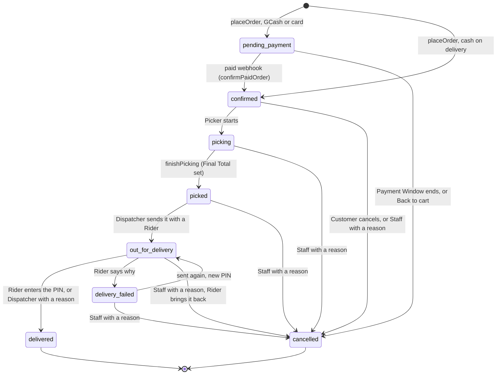
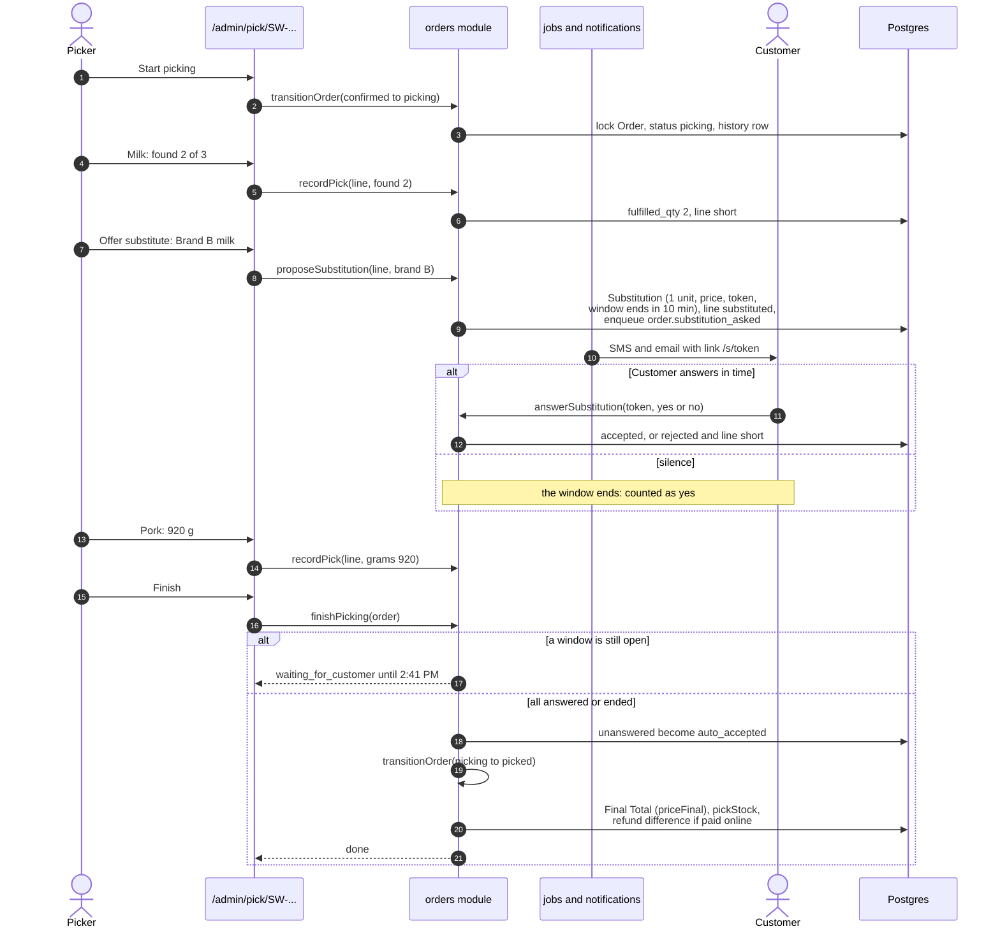
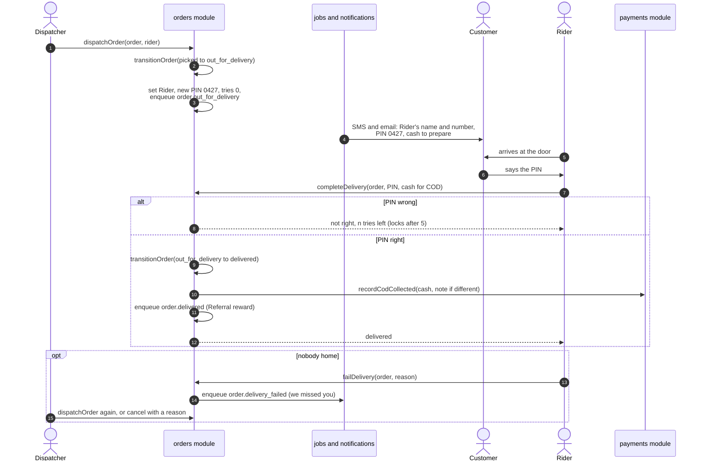
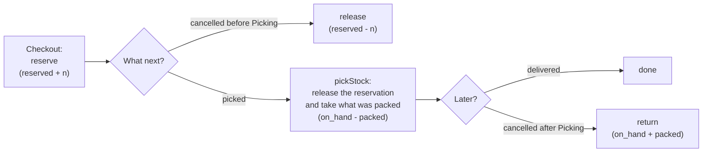

# 8. Hub operations

Once an Order is placed, it belongs to the Hub. This chapter follows it through the Order states, Picking with Substitutions, dispatch with the Delivery PIN, and the cash count, then covers the Hub's other jobs: keeping stock, setting Zones and Slots, the daily report and the printouts. The decisions behind it are [ADR 0010](../adr/0010-picking-and-substitutions.md) (Picking), [ADR 0011](../adr/0011-dispatch-pin-and-cash.md) (dispatch and cash) and [ADR 0012](../adr/0012-stock-slots-reports-receipts.md) (stock, Slots, reports, receipts).

Words used here: [Picking, Picker, Pick List, Pick Sheet, Substitution, Substitution Window, Rider, Delivery PIN, Cash Handover, Delivery Receipt, Shrink, Slot Schedule](../../GLOSSARY.md#delivery-and-fulfilment), [Order Note, Final Total](../../GLOSSARY.md#buying).

## 8.1 The Order states

An Order is always in exactly one of eight states. The allowed moves are written once, in the `NEXT` table at the top of `src/modules/orders/internal/status.ts`. Each arrow below is labelled with what makes it happen.

Note what is **not** allowed: a `delivered` or `cancelled` Order never moves again. Staff could not cancel a `picked` Order until 28 October, nor one `out_for_delivery` until 29 October ([ADR 0022](../adr/0022-staff-tools-for-the-last-runbook-gaps.md)): the Dispatcher calls the Rider first, who brings it back, and a Rider cannot mark a cancelled Order delivered.

### `transitionOrder`: the only way to change status

Every status change in the app goes through one function, `orders.transitionOrder(orderId, to, actor, reason, options)` (invariant 7 in [04-DATA-MODEL.md](../04-DATA-MODEL.md)). In one transaction it:

1. **Locks the Order row** (`SELECT ... FOR UPDATE`) so two people cannot move it at once.
2. **Checks the move** against `NEXT`, and, if the caller passed `from`, that the Order is still where the caller thought it was. A Picker on a stale screen trying to start an Order a Customer just cancelled is refused (`false`), and the screen says "This Order changed meanwhile. Reload."
3. **Updates the status**, setting `cancelled_at` or `delivered_at` when they apply.
4. **Writes a history row** in `order_status_events`: from, to, who (Customer, Staff or system, with their id) and why. The Customer's timeline and the staff history both read this table. It is append-only: rows are added, never changed.
5. **Does what the new state requires:**

| Moving to   | Side effects                                                                                                                                                                                                                               |
| ----------- | ------------------------------------------------------------------------------------------------------------------------------------------------------------------------------------------------------------------------------------------ |
| `cancelled` | Give the Slot place back (`delivery.releaseSlot`). Before Picking: release the reserved stock. After Picking: put what was taken back on the shelf (`return`). Void a cash Payment, or refund everything paid online (reason `cancelled`). |
| `picked`    | `settlePicked`: set the Final Total with `pricing.priceFinal`, take what was packed off the shelf (`inventory.pickStock`), refund the difference if paid online (reason `picked`).                                                         |
| `delivered` | Queue the `order.delivered` job (it rewards a Referral, chapter 9).                                                                                                                                                                        |

Cancel and pick lock stock rows that Checkouts also lock, so this transaction has the same 15-second budget as `placeOrder`, and it locks in the same order (Slot, then stock) so the two can never deadlock.

**Payment status** moves alongside but separately: `cod_pending` to `cod_collected` (or `unpaid` if cancelled); `unpaid` to `paid` to `partially_refunded` or `refunded` (or `failed` if the Payment Window ends).

## 8.2 The order queue

`/admin/orders` (area `orders`: Dispatchers and Admins) is the Hub's list of every Order (`listOrdersForStaff` in `src/modules/orders/internal/staff.ts`):

- Sorted by Slot time; filtered by status and delivery day; searched by Order Number, name, email or mobile.
- An Order's page (`/admin/orders/[orderNo]`) shows the Customer, the lines, the totals, the full history with who moved it and why, refunds, and **Order Notes**: notes Staff leave for each other ("Gate code 4421"), up to 500 characters, never shown to the Customer.
- Staff can move an Order only along `staffMoves`: the lifecycle, minus moves that belong to dispatch (out for delivery, delivered, failed) and minus anything for an unpaid online Order (its webhook or the Payment Window settles it). Cancelling needs a reason, which goes in the history. Choosing "Picked" here runs the same `finishPicking` as the Picker's screen.
- Every move and note is written to the audit log in the same transaction (section 8.10).

## 8.3 Picking and Substitutions

### The Picker's screens

A Picker (role `picker`, area `picking`) works from a phone:

- `/admin/pick` lists Orders being picked, then Orders waiting to be picked (`confirmed`).
- `/admin/pick/[orderNo]` is one Order's **Pick List** (`getPickList` in `src/modules/orders/internal/picking.ts`): its lines in the order a Picker walks the Hub. Until the Hub has aisle codes, that is the Category tree: top-level Category order, then sub-Category order, then name. Each line shows the quantity, the estimated weight for weighed lines, the Customer's Substitution Preference, their chosen alternative and their Picker Note ("lean cuts").
- `/admin/print/pick/[orderNo]` prints it as a **Pick Sheet** with a box to tick per line. What was found is still recorded on screen.

### The steps

1. **Start picking.** "Start" moves the Order from `confirmed` to `picking` (`startPickingAction` in `src/app/admin/pick/actions.ts`). From now on the Customer can no longer cancel.
2. **Record each line** (`recordPick`, a form result):
   - **Counted Products**: how many were found, 0 to the ordered quantity. All found makes the line `picked`; fewer makes it `short`.
   - **Weighed Products**: the packed weight in grams. 0 marks it short. More than 10% over the ordered weight is refused: "More than 10% over: repack to about 1000 g." A lighter pack is accepted and charged by weight.
3. **Offer a Substitution** for what is missing (`proposeSubstitution`). The rules ([ADR 0010](../adr/0010-picking-and-substitutions.md)):
   - Never on a weighed line ("pack what is there or mark it short").
   - Never on a "no substitute" line.
   - For "I'll choose", only the Product the Customer named, and it is accepted at once (`auto_accepted`): it was already their choice.
   - For "pick a similar item", any other Product the Picker chooses; the Customer is asked.
   - One Substitution per Order Line, covering the pieces not found. The line becomes `substituted`.
   - The substitute's current price is stored; the Customer will pay the lower of it and the ordered price.
4. **Ask the Customer** (only for "pick a similar item"). The Substitution gets a random 24-byte token and a **Substitution Window** of 10 minutes, and the job `order.substitution_asked` sends an SMS and an email with a link to `/s/[token]`. On that page the Customer sees the swap and the price they would pay, and taps yes or no, without signing in. The token opens that one Substitution and nothing else, and only while its window is open (`answerSubstitution`). A "no" turns the line back to `short`.
5. **Finish** (`finishPicking`). If any Substitution is still waiting inside its window, finishing is refused with the time it ends ("Waiting for the Customer about a substitute until 2:41 PM."), and the Picker picks another Order meanwhile. Otherwise every unanswered Substitution becomes `auto_accepted` (silence is a yes), and the Order moves to `picked`, which sets the Final Total, takes the stock and refunds any difference (section 8.1).

### What the Customer pays after Picking

`priceFinal` (chapter 5) charges each line by what was packed: pieces found, the packed weight (never above the estimate), plus an accepted substitute at the lower of the two prices for no more than the missing pieces. A refused substitute costs nothing. For a COD Order, this is what the Rider will collect; for an online Order, the difference from what was paid is refunded in one go.

## 8.4 Dispatch and the Delivery PIN

### Sending an Order out

A Dispatcher (area `dispatch`: Dispatchers and Admins) uses `/admin/dispatch`, the dispatch board (`listDispatchBoard`): every Order `picked`, `out_for_delivery` or back after a failed try, by Slot time, with the barangay, the Rider and the cash due for COD.

For each picked Order they choose a Rider. `dispatchOrder` (`src/modules/orders/internal/delivery.ts`):

1. Checks the chosen Staff member is an active `rider`.
2. In one transaction: moves the Order to `out_for_delivery` (only from `picked` or `delivery_failed`), sets the Rider, makes a **new 4-digit Delivery PIN** (`randomInt(0, 10000)`, padded: "0427"), resets the wrong-PIN counter, records the time, and queues `order.out_for_delivery`.
3. The job sends the Customer an SMS and email with the Rider's name and mobile number and the PIN (and the cash to have ready for COD). The Customer's Order page shows the same while the Order is out.

Only the dispatch board sends Orders out. The order queue cannot.

### At the door

The Rider (role `rider`, area `delivery`) sees `/admin/deliveries`: only the Orders assigned to them, by Slot time, with the address, landmark, Rider notes, phone and cash due (`listDeliveriesForRider`).

- **Delivered** (`completeDelivery`): the Rider enters the PIN the Customer gives them. A wrong PIN adds one to `pin_attempts` and says how many tries are left. After 5 wrong tries the PIN locks: "Too many tries. Call the Dispatcher." For a COD Order, the Rider also enters the cash taken, pre-filled with the Final Total; a different amount needs a note. The Order moves to `delivered` and, in the same transaction, the cash is recorded on the Payment (`cod_collected`).
- **Delivered without the PIN** (`deliverWithoutPin`): only the Dispatcher can do this, and only with a reason, stored in the history as "Without PIN: ..." and in the audit log. This covers a Customer who lost the message.
- **Failed** (`failDelivery`): the Rider says why ("nobody home"). The Order moves to `delivery_failed` and the job `order.delivery_failed` sends a "we missed you" message. The Dispatcher then sends it out again (new PIN) or cancels it (a paid Order is refunded in full, and the picked stock goes back on the shelf).
- **Cancelled on the way**: since 29 October staff can also cancel an Order that is out, from the Order page, with a reason ([ADR 0022](../adr/0022-staff-tools-for-the-last-runbook-gaps.md)). The Rider brings it back; the stock, the money and the Customer's notice work as for any cancel after Picking. Before, the Rider had to press "Could not deliver" first, which sent a "we missed you" message to a Customer who had asked to cancel.

A 4-digit PIN is not a strong secret. It proves that someone at the address had the Customer's message, and the 5-try limit stops a Rider from guessing ([ADR 0011](../adr/0011-dispatch-pin-and-cash.md)). Photo proof waits for image storage (Cloudflare R2).

## 8.5 Counting cash

At the end of the day, `/admin/cash` (area `dispatch`) lists, for a Manila date, each Rider's cash-on-delivery Orders delivered that day with what was due and what the Rider recorded (`riderCashDay` and `listCashDay` in `src/modules/payments/internal/cash.ts`).

The Dispatcher counts the Rider's cash and records it (`recordCashHandover`): one **Cash Handover** per Rider per day (`cash_handovers`, unique on Rider and day), with the recorded total, the counted total and who counted. If the count is short of what the Rider recorded, a note is required ("₱150.00 is missing. Say what happened."). A day is counted once.

## 8.6 Stock

Stock is kept per Product per Hub in `stock_levels`: `on_hand` (on the shelf), `reserved` (promised to placed, unpicked Orders) and `low_stock_threshold`. Every change writes a row in `stock_movements` with a reason, the amount, and the Order or Staff member behind it. The movement log is append-only, so stock can always be explained.

### How an Order moves stock

Stock leaves the shelf count at `picked`, not at Checkout ([ADR 0012](../adr/0012-stock-slots-reports-receipts.md)). `pickStock` releases each line's reservation and takes off `on_hand` what was actually packed: the pieces found, a weighed line's pack, and an accepted substitute. The shelf count never goes below 0, but it may end below what other Orders have reserved (a substitute was never reserved); those Orders come up short at their own pick ([ADR 0022](../adr/0022-staff-tools-for-the-last-runbook-gaps.md)). The movement records what was really taken. An Order cancelled after Picking puts those items back (`return`).

### What staff do

At `/admin/stock` (area `stock`: Dispatchers and Admins), searchable, with "only what is low":

| Action    | Function               | Rule                                                                                                                                                | Movement reason |
| --------- | ---------------------- | --------------------------------------------------------------------------------------------------------------------------------------------------- | --------------- |
| Receive   | `receiveStock`         | How many came in from a supplier                                                                                                                    | `receipt`       |
| Shrink    | `recordShrink`         | How many spoiled, broke or went missing; a note is required                                                                                         | `shrink`        |
| Count     | `countStock`           | Set the shelf number after a physical count, even below what is reserved (ADR 0022): the Product stops selling and the Stock screens show "N short" | `adjustment`    |
| Threshold | `setLowStockThreshold` | At or under this, the Product is "low" and shows "Only a few left"                                                                                  | (none)          |

Each Product's page (`/admin/stock/[productId]`) shows its latest movements. The shop never shows counts, only "in stock", "only a few left" or "out of stock".

## 8.7 Zones and the Slot Schedule

At `/admin/setup` (area `setup`: Admins only, because these change what Customers pay):

- **Zone fees**: each Zone's Delivery Fee, Free-Delivery Threshold and Order Minimum (`updateZoneFees`). Checkout uses the new values at once. The Zones' cities and barangays stay in the seed data until a Hub opens a new area.
- **The weekly Slot Schedule** (`slot_templates`: Hub, weekday, start, end, capacity). Admins add or remove windows and change a window's capacity. The cron tick's `ensureSlots` makes the next 7 Manila days' Slots from it and never touches a Slot that already exists, so a schedule change applies only to days not made yet.
- **One Slot**: resize or close a single upcoming Slot (`setSlotCapacity`). It can never go below what is booked (a database check too: `booked <= capacity`). Setting it to the booked number closes it.

## 8.8 The daily report

`/admin/report` (area `reports`: Dispatchers and Admins) shows a Manila day and the 7 days before it (`dailyReport` in `src/modules/orders/internal/reports.ts`):

| Figure            | How it is counted                                                                                |
| ----------------- | ------------------------------------------------------------------------------------------------ |
| Placed            | Orders placed that day                                                                           |
| Delivered         | Orders delivered that day                                                                        |
| Cancelled         | Orders cancelled that day                                                                        |
| Revenue           | The Final Totals of Orders delivered that day (already net of what Picking refunded)             |
| Average basket    | Revenue divided by delivered Orders                                                              |
| Fill rate         | Lines of delivered Orders delivered as ordered, or with an accepted Substitution, over all lines |
| Substitution rate | Lines with an accepted Substitution, over all lines                                              |
| Late deliveries   | Orders delivered after their Slot ended                                                          |
| Freshness Claims  | Claims, and claims per 100 delivered Orders (the launch target is under 3)                       |
| Funnel            | Product views, adds to Cart, Checkouts started and Orders placed, with the share that went on    |

The PRD's targets to watch: fill rate 95% or better, on-time delivery 90% or better, fewer than 3 Freshness Claims per 100 Orders (PRD section 8). There is no chart yet.

## 8.9 Printouts

Printouts are web pages with a print stylesheet, not PDF files ([ADR 0012](../adr/0012-stock-slots-reports-receipts.md)):

- **Pick Sheet**: `/admin/print/pick/[orderNo]`, the Pick List with a box per line.
- **Delivery Receipt**: `/admin/print/receipt/[orderNo]` (`getReceipt` in `reports.ts`), packed with the Order: what each line was charged (by the picked amounts once picked), the substitute, the Delivery Fee, the Voucher, the total, and the VAT breakdown from `pricing.receiptBreakdown`: VATable sales (VAT included), VAT-exempt sales, zero-rated sales and the VAT inside. It says **"This is not an official receipt"** until BIR registration and the accountant's answers ([ADR 0007](../adr/0007-pricing-rules-ahead-and-tax-to-confirm.md)).

## 8.10 The audit log

Every staff write is recorded in `audit_log`: who, what action, which record, and the values before and after. `/admin/audit` (Admins only) lists them.

Most staff Server Actions use one helper, `adminWrite` in `src/app/admin/admin-write.ts`: it runs the write and its audit rows in the same transaction, so a change is never saved without its record, and a refused write records nothing. A few actions record the audit right after the change instead (marked `ponytail:` in the code, with the reason).

## When plans change: the staff tools (28 and 29 Oct)

The runbook ([docs/runbook.md](../runbook.md)) first listed what staff could not do in the app. Most of it now has a tool, and each tool goes through the same rules as the rest of the app:

- **Order page.** Record a payment PayMongo shows but no webhook applied: it goes through the same code as a verified webhook (`recordPaidByStaff` in `src/modules/payments/internal/webhooks.ts`), so the Order is confirmed, or refunded if it had closed. Text the Customer; give a Voucher; move the Order to another Slot that still takes Orders, or to another saved address the same Hub serves, in any of its Zones, keeping the Delivery Fee it was placed with (`src/modules/orders/internal/changes.ts`, [ADR 0022](../adr/0022-staff-tools-for-the-last-runbook-gaps.md)); cancel even when packed or on the way, which puts what was picked back on the shelf; block an account from ordering. Admins also see the Order's PayMongo checkout, payment and refund ids.
- **Freshness Claims.** File a claim for a Customer who called in, from a delivered Order's page; reopen a rejected claim (chapter 9).
- **Stock.** A physical count may go below what is reserved (section 8.6).
- **Dispatch.** Hand an Order on its way to another Rider (the PIN stays; the Customer is told who is coming).
- **Picking.** Record a Customer's answer to a substitute given by phone, through the same function as the link.
- **Cash.** Correct one Order's cash before the day is counted, or the count after.
- **Zones and Slots, Hub status.** A Shop Notice every shopper sees until a chosen time, GCash and card paused (cash on delivery only), and whole days closed to new Orders.
- **System.** When the cron last ran (each tick leaves a heartbeat), every job not done with its last error, and the newest payment events.

A status change that loses a Postgres deadlock to a checkout or another pick on the same stock now runs again (`retryConflicts` in `src/lib/db.ts`) instead of showing an error page.

## Where to look in the code

| Topic                            | File                                                                                                                                      |
| -------------------------------- | ----------------------------------------------------------------------------------------------------------------------------------------- |
| The states and `transitionOrder` | `src/modules/orders/internal/status.ts`                                                                                                   |
| The order queue                  | `src/modules/orders/internal/staff.ts`, `src/app/admin/orders/`                                                                           |
| Picking and Substitutions        | `src/modules/orders/internal/picking.ts`, `src/app/admin/pick/`                                                                           |
| The Customer's answer page       | `src/app/[lang]/s/[token]/`                                                                                                               |
| Dispatch, PIN, failed deliveries | `src/modules/orders/internal/delivery.ts`, `src/app/admin/dispatch/`, `src/app/admin/deliveries/`                                         |
| Cash                             | `src/modules/payments/internal/cash.ts`, `src/app/admin/cash/`                                                                            |
| Stock                            | `src/modules/inventory/internal/reserve.ts`, `admin.ts`, `src/app/admin/stock/`                                                           |
| Zones and Slots setup            | `src/modules/delivery/internal/schedule.ts`, `src/app/admin/setup/`                                                                       |
| Report and receipt               | `src/modules/orders/internal/reports.ts`, `src/app/admin/report/`, `src/app/admin/print/`                                                 |
| Audit                            | `src/app/admin/admin-write.ts`, `src/modules/identity/internal/audit.ts`                                                                  |
| The tests                        | `tests/db/orders.test.ts` (picking, dispatch, stock, reports), `e2e/picking.spec.ts`, `e2e/dispatch.spec.ts`, `e2e/stock-reports.spec.ts` |

## Check yourself

A Customer chose "I'll choose: Brand B milk" for a line. The Picker finds none of the ordered milk. Can they substitute Brand C?

No. For "I'll choose" (`preferred`), only the Product the Customer named may stand in (`not_their_choice`). Brand B is accepted at once without asking. If Brand B is also out, the line is short.

The Picker taps Finish while a Substitution Window has 4 minutes left. What happens?

`finishPicking` refuses with `waiting_for_customer` and the time the window ends. The Picker can pick another Order and come back. After the window ends, Finish treats the silence as a yes.

A Rider enters the wrong PIN five times. How does the Order get delivered?

The PIN locks for the Rider. They call the Dispatcher, who uses "delivered without the PIN" with a reason; the reason is kept in the Order history ("Without PIN: ...") and the audit log.

An Order is cancelled after Picking (its delivery failed twice). What happens to the stock and the money?

`transitionOrder` gives back the Slot place, puts what was packed back on the shelf (movement `return`), and either voids the COD Payment or refunds everything paid online with reason `cancelled`.

