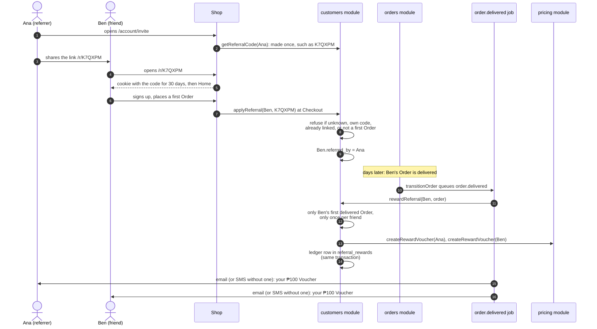
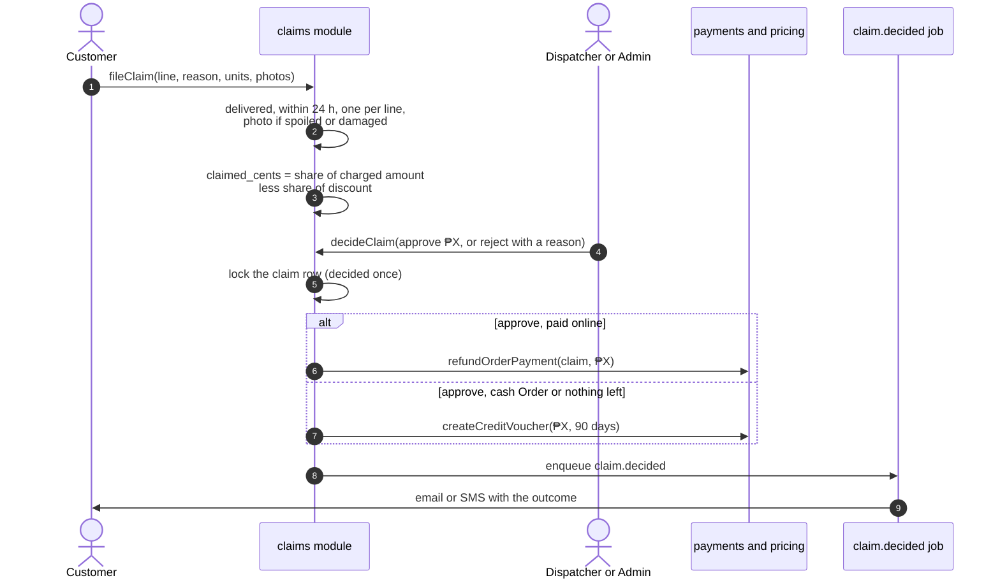

# 9. Growth features

Phase 5 built the features meant to make Customers come back: Recipes and Articles, Reorder and Shopping Lists, Cart Reminders and Stock Alerts, Promotions, Vouchers and Referrals, Freshness Claims, Filipino pages, an installable app, and a privacy-first Funnel. This chapter explains each, how it fits the modules you already know, and the decision behind it ([ADRs 0013 to 0017](../adr/)).

A pattern to notice: almost none of these features needed new machinery. They reuse `cart.addLines`, the jobs outbox, the refund ledger, the Voucher rules and the cached shop reads. That is the payoff of the module design in chapter 3.

## 9.1 Recipes and Articles ([ADR 0013](../adr/0013-recipes-articles-and-content-editors.md))

**Who writes them.** A new Staff role, the **Content Editor** (`content_editor`, area `content`), writes Recipes and Articles at `/admin/recipes` and `/admin/articles` with no code. Admins may too; Merchandisers may not (content and the catalogue are separate jobs). The editor keeps the whole draft in the browser and sends it as one piece, checked by `content.saveRecipe` or `saveArticle` (form results, ADR 0009). Each save is audited and calls `updateTag("content")`, so the shop shows it at once.

**A Recipe** has a title, intro, one photo (stored as a 1600-pixel-wide WebP), base servings, prep and cook minutes, numbered steps (one box per step), and **Ingredients** ([glossary](../../GLOSSARY.md#buying)). An Ingredient is either:

- **a Product to buy**: how many for the base servings, and whether that number grows with servings (chicken does, a bottle of soy sauce does not); or
- **plain text** for something not sold ("water").

An Ingredient can be marked "usually at home" (salt, oil): it starts unticked. A Recipe is a Draft until published; a published one can be featured on Home (the newest featured one shows). Prices are never typed into a Recipe: they always come from the catalogue, so a Promotion shows on the Recipe too.

**The Recipe page** (`/recipes/[slug]`) lets the Customer change servings; counts rescale with `scaledCount` (`src/lib/servings.ts`), which rounds up: 2 chickens for 4 servings become 3 for 5. An Ingredient whose Product sold out is marked, and a similar Product in stock is offered, unticked.

**"Add to cart"** sends only the servings and which rows are ticked. `content.addRecipeToCart` (`src/modules/content/internal/to-cart.ts`) then:

1. Loads the published Recipe and caps servings at 50.
2. For each ticked row, accepts the Product only if it is the Ingredient's own or one of its similar Products (`catalog.listRelatedProducts`). Anything else is ignored: the browser cannot add an arbitrary Product at an arbitrary count.
3. **Recomputes every count on the server** from the Recipe.
4. Calls `cart.addLines`, which adds on top of what the Cart holds, each capped by stock.
5. Reports what was added, what sold out and what was capped, which the page words.

**Articles** ("Tips and guides" to Customers) have sections (an optional heading and text each) and linked Products shown at the end to add to the Cart. Both appear in the sitemap; Recipes carry structured data for search engines.

## 9.2 Reorder, "Buy again" and Shopping Lists ([ADR 0014](../adr/0014-reorder-lists-reminders-stock-alerts.md))

All three put Products into the Cart through the same function as Recipes: `cart.addLines(owner, lines, hubId)` in `src/modules/cart/internal/add.ts`. It sums repeated Products, adds on top of what the Cart already holds, calls `setLineQuantity` for each (so every line is capped by stock and by 99), and returns how many units were added and which Products sold out or were capped. `src/app/[lang]/cart/fill.ts` turns that into the message the Customer sees.

- **Reorder** ([glossary](../../GLOSSARY.md#buying)): "Reorder these items" on an Order page adds that Order's Products (`orders.getReorderLines`: the Products ordered, not their substitutes) at today's prices.
- **"Buy again"** on Home shows a signed-in Customer up to 12 Products from their delivered Orders, most often bought first, still sold (`orders.listBoughtBefore`, one SQL query). Guests and new Customers see nothing.
- **Shopping Lists** ([glossary](../../GLOSSARY.md#buying)) at `/account/lists`: named lists ("Weekly", "Office pantry"), up to 20 lists of up to 100 Products each with a count. A Product is saved from its page; the whole Cart can be saved at once; a list goes to the Cart in one tap. Lists belong to `cart` and are always read and written with the owning Customer's id (`src/modules/cart/internal/lists.ts`).

## 9.3 Cart Reminders ([ADR 0014](../adr/0014-reorder-lists-reminders-stock-alerts.md))

A **Cart Reminder** ([glossary](../../GLOSSARY.md#buying)) is one email sent 3 hours after a Customer left items in their Cart without ordering.

**Consent first.** It goes only to a signed-in Customer who turned on "Send me reminders and offers" in their account (`customers.marketing_opt_in`, off by default), and who has an email. This follows the Data Privacy Act: marketing needs consent. Order and delivery messages are not marketing and need none.

**How it is sent**, from the cron tick (chapter 10):

1. `cart.queueCartReminders` finds, in one transaction, every open Cart with items whose last change was between 3 hours and 2 days ago, not yet reminded, owned by an opted-in Customer with an email. It locks those Carts (`FOR UPDATE ... SKIP LOCKED`, so two ticks never take the same one).
2. For each it sets `carts.reminded_at` and queues the job `cart.reminder` **in the same transaction**. So a Cart is reminded once, and never lost: the mark and the job commit together.
3. The job (`src/server/job-handlers.ts`) checks again with `getCartReminder`: if the Customer ordered, emptied the Cart or turned reminders off meanwhile, nothing is sent.
4. The email lists the items, links to the Cart, and has a **stop link** that works without signing in.

**The stop link** is `/stop/<customer id>.<signature>`. The signature is an HMAC of the Customer's id made with the app's secret (`signValue` in `src/lib/signed.ts`), so nobody can make a stop link for someone else. Opening it shows a page with one button; consent is turned off only when the button is pressed, never by the link alone, because email scanners open links automatically.

Not built, by choice: SMS reminders, more than one reminder, offers inside the reminder.

## 9.4 Stock Alerts ([ADR 0014](../adr/0014-reorder-lists-reminders-stock-alerts.md))

On a sold-out Product, a signed-in Customer can tap "Tell me when it's back" (`inventory.requestStockAlert`, one row in `stock_alerts` per Customer and Product). Each cron tick, `inventory.queueStockAlerts`:

1. Deletes alerts older than 30 days, unsent.
2. Finds alerts whose Product is active and has free stock at the Hub again, locks them, deletes each and queues the job `stock.back` in the same transaction.
3. The job sends one email and, if the Customer has a mobile number, one SMS.

The Customer asked for it, so it is not marketing and needs no opt-in.

## 9.5 Promotions and Vouchers ([ADR 0015](../adr/0015-promotions-vouchers-referrals.md))

Chapter 5 explains the money rules. In short:

- **Promotions** are the shelf price. Merchandisers and Admins create them at `/admin/promotions`: a percent (1 to 90) or a peso amount off each unit, on chosen Products and/or Categories, between two dates. The lowest promoted price wins. Home shows "On sale this week" (`catalog.listPromotedProducts`).
- **Vouchers** are codes, managed at `/admin/vouchers`: percent off (with an optional cap), peso off, or free delivery; with dates, minimum spend, total and per-Customer limits, first-Order-only, or for one Customer only. One Voucher per Order, on top of Promotions, signed-in only. It is kept on the Cart, re-checked every time the Cart is priced, and recorded under a lock at Checkout so its last use goes to one Order. A Voucher with uses is switched off, never deleted.

Not built: buy-X-get-Y, stacking two Vouchers, Vouchers for guests.

## 9.6 Referrals ([ADR 0015](../adr/0015-promotions-vouchers-referrals.md))

A **Referral** ([glossary](../../GLOSSARY.md#people)) rewards a Customer when someone they invited completes a first Order: a ₱100 Voucher for each of them.

Details:

- Each Customer's **Referral Code** ([glossary](../../GLOSSARY.md#people)) is 6 characters without 0, O, 1 or I, made the first time it is shown.
- The link (`src/app/[lang]/r/[code]/route.ts`) only stores the code in a cookie for 30 days. The friend is linked at their first Checkout (`placeOrderAction` calls `customers.applyReferral`), which refuses an unknown code, the Customer's own code, a Customer already linked, or one who has ordered before. A refusal changes nothing and the shop says nothing.
- The reward is given only when the friend's first Order is **delivered**, not just placed. `rewardReferral` runs in one transaction: both personal Vouchers (`FRIEND-XXXXXX`: ₱100 off, minimum spend ₱500, 60 days, one use, for that Customer only) and the ledger row in `referral_rewards`, which is unique per friend and per Order, so a friend is rewarded once.
- `/account/invite` shows the share link, the friends who joined (first names only) and the Vouchers earned.

Not built: a cap on rewards per Customer (watch for abuse after launch).

## 9.7 Freshness Claims ([ADR 0016](../adr/0016-freshness-claims.md))

A **Freshness Claim** ([glossary](../../GLOSSARY.md#delivery-and-fulfilment)) is a Customer's report, within 24 hours of delivery, that an Order Line was spoiled, damaged, missing or the wrong item. The launch target is fewer than 3 claims per 100 Orders.

### Filing

From a delivered Order, the Customer opens `/orders/[orderNo]/claim` and, for one line, gives the reason, how many of the line's items (a weighed line is claimed whole), an optional note (up to 500 characters) and photos: 1 to 3, up to 8 MB each, **required for spoiled or damaged**. `claims.fileClaim` (`src/modules/claims/internal/claims.ts`) checks:

- the line is on one of the Customer's own Orders, the Order is delivered, and it is within 24 hours of `delivered_at`;
- the line has no claim yet (the database allows one claim per Order Line, so two taps at once make one claim);
- something was charged for it (a refused substitute or a fully short line cannot be claimed);
- the units are 1 to what was charged.

**The server works out what the claim is worth.** The Customer never types an amount. `claims.claimValue` takes the line's charged amount after Picking (`pricing.chargedLine`, substitutes included), subtracts its share of the Order's Voucher discount (spread as ADR 0007 says), and takes the share for the units claimed. Photos are resized to WebP (at most 1600 pixels) and stored through the media store.

### Deciding

Admins and Dispatchers (area `claims`) review every claim at `/admin/claims`. `claims.decideClaim` locks the claim row, so two reviewers at once cannot both pay it, then:

- **Reject**, with a reason the Customer sees.
- **Approve** the full amount or less. The money goes back:
  - to GCash or the card, if the Order was paid online, through the refund ledger (`payments.refundOrderPayment(tx, orderId, "claim", amount, claimId)`: one refund per claim, never more than is left of the Payment; chapter 7);
  - and anything that cannot be refunded (a cash Order, or nothing left on the Payment) becomes a personal **store-credit Voucher** (`CREDIT-XXXXXX`, no minimum spend, 90 days).

Both outcomes queue `claim.decided`, which tells the Customer by email (or SMS without one) the amount and how it comes back, or why it was rejected. The Order page lists each claim and its status. Every decision is audited. The daily report counts claims per 100 delivered Orders.

Not built: claims after 24 hours (Staff can still issue a Voucher by hand), automatic approval, asking for the item back.

## 9.8 Filipino pages ([ADR 0017](../adr/0017-filipino-pwa-and-funnel.md))

**Addresses.** Filipino pages live at `/fil/...`; English keeps the addresses without a prefix. Every shop page sits under `src/app/[lang]/`, so each language is prerendered and cached separately and the page's `<html lang>` is right for screen readers and search engines. The proxy (`src/proxy.ts`, chapter 2) maps `/cart` to `/en/cart` inside, redirects `/en/...` to the unprefixed address, and adds a `Link` header naming both versions (`hreflang`) so search engines know they belong together. A switch in the header and footer moves between the same page in either language.

**Words.** There is no translation library. Two dictionaries, `src/i18n/en.ts` and `src/i18n/fil.ts`, hold the same keys, and TypeScript refuses a build where Filipino lacks a key English has. Some entries are functions, so sentences can include values: `below_minimum: (amount) => "Magdagdag pa ng " + amount + " ..."`.

- Server Components read the language with `getLang()` (`src/i18n/server.ts`, using `next/root-params`).
- Client Components read the words with `useMessages()` from `I18nProvider` (`src/i18n/client.tsx`).
- **Server Actions cannot read the language** (Next.js refuses `next/root-params` there). So actions return reason codes and data, and the page chooses the words (chapter 3, "How a module says no"). Checkout and the pay page send the language with the form only to pick the next address and the answer's words.

**Links.** Shop code must link with `@/components/link`, which adds `/fil` on Filipino pages; an ESLint rule forbids `next/link` in shop code so nobody forgets. Redirects and canonical addresses use `localPath(lang, path)`.

**What is translated**: the shop's shell (header, menus, footer, Cart drawer), Home, Categories, search, Product pages, the Cart, Checkout and the Order pages. **Still English**: the account pages, Recipes, Articles, Shopping Lists, claims, the Address form, all messages (email and SMS), and the staff screens. Product, Category and Recipe names are data and stay as Staff enter them. The Filipino is a draft in everyday Taglish and **must be checked by a native speaker before launch** (roadmap section 0).

Since 28 Oct the rest of the shop is in Filipino too ([ADR 0019](../adr/0019-filipino-for-the-rest-of-the-shop.md)), and so are the emails and texts ([ADR 0021](../adr/0021-messages-in-the-customers-language.md)). The Customer's language is stored (`customers.lang`), set when they place an Order or fill a form on a Filipino page, and every message reads it. The message words live in `src/modules/notifications/internal/words.ts`, not in the page dictionaries, because those reach the browser and these never do. Sign-in codes stay English: before sign-in the language is not known.

The page dictionaries themselves are about 11 KB each. An English page carries only the English one; the Filipino one loads only on Filipino pages (`src/i18n/client.tsx`).

## 9.9 The installable app ([ADR 0017](../adr/0017-filipino-pwa-and-funnel.md))

A **PWA** (progressive web app) is a website a phone can install like an app: an icon on the home screen, opening full screen, working a little without a connection. Hoshimono's has three parts:

- **The manifest** (`src/app/manifest.ts`) names the app, its colours and its icons (`src/app/icon.tsx` draws the lime "h" at 192 and 512 pixels). The app opens full screen at `/`.
- **The install button**: when Android's browser offers installation, "Install the app" appears in the footer (`src/components/shell/installable.tsx`).
- **The service worker** (`public/sw.js`): a small script the browser keeps running in the background for our site, which can answer requests from stored copies. It is registered only in production builds.

The service worker's rules:

| Kind of request                                                                         | What it does                                                                                                                 |
| --------------------------------------------------------------------------------------- | ---------------------------------------------------------------------------------------------------------------------------- |
| Built files, photos, icons                                                              | Stored first: answered from the stored copy if there is one (these never change at the same address)                         |
| Shop pages                                                                              | Network first, so prices and stock are current; the last stored copy if offline; else the offline page in the right language |
| Cart, Checkout, payment, Orders, account, sign-in, signed links, the API, staff screens | Never stored, never answered from storage                                                                                    |

It keeps at most 150 pages and 150 files, dropping the oldest. While offline, a note says prices may have changed. Placing an Order, paying and staff work always need the network.

Not built: push notifications, saving Cart changes made offline.

## 9.10 The Funnel ([ADR 0017](../adr/0017-filipino-pwa-and-funnel.md))

The **Funnel** ([glossary](../../GLOSSARY.md#shop)) counts four shopping steps per Manila day: a Product page viewed, an item added to a Cart, a Checkout started, an Order placed. **Counts only, never who**: no identifier, no cookie, no third party, so no consent banner is needed.

- The table `funnel_counts` has one row per day and step with a count; `countStep` in `src/lib/funnel.ts` adds one with a single atomic upsert (`INSERT ... ON CONFLICT DO UPDATE SET count = count + 1`).
- The browser sends three steps as a **beacon** (a fire-and-forget request that does not slow the page) to `/api/events`: `product_viewed` when a Product page opens, `added_to_cart` when a Product goes from 0 to 1 in the Cart, `checkout_started` when Checkout opens. The route accepts only those three names and at most 120 per minute per IP.
- `order_placed` is counted on the server by the Checkout action after a successful Order, so it cannot be faked from the browser.
- The daily report shows the 7 days to the chosen day, each step and the share that went on to the next.

Not built: Vercel Analytics (waits for hosting), journeys per visitor.

## Where to look in the code

| Feature              | Files                                                                                                                                                                                                      |
| -------------------- | ---------------------------------------------------------------------------------------------------------------------------------------------------------------------------------------------------------- |
| Recipes, Articles    | `src/modules/content/`, `src/app/admin/recipes/`, `src/app/[lang]/recipes/`, `src/lib/servings.ts`                                                                                                         |
| Adding many lines    | `src/modules/cart/internal/add.ts`, `src/app/[lang]/cart/fill.ts`                                                                                                                                          |
| Reorder, Buy again   | `src/modules/orders/internal/again.ts`, `src/components/home/buy-again.tsx`                                                                                                                                |
| Shopping Lists       | `src/modules/cart/internal/lists.ts`, `src/app/[lang]/account/lists/`                                                                                                                                      |
| Cart Reminders       | `src/modules/cart/internal/reminders.ts`, `src/lib/signed.ts`, `src/app/[lang]/stop/[token]/`                                                                                                              |
| Stock Alerts         | `src/modules/inventory/internal/alerts.ts`                                                                                                                                                                 |
| Promotions, Vouchers | `src/modules/pricing/internal/promotions.ts`, `vouchers.ts`, `src/app/admin/promotions/`, `src/app/admin/vouchers/`                                                                                        |
| Referrals            | `src/modules/customers/internal/referrals.ts`, `src/app/[lang]/r/`, `src/app/[lang]/account/invite/`                                                                                                       |
| Freshness Claims     | `src/modules/claims/`, `src/app/[lang]/orders/[orderNo]/claim/`, `src/app/admin/claims/`                                                                                                                   |
| Filipino             | `src/i18n/`, `src/proxy.ts`, `src/components/link.tsx`                                                                                                                                                     |
| Installable app      | `src/app/manifest.ts`, `src/app/icon.tsx`, `public/sw.js`, `src/components/shell/installable.tsx`                                                                                                          |
| Funnel               | `src/lib/funnel.ts`, `src/app/api/events/route.ts`, `src/components/count-step.tsx`                                                                                                                        |
| The tests            | `tests/db/content.test.ts`, `retention.test.ts`, `promotions.test.ts`, `claims.test.ts`, `funnel.test.ts`; `e2e/recipes.spec.ts`, `retention.spec.ts`, `offers.spec.ts`, `filipino.spec.ts`, `app.spec.ts` |

## Check yourself

A Customer ticks every row of a Recipe, then edits the request in their browser to ask for 50 cartons of milk. What is added?

The count the Recipe gives for the chosen servings, capped by stock. `addRecipeToCart` ignores counts from the browser; it takes only the servings and which rows are ticked, and recomputes every count from the Recipe.

Why is the Cart Reminder's mark (<code>reminded_at</code>) written in the same transaction as the job?

So the two happen together. If the mark were saved but the job lost, the Customer would never be reminded; if the job were saved without the mark, the next tick could queue a second reminder.

A cash-on-delivery Customer's claim of ₱80 is approved. How do they get the money?

There is no online Payment to refund, so `decideClaim` creates a personal `CREDIT-` Voucher for ₱80 with no minimum spend, valid 90 days, and the `claim.decided` message tells them the code.

