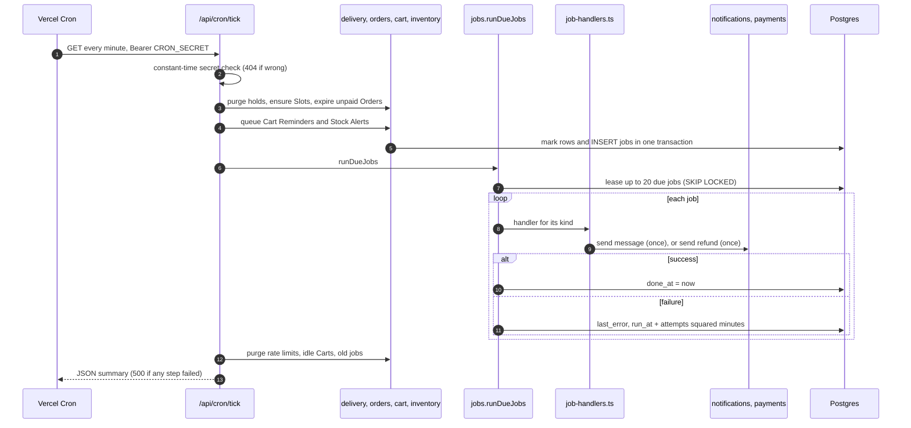
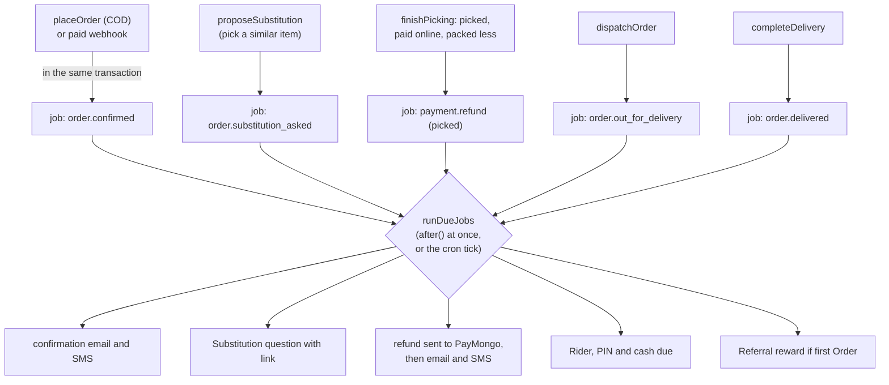

# 10. Background work: the jobs outbox and the cron tick

Some work must not happen inside the Customer's request: sending an email can be slow or fail, a refund must be retried, an unpaid Order must be cancelled 15 minutes later when nobody is on the page. This chapter explains how Hoshimono does that work without a queue service: a `jobs` table, a timer that calls the app every minute, and a habit of writing the job in the same transaction as the change it follows.

## 10.1 Why not just send the email right away?

Imagine `placeOrder` sent the confirmation email itself, inside its transaction:

- If the email service were slow, the Customer would wait, holding locks on the Cart, the Slot and the stock while every other Checkout waited too.
- If the email went out and the transaction then failed, the Customer would get a confirmation for an Order that does not exist.
- If the transaction committed and the email then failed, the Customer would never hear about their Order, and nothing would try again.

The fix is the **outbox pattern**: inside the transaction, write a small note saying "send the confirmation for Order X" into a table. The note commits with the Order or not at all. Afterwards, a separate runner reads the notes and does the work, retrying until it succeeds. So **a placed Order always gets its notice, and a notice is never sent for an Order that does not exist** ([03-ARCHITECTURE.md](../03-ARCHITECTURE.md) section 11, [ADR 0001](../adr/0001-modular-monolith-nextjs.md)).

## 10.2 The `jobs` table

One row per job (`prisma/schema.prisma`, model `Job`; owned by the `jobs` module):

| Column       | Meaning                                                   |
| ------------ | --------------------------------------------------------- |
| `kind`       | What to do, such as `order.confirmed` or `payment.refund` |
| `payload`    | The details as JSON, such as `{ "orderId": "..." }`       |
| `run_at`     | When it may run next                                      |
| `attempts`   | How many times it has been tried                          |
| `last_error` | The last failure, kept for people to read                 |
| `done_at`    | When it succeeded; empty while it is still to do          |

`jobs.enqueueJob(client, kind, payload)` adds a row. The first argument is the caller's open transaction, so the job exists only if the change it follows commits (chapter 3, "Joining a caller's transaction").

## 10.3 Running jobs: `runDueJobs`

`jobs.runDueJobs(handlers)` in `src/modules/jobs/internal/jobs.ts` runs up to 20 due jobs:

1. **Lease them** in one statement:

   ```sql
   UPDATE jobs SET run_at = now + 5 minutes, attempts = attempts + 1
   WHERE id IN (
     SELECT id FROM jobs
     WHERE done_at IS NULL AND run_at <= now AND attempts < 5
     ORDER BY run_at
     LIMIT 20
     FOR UPDATE SKIP LOCKED)
   RETURNING id, kind, payload, attempts
   ```

   `FOR UPDATE SKIP LOCKED` means "lock the rows I take, and skip any row another runner has already locked". Two runners at the same moment (a cron tick and a Checkout's `after()`) therefore never take the same job. Pushing `run_at` 5 minutes ahead is a **lease**: if this runner crashes mid-job, the job becomes due again after 5 minutes and another runner picks it up.

2. **Run each** by looking up its handler by `kind`. A kind with no handler is a failure.
3. **On success**, set `done_at`.
4. **On failure**, log it, keep the error, and push `run_at` back by `attempts²` minutes: 1, 4, 9, then 16 minutes. After the fifth failed try the job stops, with its last error kept for a person to read.

Finished jobs are deleted after 30 days (`purgeDoneJobs`).

Because a job may run more than once (a retry after a partial failure, a lease that expired), **every handler is safe to repeat**. The next section shows how.

## 10.4 Every job kind

The handlers are wired in one file, `src/server/job-handlers.ts`, outside the modules, so no module needs to know about another's messages.

| Job kind                   | Queued by                                                           | The handler                                                                                                                                                        |
| -------------------------- | ------------------------------------------------------------------- | ------------------------------------------------------------------------------------------------------------------------------------------------------------------ |
| `order.confirmed`          | `placeOrder` (cash on delivery); `confirmPaidOrder` (paid online)   | Email and SMS "Order SW-... is confirmed", with the Slot, the total ("about" for weighed items) and a tracking link. Skipped if the Order was cancelled meanwhile. |
| `order.substitution_asked` | `proposeSubstitution`, for "pick a similar item" lines              | Email and SMS with the swap, the price and the `/s/[token]` link. Skipped if already answered or the window ended.                                                 |
| `order.out_for_delivery`   | `dispatchOrder`                                                     | Email and SMS with the Rider's name and number, the Delivery PIN and the cash due. Skipped if no longer out. A new message per trip.                               |
| `order.delivery_failed`    | `failDelivery`                                                      | "We missed you" email and SMS. A new message per trip.                                                                                                             |
| `order.delivered`          | `transitionOrder` on the move to `delivered`                        | Rewards a Referral if this was an invited friend's first delivered Order, and messages both (chapter 9).                                                           |
| `payment.refund`           | `requestRefund` (cancel, pick, late payment, claim); `settleRefund` | Sends the refund once (`sendRefund`), then emails and texts the Customer (not for cash, not for claims).                                                           |
| `cart.reminder`            | `queueCartReminders` (cron)                                         | The one Cart Reminder email, unless they ordered, emptied the Cart or opted out meanwhile.                                                                         |
| `stock.back`               | `queueStockAlerts` (cron)                                           | Back-in-stock email, and SMS with a mobile number.                                                                                                                 |
| `claim.decided`            | `decideClaim`                                                       | Email (or SMS without one) with the decision, the amount and how it comes back.                                                                                    |

Sign-in links and codes are the one kind of message sent directly, not through a job: the Customer is waiting for them on the sign-in page.

## 10.5 Sending each message once: the notifications log

A job that sends an email and then an SMS might fail on the SMS and be retried. The retry must not send the email again. The `notifications` module keeps a **delivery log**, the `notifications` table, with one row per message actually sent.

`sendOnce` in `src/modules/notifications/internal/send-once.ts`:

1. Looks for a log row for this template, channel and Order (or, for messages not about an Order, this template, channel and `ref` such as `cart:<id>`).
2. If found, does nothing.
3. Otherwise sends, then writes the log row.

The table has unique constraints on (template, channel, Order) and (template, channel, `ref`). Templates that may legitimately repeat include what makes them distinct: `out_for_delivery_<trip time>` for each time an Order leaves the Hub, `substitution_<id>` for each Substitution, `refund_<reason>` for each kind of refund.

**Providers.** Messages go through two small interfaces, `EmailProvider` and `SmsProvider` (`src/modules/notifications/internal/providers.ts`). Today only console providers exist: they print the message to the server's log (`[email] to ...`, `[sms] to ...`) and refuse to run in a production build on a real domain, so a launch without real providers fails loudly instead of silently sending nothing. Resend for email and an SMS sender (Semaphore or Twilio) plug in behind the same interfaces when those accounts exist (chapter 14).

## 10.6 The cron tick

A **cron** is a timer that runs something on a schedule. `vercel.json` asks Vercel to call `GET /api/cron/tick` every minute (`"schedule": "* * * * *"`). Per-minute crons need a paid Vercel plan, and the Vercel account does not exist yet; until then nothing calls it automatically. The end-to-end tests call it themselves.

The route (`src/app/api/cron/[job]/route.ts`):

1. **Checks the caller.** It requires the header `Authorization: Bearer <CRON_SECRET>`. Both the header and the expected value are hashed with SHA-256 and compared in constant time, so the comparison never leaks how close a guess was. A wrong or missing secret, or any job name other than `tick`, gets `404 Not found` (not "forbidden": it does not even admit the address exists).
2. **Runs nine steps, in order, each on its own.** A step that throws is logged and recorded, and the next step still runs: a failed hold purge must never stop confirmations going out.

| Step          | Function                                    | What it does                                                                               |
| ------------- | ------------------------------------------- | ------------------------------------------------------------------------------------------ |
| `holds`       | `delivery.purgeExpiredHolds`                | Deletes Slot Holds past their 10 minutes                                                   |
| `slots`       | `delivery.ensureSlots`                      | Makes the next 7 Manila days' Slots from the weekly schedule; never touches existing ones  |
| `unpaid`      | `orders.expireUnpaidOrders`                 | Cancels online Orders unpaid after 15 minutes (the Payment Window), lines back to the Cart |
| `reminders`   | `cart.queueCartReminders`                   | Queues Cart Reminders that came due                                                        |
| `stockAlerts` | `inventory.queueStockAlerts`                | Ends Stock Alerts older than 30 days; queues those whose Product is back                   |
| `jobs`        | `jobs.runDueJobs`                           | Runs up to 20 due jobs, including those just queued above                                  |
| `rateLimits`  | `purgeRateLimits` (`src/lib/rate-limit.ts`) | Deletes rate-limit windows that have ended                                                 |
| `carts`       | `cart.purgeIdleCarts`                       | Deletes Guest Carts idle 30 days and Carts checked out 30 days ago                         |
| `doneJobs`    | `jobs.purgeDoneJobs`                        | Deletes jobs finished 30 days ago                                                          |

3. **Answers** with a JSON summary of what each step did, and status `500` if any step failed, so a monitoring service can notice.

Every step is **idempotent**: an extra call, or two calls at once, does no harm. Expired holds are simply already gone; Slots that exist are skipped; Orders are locked before being cancelled; jobs are leased with `SKIP LOCKED`.



## 10.7 Not waiting for the minute: `after()`

Waiting up to a minute for a confirmation email would feel slow. So the places that queue urgent jobs also start a run themselves, **after** answering the Customer, with Next.js's `after(() => runDueJobs(jobHandlers))`:

- `placeOrderAction` after a cash Order (the confirmation).
- The webhook route after a payment is applied (the confirmation).
- The cancel action on the Order page (a refund for a paid Order).
- The staff actions for Picking, the order queue, dispatch, Freshness Claims and refunds to check (a Substitution question, a refund, the "on its way" message, a claim decision).

The cron tick remains the safety net: if the immediate run fails or the server stops, the job is still in the table and the next tick runs it.

## 10.8 The full picture of one Order's background work



## Where to look in the code

| Topic               | File                                                                                                        |
| ------------------- | ----------------------------------------------------------------------------------------------------------- |
| The outbox          | `src/modules/jobs/internal/jobs.ts`                                                                         |
| Which job does what | `src/server/job-handlers.ts`                                                                                |
| The cron route      | `src/app/api/cron/[job]/route.ts`, `vercel.json`                                                            |
| Sending once        | `src/modules/notifications/internal/send-once.ts`                                                           |
| Message texts       | `src/modules/notifications/internal/*.ts`                                                                   |
| Console providers   | `src/modules/notifications/internal/providers.ts`                                                           |
| The tests           | `tests/db/jobs.test.ts`, `tests/db/notifications.test.ts`, `e2e/checkout.spec.ts` (the cron route's secret) |

## Check yourself

<details>
<summary>The SMS provider is down when a confirmation job runs. The email went out. What happens next?</summary>

The handler throws on the SMS; the job keeps its error and is retried after 1 minute, then 4, 9 and 16. On each retry, `sendOnce` finds the email already in the log and skips it, and tries only the SMS. After five failed tries the job stops with its error kept.
</details>

<details>
<summary>Why does the cron route answer 404, not 401, to a wrong secret?</summary>

So it reveals nothing: to an outsider the address looks like it does not exist.
</details>

<details>
<summary>Two cron ticks overlap because the first ran slowly. Can a refund be sent twice?</summary>

No, on two levels. `runDueJobs` leases jobs with `FOR UPDATE SKIP LOCKED`, so the two runs take different jobs. And `sendRefund` itself moves the refund from `pending` to `sending` in one statement, so only one runner can ever send it.
</details>
